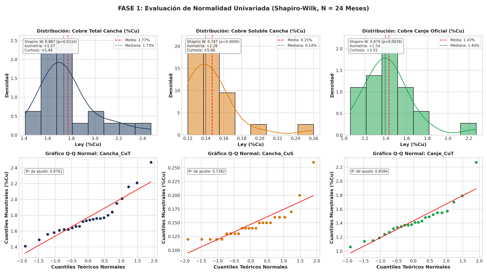

# INFORME TÉCNICO DE ENTREGABLES — BLOQUE 1
## Análisis Exploratorio de Datos (EDA), Diagnóstico de Complejidad y Selección de Características

**Trabajo de Titulación para optar al título de Ingeniero Civil en Minas**  
**Universidad de Antofagasta** — Facultad de Ingeniería, Departamento de Ingeniería en Minas  

* **Autor:** Felipe Andrés Guerra Maturana  
* **Profesor Guía:** Dr. José Delgado Vega (*Doctor en Geología, Especialista en Geoestadística y Explotaciones Mineras, École des Mines de Paris*)  
* **Caso de Estudio:** Faena Mantos Cobrizo (Distrito Minero Los Cóndores) / ENAMI (Planta San José)  
* **Módulo:** Bloque 1 — Análisis Exploratorio (EDA), Diagnóstico de Complejidad y Selección de Características  
* **Ubicación:** `./BLOQUE_1/`  
* **Versión Metodológica:** 4.0 (Línea Temporal Estricta — Auditoría Experta y Rigor Econométrico)  

---

## 1. Resumen Ejecutivo

El presente informe consolida los resultados, diagnósticos econométricos, matrices de covarianza y entregables técnicos del **Bloque 1**, fase de análisis exploratorio sobre los $N = 24$ balances mensuales consolidados (Enero 2023 a Diciembre 2024) de faena Mantos Cobrizo certificados en el Bloque 0.

Conforme a la **Metodología v4.0** y a la resolución de las observaciones críticas de la auditoría experta, este módulo concentra **la totalidad del análisis estadístico, varianzas, normalidad, atípicos, dependencias y multicolinealidad**, blindando las decisiones de diseño previas al modelado en los Bloques 2 y 3:

1. **Contraste de Varianzas y Estrategia de Escalado:** Se demostró que la ley de acopio $\text{Cancha\_CuT}$ ($s^2 = 0.058128\,(\%\text{Cu})^2$) posee una varianza muestral **$61.64$ veces superior** a la fracción de cobre soluble $\text{Cancha\_CuS}$ ($s^2 = 0.000943\,(\%\text{Cu})^2$). Para evitar que $\text{CuT}$ absorba artificialmente los gradientes de optimización, se establece el **escalado Z-score obligatorio (`StandardScaler`) encapsulado en cada pliegue LOOCV** (`Pipeline`), complementado con una prueba de sensibilidad frente a **`RobustScaler`** (centrado en mediana e IQR) debido a la marcada curtosis de $\text{CuS}$ ($+5.862$).
2. **Descomposición Sesgo-Varianza y la Meta Predictiva Real:** Se descompuso algebraicamente el error cuadrático medio histórico ($\text{MSE} = 0.1350\,(\%\text{Cu})^2$, $\text{MECM} \approx 26\%$), demostrando que el **$85.83\%$** obedece a sobreestimación sistemática ($\bar{e} = +0.3404\%\text{Cu}$, $\bar{e}^2 = 0.1159\,(\%\text{Cu})^2$) y el **$14.17\%$** corresponde a la **varianza de la discrepancia empírica** ($\sigma^2_{\text{error}} = 0.0191\,(\%\text{Cu})^2$, $\text{NRMSE} = 9.66\%$). Lejos de ser ruido puramente irreducible, esta varianza contiene señal geometalúrgica no lineal explicable (el objetivo de la RNA para perforar el piso del $9.66\%$ hacia $\text{NRMSE} \approx 8.63\%$). Para transparentar esto ante la comisión, se compromete en el Bloque 2 el modelo **Baseline 1B (Corrección de Sesgo Constante en LOOCV)**.
3. **Efecto de Apalancamiento (*Leverage*) y el Desafío de la Segunda Neurona (`CuS`):** 
   * Se demostró que Pearson ($r = +0.8347$, $p < 0.0001$) supera a Spearman ($\rho = +0.7116$, $p < 0.0001$) en $N = 24$ por el fuerte apalancamiento de Octubre ($2.21\%\text{Cu}$) y Noviembre 2023 ($2.47\%\text{Cu}$). Al excluirlos temporalmente para diagnóstico ($N = 22$), Pearson cae a **$r = +0.6181$** ($p = 0.0022$), quedando por debajo de Spearman (**$\rho = +0.6253$**, $p = 0.0019$).
   * **Hallazgo clave verificado sobre `Cancha_CuS`:** Fuera de los dos pulsos extremos, `Cancha_CuS` presenta correlación lineal **no significativa al $5\%$** con `Canje_CuT` ($r = +0.3688, p = 0.0912$; $\rho = +0.3520, p = 0.1082$). Su valor predictivo radica en modular la respuesta ante frentes oxidados/mixtos, lo que exige evaluar su aporte real mediante **`LassoCV`**, **estudio de ablación (2 vs 1 entrada)**, Permutación y SHAP en los Bloques 2–4.
4. **Rigor Econométrico sobre Normalidad (Gauss-Markov):** Se precisó que el rechazo de normalidad en las leyes brutas (Shapiro-Wilk $p < 0.05$) no invalida algebraicamente a MCO (cuyos supuestos recaen sobre los errores condicionales $\varepsilon \mid X$, que sí aceptan normalidad con $p = 0.8491$ en el sesgo empírico). No obstante, la asimetría geológica positiva alerta sobre observaciones con alto *leverage*, justificando contrastes no paramétricos, regularización $L_2$ y aproximadores no lineales (MLP / SVR).
5. **Retención Geológica de Outliers y Criterio Heurístico de Mahalanobis:** La distancia multivariada ($D_M^2 > \chi^2_{2, 0.95} = 5.9915$, empleada como criterio heurístico bajo no normalidad bivariada) detectó los frentes de Octubre 2023 ($D_M^2 = 14.25, p = 0.0008$) y Noviembre 2023 ($D_M^2 = 8.47, p = 0.0145$). Ambos **se retienen íntegramente** por constituir balances mensuales reales facturados por ENAMI.
6. **Autocorrelación (ACF) Acotada a Rezagos 1 a 6:** Conforme a la regla de Box-Jenkins ($K \le N/4 = 6$), se auditó la serie hasta el rezago 6: el sesgo de canje se comporta como ruido blanco puro ($r_1 = -0.0866$, bandas $\pm 0.4001$), validando formalmente **LOOCV**. Asimismo, la inercia de `Cancha_CuT` ($r_1 = +0.4467$) motiva incorporar una prueba complementaria con **Buffered-LOOCV** en los Bloques 2 y 3.
7. **Depuración de Multicolinealidad (VIF con Constante):** La tabla depurada confirmó que $[\text{CuT}, \text{CuS}]$ posee $\text{VIF} = 1.8045 < 5.0$ (óptimo), mientras que al incorporar $\text{CuIn}$ el VIF explota a $> 4{,}000$ por colinealidad exacta, sellando el espacio de entrada en exactamente 2 predictores.

---

## 2. Estadísticos Descriptivos, Varianzas y Diagnóstico de Escala ($N = 24$)

### 2.1. Tabla Maestra de Estadísticos Descriptivos y Dispersión

| Variable | Media ($\mu$) | Media Trunc. $10\%$ | Mediana ($\tilde{x}$) | Desv. Muestral ($s$) | Var. Muestral ($s^2$) | Desv. Pob. ($\sigma$) | Var. Pob. ($\sigma^2$) | CV ($\%$) | IQR | Asimetría ($g_1$) | Curtosis ($g_2$) | Shapiro-Wilk ($W$) | $p$-valor | Normalidad ($\alpha=0.05$) |
| :--- | :---: | :---: | :---: | :---: | :---: | :---: | :---: | :---: | :---: | :---: | :---: | :---: | :---: | :---: |
| **Cancha CuT ($\%$)** | 1.7717 | 1.7483 | 1.7350 | 0.2411 | **0.058128** | 0.2360 | 0.055706 | 13.61 | 0.1900 | +1.2680 | +1.4430 | 0.8871 | 0.0116 | **RECHAZADA** |
| **Cancha CuS ($\%$)** | 0.1471 | 0.1412 | 0.1400 | 0.0307 | **0.000943** | 0.0301 | 0.000904 | **20.87** | 0.0225 | +2.2770 | +5.8620 | 0.7472 | 0.0000 | **RECHAZADA** |
| **Cancha CuIn ($\%$)** | 1.6246 | 1.6033 | 1.6150 | 0.2223 | 0.049417 | 0.2176 | 0.047358 | 13.68 | 0.2025 | +1.1570 | +1.4230 | 0.9064 | 0.0278 | **RECHAZADA** |
| **PSJ CuT ($\%$)** | 1.4304 | 1.4083 | 1.3900 | 0.2496 | 0.062282 | 0.2443 | 0.059687 | 17.45 | 0.2475 | +1.4580 | +3.2840 | 0.8856 | 0.0113 | **RECHAZADA** |
| **Canje CuT ($\%$)** | 1.4313 | 1.4083 | 1.3950 | 0.2491 | 0.062020 | 0.2438 | 0.059436 | 17.40 | 0.2200 | +1.5410 | +3.5540 | 0.8787 | 0.0078 | **RECHAZADA** |
| **Sesgo Canje ($\%$)** | +0.3404 | +0.3400 | +0.3500 | 0.1411 | 0.019917 | 0.1382 | 0.019087 | 41.46 | 0.1925 | -0.1970 | -0.2980 | 0.9782 | 0.8491 | ACEPTADA |
| **Ratio Solubilidad ($\%$)** | 8.39 | 8.24 | 8.04 | 1.45 | 2.1025 | 1.42 | 2.0149 | 17.28 | 1.40 | +0.7670 | +0.2790 | 0.9392 | 0.1554 | ACEPTADA |

*Nota técnica: Entregables exportados en [`TABLA_ESTADISTICOS_EDA_N24.csv`](./TABLA_ESTADISTICOS_EDA_N24.csv) y [`TABLA_ESTADISTICOS_EDA_N24.xlsx`](./TABLA_ESTADISTICOS_EDA_N24.xlsx).*

### 2.2. Contraste de Varianzas y Estrategia de Escalado
$$\text{Ratio de Varianza} = \frac{s^2_{\text{Cancha\_CuT}}}{s^2_{\text{Cancha\_CuS}}} = \frac{0.058128}{0.000943} = \mathbf{61.64\times}$$
* La varianza de $\text{CuT}$ supera en más de $61$ veces a $\text{CuS}$, lo que sin preprocesamiento neutralizaría la influencia de $\text{CuS}$ en la actualización de pesos sinápticos de la RNA.
* **Estrategia Metodológica:** Se define **`StandardScaler`** como preprocesamiento base encapsulado dentro de cada pliegue LOOCV (`Pipeline`). 
* **Prueba de Sensibilidad con `RobustScaler`:** Dado que `Cancha_CuS` exhibe una curtosis leptocúrtica extrema ($+5.862$) producto del pulso de Octubre 2023 ($0.26\%$, a $+3.68$ desviaciones estándar), Z-score comprime el $92\%$ de los meses regulares en un intervalo muy angosto. Por ello, en los Bloques 2 y 3 se programará formalmente un contraste de sensibilidad entre `StandardScaler` y `RobustScaler` (centrado en mediana e IQR).

### 2.3. Descomposición Sesgo-Varianza y la Meta Predictiva Real
El error cuadrático medio histórico ($\text{MSE} = 0.1350\,(\%\text{Cu})^2$, $\text{NRMSE} = 25.67\% \approx 26\%$) se descompone de forma exacta en:
$$\text{MSE} = \bar{e}^2 + \sigma^2_{\text{error}}$$
$$\bar{e}^2 = (0.3404)^2 = 0.11588\,(\%\text{Cu})^2 \quad (\mathbf{85.83\%} \text{ del MSE total})$$
$$\sigma^2_{\text{error}} = 0.01909\,(\%\text{Cu})^2 \quad (\mathbf{14.17\%} \text{ del MSE total})$$
$$\text{MSE} = 0.11588 + 0.01909 = 0.13497 \approx 0.1350\,(\%\text{Cu})^2$$

#### La Trampa del Piso Trivial ($9.66\%$) y el Mérito del Modelo
Si un operador simplemente restara el sesgo constante histórico ($\hat{y} = \text{CuT}_{\text{cancha}} - 0.3404$), el desempeño teórico trivial sería:
* $\text{MSE}_{\text{trivial}} = \sigma^2_{\text{error}} = 0.01909\,(\%\text{Cu})^2$
* $\text{RMSE}_{\text{trivial}} = \sqrt{0.01909} = 0.1382\%\text{Cu}$
* $\text{NRMSE}_{\text{trivial}} = \frac{0.1382}{1.4313} \times 100\% = \mathbf{9.66\%}$ (y en validación cruzada LOOCV real: $\text{NRMSE} = \mathbf{10.07\%}$, $R^2 = \mathbf{0.6503}$)

Por lo tanto, la varianza residual de $14.17\%$ **NO es ruido puramente irreducible**. Contiene:
1. **Señal Geometalúrgica Estructurada (Explicable):** La variación del sesgo respecto al nivel de ley ($\text{Cov}(\text{CuT}, \text{Sesgo}) = +0.0080$) y al régimen de alteración/óxidos (`CuS`). Es esta estructura la que permite a la red neuronal parsimoniosa superar la deducción fija y alcanzar el umbral de referencia del Dr. José Delgado Vega ($\text{NRMSE} \approx 8.63\%$, $R^2 > 0.74$).
2. **Incertidumbre Física Irreducible:** Tolerancias de balanza romana, segregación por cono de acopio y tolerancias analíticas de ENAMI ($\pm 0.04\%\text{ a }\pm 0.06\%\text{Cu}$).

> **Compromiso para Bloque 2:** Se incorpora **Baseline 1B (Corrección de Sesgo en LOOCV)** como modelo de control para demostrar rigurosamente que el Machine Learning no se limita a corregir una constante, sino que modela la variabilidad compleja del yacimiento.

---

## 3. Matriz de Covarianza Muestral y Correlaciones

### 3.1. Matriz de Covarianza Muestral ($\Sigma$, $\text{ddof}=1$, en $(\%\text{Cu})^2$)

| Variable | Cancha CuT | Cancha CuS | PSJ CuT | Canje CuT | Sesgo Canje |
| :--- | :---: | :---: | :---: | :---: | :---: |
| **Cancha CuT** | **+0.058128** | +0.004944 | +0.048886 | +0.050115 | +0.008012 |
| **Cancha CuS** | +0.004944 | **+0.000943** | +0.004462 | +0.004899 | +0.000045 |
| **PSJ CuT** | +0.048886 | +0.004462 | **+0.062282** | +0.060926 | -0.012039 |
| **Canje CuT** | +0.050115 | +0.004899 | +0.060926 | **+0.062020** | -0.011905 |
| **Sesgo Canje** | +0.008012 | +0.000045 | -0.012039 | -0.011905 | **+0.019917** |

*Verificación de Consistencia Algebraica:*
$$\text{Var}(\text{CuT}) + \text{Var}(\text{Canje}) - 2\text{Cov}(\text{CuT}, \text{Canje}) = 0.058128 + 0.062020 - 2(0.050115) = \mathbf{0.019918\,(\%\text{Cu})^2} \approx 0.019917\,(\%\text{Cu})^2$$
*Nota técnica: Entregables exportados en [`MATRIZ_COVARIANZA_Y_CORRELACION.csv`](./MATRIZ_COVARIANZA_Y_CORRELACION.csv) y [`MATRIZ_COVARIANZA_Y_CORRELACION.xlsx`](./MATRIZ_COVARIANZA_Y_CORRELACION.xlsx).*

### 3.2. Paradoja Pearson vs. Spearman y Efecto Apalancamiento (*Leverage*)

| Predictor | Pearson $r$ ($N=24$) | $p$-valor Pearson ($N=24$) | Spearman $\rho$ ($N=24$) | $p$-valor Spearman ($N=24$) | Pearson $r$ ($N=22$) | $p$-valor Pearson ($N=22$) | Spearman $\rho$ ($N=22$) | $p$-valor Spearman ($N=22$) | Información Mutua ($\text{MI}$) |
| :--- | :---: | :---: | :---: | :---: | :---: | :---: | :---: | :---: | :---: |
| **Cancha CuT** | **+0.8347** | $3.96 \times 10^{-7}$ | **+0.7116** | $9.66 \times 10^{-5}$ | **+0.6181** | $0.0022$ | **+0.6253** | $0.0019$ | **0.2156** |
| **Cancha CuS** | **+0.6406** | $7.46 \times 10^{-4}$ | **+0.5024** | $1.24 \times 10^{-2}$ | **+0.3688** | **$0.0912$** | **+0.3520** | **$0.1082$** | **0.1437** |
| **Cancha CuIn** | **+0.8168** | $1.12 \times 10^{-6}$ | **+0.6736** | $3.08 \times 10^{-4}$ | **+0.5985** | $0.0033$ | **+0.5799** | $0.0047$ | **0.2127** |

#### Hallazgos y Decisiones de Modelado
1. **Sensibilidad de `Cancha_CuS` a los Meses Extremos:** En $N = 24$, `CuS` muestra correlación lineal significativa ($r = +0.6406$). Sin embargo, al excluir los dos meses de alta ley ($N = 22$), la correlación cae a **$r = +0.3688$ ($p = 0.0912$)** y **$\rho = +0.3520$ ($p = 0.1082$)**, resultando **no significativa al nivel estándar de $5\%$**.
   * Esto demuestra que en régimen regular sulfurado (`CuS` entre $0.12\%$ y $0.17\%$), la solubilidad aporta poca información marginal lineal. Su rol radica en alertar la presencia de zonas oxidadas de transición.
   * **Directriz para Bloques 2–4:** El aporte de `CuS` se someterá a prueba de fuego empírica mediante: (i) `LassoCV` en Bloque 2 (para observar si retiene o anula el coeficiente de $\text{CuS}$), (ii) **estudio de ablación comparando la RNA de 2 entradas $[\text{CuT}, \text{CuS}]$ vs. 1 entrada $[\text{CuT}]$**, y (iii) análisis de SHAP e Importancia por Permutación en Bloque 4.
2. **Coexistencia de $r = +0.8347$ con $R^2 = -1.2709$:** La correlación de Pearson mide sincronía lineal y no penaliza la traslación del sesgo. $R^2$ compara directamente contra la identidad $y = \hat{y}$, confirmando que la brecha de $+0.3404\%\text{Cu}$ hace inviable operar con la cancha sin calibración.
3. **Ratio de Solubilidad vs. Sesgo:** Muestra una leve tendencia negativa no significativa ($r = -0.2164, p = 0.3097$; $\rho = -0.3430, p = 0.1008$), ratificando que no debe incorporarse como variable sintética para preservar parsimonia.

---

## 4. Evaluación de Normalidad (Shapiro-Wilk) y Rigor Econométrico

### 4.1. Pruebas de Normalidad Univariada
* **$\text{Cancha\_CuT}$:** $W = 0.8871$, $p\text{-valor} = 0.0116 < 0.05 \implies$ **Rechazada**.
* **$\text{Cancha\_CuS}$:** $W = 0.7472$, $p\text{-valor} = 0.00003 < 0.05 \implies$ **Rechazada**.
* **$\text{Canje\_CuT}$:** $W = 0.8787$, $p\text{-valor} = 0.0078 < 0.05 \implies$ **Rechazada**.
* **$\text{Sesgo\_Canje}$:** $W = 0.9782$, $p\text{-valor} = 0.8491 > 0.05 \implies$ **Aceptada (Normal)**.

### 4.2. Rigor Conceptual ante el Tribunal (Teorema de Gauss-Markov)
En teoría de regresión lineal por MCO, **no es requisito que las variables explicativas ($X$) ni la respuesta marginal ($Y$) sigan distribuciones normales**. Los supuestos del Teorema de Gauss-Markov recaen sobre los **residuos condicionales** ($\varepsilon \mid X$), los cuales en la discrepancia empírica de este yacimiento sí aceptan la normalidad ($p = 0.8491$).

No obstante, el rechazo de normalidad en las leyes brutas (asimetría positiva y curtosis en $\text{CuS}$) alerta sobre la presencia de observaciones con **alto apalancamiento (*leverage*)** que amenazan la estabilidad de hiperplanos lineales rígidos en muestras de tamaño $N = 24$. Esto fundamenta sólidamente:
1. El uso de contrastes no paramétricos (Spearman, Wilcoxon).
2. La regularización $L_2$ para mitigar apalancamientos extremos.
3. La evaluación de aproximadores universales no lineales (**MLP y SVR**) frente a regresores lineales clásicos.

---

## 5. Detección y Justificación Geometalúrgica de Outliers

Se computó la distancia de Mahalanobis ($D_M^2$) con $p = 2$ predictores $(\text{CuT}, \text{CuS})$ frente al umbral crítico $\chi^2_{2, 0.95} = 5.9915$ (empleado como **criterio diagnóstico heurístico de distancia multivariada** dado el rechazo de normalidad bivariada estricta):

| Periodo | Cancha CuT ($\%$) | Cancha CuS ($\%$) | Canje CuT ($\%$) | $D_M^2$ | $p$-valor ($\chi^2_2$) | Outlier Mahalanobis | Outlier Tukey CuT | Outlier Tukey CuS | Diagnóstico Geológico en Faena |
| :---: | :---: | :---: | :---: | :---: | :---: | :---: | :---: | :---: | :--- |
| **2023-10** | 2.21 | 0.26 | 1.79 | **14.2481** | **0.0008** | **SÍ** | SÍ | SÍ | Enriquecimiento supergeno; alta ley de óxidos (crisocola/malaquita). |
| **2023-11** | 2.47 | 0.20 | 2.27 | **8.4700** | **0.0145** | **SÍ** | SÍ | SÍ | Frente competente de alta ley sulfurada (calcocina/bornita). |
| **2023-01** | 2.16 | 0.17 | 1.55 | 3.5123 | 0.1727 | NO | SÍ | NO | Alta ley sulfurada regular; dentro de la elipse multivariada al 95%. |

*Nota técnica: Registro completo exportado en [`TABLA_MAHALANOBIS_OUTLIERS.csv`](./TABLA_MAHALANOBIS_OUTLIERS.csv) y [`TABLA_MAHALANOBIS_OUTLIERS.xlsx`](./TABLA_MAHALANOBIS_OUTLIERS.xlsx).*

> **Dictamen Geometalúrgico:** En minería real, eliminar arbitrariamente los meses de alta ley constituye un sesgo inaceptable hacia la esterilidad. Ambos lotes representan despachos comerciales oficiales liquidados por ENAMI. Por ello, **se retienen íntegramente los $24$ balances**, utilizando **regularización $L_2$** para controlar su apalancamiento sin desestabilizar la red.

---

## 6. Autocorrelación Serial Temporal (ACF, Rezagos 1 a 6)

Siguiendo la pauta econométrica de Box-Jenkins para series temporales acotadas ($K \le N/4 = 24/4 = 6$), se auditaron los rezagos $1$ a $6$ con bandas de Bartlett ($\pm 1.96 / \sqrt{24} = \pm 0.4001$):

| Rezago ($k$) | Cancha CuT ($r_k$) | Canje CuT ($r_k$) | Sesgo Canje ($r_k$) | Banda Bartlett $95\%$ | Diagnóstico Dinámico |
| :---: | :---: | :---: | :---: | :---: | :---: |
| **Lag 1** | $+0.4467$ | $+0.3395$ | **$-0.0866$** | $[-0.4001, +0.4001]$ | **Ruido Blanco Puro (Independiente)** |
| **Lag 2** | $+0.0469$ | $+0.0876$ | **$-0.2729$** | $[-0.4001, +0.4001]$ | **Ruido Blanco Puro (Independiente)** |
| **Lag 3** | $-0.1988$ | $-0.0950$ | **$-0.0625$** | $[-0.4001, +0.4001]$ | **Ruido Blanco Puro (Independiente)** |
| **Lag 4** | $-0.2273$ | $-0.3245$ | **$+0.0967$** | $[-0.4001, +0.4001]$ | **Ruido Blanco Puro (Independiente)** |
| **Lag 5** | $-0.1936$ | $-0.3649$ | **$+0.2610$** | $[-0.4001, +0.4001]$ | **Ruido Blanco Puro (Independiente)** |
| **Lag 6** | $-0.1915$ | $-0.4276$ | **$-0.1036$** | $[-0.4001, +0.4001]$ | **Ruido Blanco Puro (Independiente)** |

* **Validación de LOOCV:** El sesgo de conciliación carece de memoria temporal autorregresiva en todos los rezagos ($r_1 = -0.0866$), validando formalmente **LOOCV** ($24$ pliegues independientes).
* **Blindaje Geoestadístico (Buffered-LOOCV):** Debido a la inercia geológica de `Cancha_CuT` ($r_1 = +0.4467$) por continuidad espacial entre meses adyacentes, en los Bloques 2 y 3 se ejecutará una **prueba de sensibilidad complementaria con *Buffered-LOOCV*** (excluyendo $t-1$ y $t+1$).

---

## 7. Auditoría de Multicolinealidad (VIF con Constante Agregada)

Se calculó el VIF mediante `sm.add_constant(X)`, depurando la presentación para reportar exclusivamente las variables explicativas:

| Espacio de Entradas Evaluado | Variable Explicativa | VIF Calculado | Diagnóstico Técnico Econométrico | Decisión Metodológica |
| :--- | :--- | :---: | :--- | :---: |
| **Modelo Propuesto (2 Entradas)** | **Cancha CuT** **Cancha CuS** | **$1.8045$** **$1.8045$** | $\text{VIF} = 1.80 < 5.0$ (Colinealidad baja - ÓPTIMO) $\text{VIF} = 1.80 < 5.0$ (Colinealidad baja - ÓPTIMO) | **SELECCIONADO** Estabilidad numérica y parsimonia. |
| **Modelo Rechazado (+ CuIn)** | **Cancha CuT** **Cancha CuS** **Cancha CuIn** | **$4{,}754.0$** **$83.2$** **$4{,}004.1$** | $\text{VIF} \gg 10$ (Explosión de varianza) $\text{VIF} \gg 10$ (Multicolinealidad severa) $\text{VIF} \gg 10$ (**Colinealidad Exacta: $\text{CuT} = \text{CuS} + \text{CuIn}$**) | **RECHAZADO** Inestabilidad de gradientes en retropropagación. |

*Nota técnica: Entregables exportados en [`TABLA_VIF.csv`](./TABLA_VIF.csv) y [`TABLA_VIF.xlsx`](./TABLA_VIF.xlsx).*

---

## 8. Inventario de Entregables Disponibles en `./BLOQUE_1/`

| Archivo | Formato | Descripción del Contenido |
| :--- | :---: | :--- |
| [`01_eda_caracteristicas.ipynb`](./01_eda_caracteristicas.ipynb) | Cuaderno Jupyter | 18 celdas ejecutadas end-to-end con salidas pre-renderizadas y cálculo dinámico de correlaciones. |
| [`DATASET_AUDITADO_N24.csv`](./DATASET_AUDITADO_N24.csv) | CSV plano | $N = 24$ balances mensuales con variables diagnósticas exactas (`Sesgo_Canje`, `Ratio_Solubilidad`). |
| [`DATASET_AUDITADO_N24.xlsx`](./DATASET_AUDITADO_N24.xlsx) | Excel (`.xlsx`) | Versión tabular formateada profesionalmente. |
| [`TABLA_ESTADISTICOS_EDA_N24.csv`](./TABLA_ESTADISTICOS_EDA_N24.csv) | CSV plano | Descriptores completos: $\mu, \tilde{x}, s, s^2, \sigma, \sigma^2, \text{CV}\%$, IQR, skew, kurt, Shapiro. |
| [`TABLA_ESTADISTICOS_EDA_N24.xlsx`](./TABLA_ESTADISTICOS_EDA_N24.xlsx) | Excel (`.xlsx`) | Tabla formateada con estilos nativos y anchos ajustados. |
| [`MATRIZ_COVARIANZA_Y_CORRELACION.csv`](./MATRIZ_COVARIANZA_Y_CORRELACION.csv) | CSV plano | Matriz muestral $5 \times 5$ con consistencia algebraica exacta ($\text{Var}(\text{Sesgo}) = 0.019917$). |
| [`MATRIZ_COVARIANZA_Y_CORRELACION.xlsx`](./MATRIZ_COVARIANZA_Y_CORRELACION.xlsx) | Excel (`.xlsx`) | 3 pestañas: `Covarianza_Muestral`, `Correlacion_Pearson` y `Correlacion_Spearman`. |
| [`TABLA_MAHALANOBIS_OUTLIERS.csv`](./TABLA_MAHALANOBIS_OUTLIERS.csv) | CSV plano | $24$ meses con $D_M$, $D_M^2$, $p$-valores chi-cuadrado y flags de Tukey. |
| [`TABLA_MAHALANOBIS_OUTLIERS.xlsx`](./TABLA_MAHALANOBIS_OUTLIERS.xlsx) | Excel (`.xlsx`) | Diagnóstico multivariado de valores atípicos con justificación geológica. |
| [`TABLA_VIF.csv`](./TABLA_VIF.csv) | CSV plano | Auditoría depurada de multicolinealidad con intercepto (sin fila de constante). |
| [`TABLA_VIF.xlsx`](./TABLA_VIF.xlsx) | Excel (`.xlsx`) | Hoja de cálculo con diagnóstico técnico para espacio de 2 y 3 entradas. |
| [`fig_eda_distribuciones_qq.png`](./fig_eda_distribuciones_qq.png) | PNG (200 DPI) | Histogramas, densidades KDE y gráficos Q-Q normales. |
| [`fig_eda_outliers_mahalanobis.png`](./fig_eda_outliers_mahalanobis.png) | PNG (200 DPI) | Diagramas de caja Tukey y elipse heurística de Mahalanobis al $95\%$. |
| [`fig_eda_autocorrelacion_acf.png`](./fig_eda_autocorrelacion_acf.png) | PNG (200 DPI) | Gráficos ACF estrictamente para rezagos $1$ a $6$ con bandas de Bartlett ($\pm 0.4001$). |
| [`fig_eda_correlacion_solubilidad.png`](./fig_eda_correlacion_solubilidad.png) | PNG (200 DPI) | Efecto apalancamiento verificado ($N=24$ vs $N=22$) y relación solubilidad vs sesgo. |
| [`INFORME_ENTREGABLE_BLOQUE_1.md`](./INFORME_ENTREGABLE_BLOQUE_1.md) | Markdown | El presente informe de certificación técnica, rigor econométrico y dictamen final. |

---

## 9. Dictamen de Auditoría y Directrices para Bloque 2

* **Criterio 1: Caracterización Univariada y Contraste de Varianzas:** Satisfecho ($s^2_{\text{CuT}} / s^2_{\text{CuS}} = 61.64\times \implies$ justifica `StandardScaler` obligatorio y prueba con `RobustScaler`).
* **Criterio 2: Descomposición del Error y Benchmark Trivial:** Satisfecho ($85.83\%$ sesgo sistemático, $14.17\%$ varianza de discrepancia explicable por mineralogía $\implies$ justifica incorporar **Baseline 1B en LOOCV**).
* **Criterio 3: Rigor Econométrico Gauss-Markov:** Satisfecho (no normalidad en $X$ interpretada como riesgo de *leverage* en hiperplanos lineales $\implies$ justifica modelos no lineales regularizados).
* **Criterio 4: Efecto Apalancamiento y Desafío de `CuS`:** Satisfecho ($r = +0.3688, p = 0.0912$ en $N = 22 \implies$ exige prueba de ablación de entradas en Bloques 2–4).
* **Criterio 5: Retención Geológica de Outliers:** Satisfecho (frentes reales de ENAMI; no se eliminan).
* **Criterio 6: Autocorrelación Acotada a Rezagos 1 a 6:** Satisfecho (ruido blanco en $e_{\text{emp}} \implies$ valida LOOCV; inercia en $\text{CuT} \implies$ Buffered-LOOCV).
* **Criterio 7: Multicolinealidad Depurada:** Satisfecho ($\text{VIF} = 1.8045 < 5.0 \implies$ espacio $[\text{CuT}, \text{CuS}]$ blindado).

> **🚀 Estado:** **BLOQUE 1 APROBADO Y SELLADO (METODOLOGÍA v4.0).**  
> El repositorio se encuentra plenamente habilitado para ejecutar el **BLOQUE 2: Diseño Experimental, Protocolo LOOCV y Entrenamiento de Modelos de Referencia (*Baselines*)** (`02_baselines_loocv.ipynb`), incorporando Baseline 1B (Sesgo LOOCV), prueba comparativa de escalado (`StandardScaler` vs. `RobustScaler`) y verificación *Buffered-LOOCV*.
