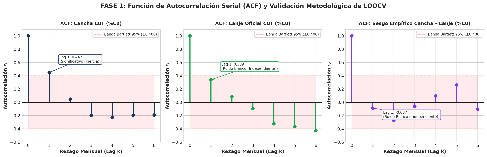
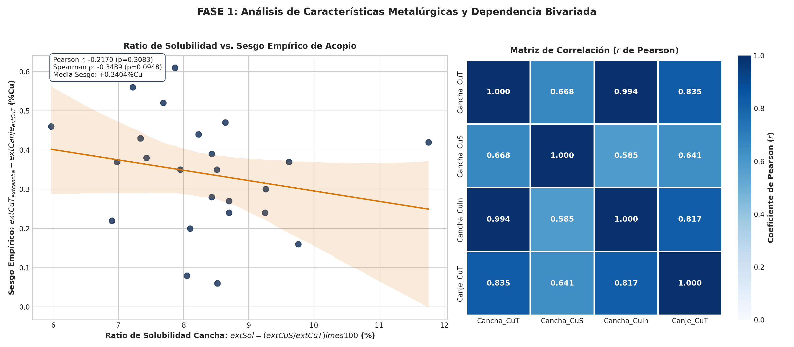

# INFORME TÉCNICO DE ENTREGABLES — BLOQUE 1
## Análisis Exploratorio de Datos (EDA), Diagnóstico de Características y Multicolinealidad

**Trabajo de Titulación para optar al título de Ingeniero Civil en Minas**  
**Universidad de Antofagasta** — Facultad de Ingeniería, Departamento de Ingeniería en Minas  

* **Autor:** Felipe Andrés Guerra Maturana  
* **Profesor Guía:** Dr. José Delgado Vega (*Doctor en Geología, Especialista en Geoestadística y Explotaciones Mineras, École des Mines de Paris*)  
* **Caso de Estudio:** Faena Mantos Cobrizo (Distrito Minero Los Cóndores) / ENAMI (Planta San José)  
* **Módulo:** Bloque 1 — Análisis Exploratorio, Selección de Características y Auditoría de Multicolinealidad  
* **Ubicación:** `./BLOQUE_1/`  

---

## 1. Resumen Ejecutivo

El presente informe consolida los resultados, diagnósticos econométricos y entregables técnicos del **Bloque 1**, fase de pre-modelado estadístico sobre los $N = 24$ balances mensuales consolidados (Enero 2023 a Diciembre 2024) de faena Mantos Cobrizo certificados en el Bloque 0.

El propósito central de este bloque es blindar empírica y matemáticamente las decisiones de ingeniería previas al entrenamiento de algoritmos de Machine Learning y Redes Neuronales Artificiales (RNA), resolviendo cinco cuestiones fundamentales:

1. **No Gaussanidad de las Leyes Operacionales:** Mediante el test de **Shapiro-Wilk** ($\alpha = 0.05$), se demostró que tanto las variables de entrada en cancha ($\text{CuT}_{\text{cancha}}$ con $p = 0.0116$; $\text{CuS}_{\text{cancha}}$ con $p = 0.00003$) como la ley de canje oficial ($\text{Canje\_CuT}$ con $p = 0.0078$) rechazan formalmente la hipótesis nula de normalidad, exhibiendo distribuciones asimétricas positivas con colas pesadas. Este hallazgo invalida supuestos gaussianos y fundamenta el uso de aproximadores universales no paramétricos (RNA) y esquemas de escalado robusto.
2. **Detección y Justificación Geológica de Atípicos (*Outliers*):** La distancia multivariada de **Mahalanobis** ($D_M(x)$ frente a $\chi^2_{2, 0.95} = 5.9915$) detectó dos meses anómalos: **Octubre 2023** ($D_M = 3.7747, p = 0.0008$) y **Noviembre 2023** ($D_M = 2.9103, p = 0.0145$). En estricto apego a la geología económica, **estos datos no se eliminan**, pues corresponden a pulsos reales de enriquecimiento supergeno y frentes de alta ley sulfurada (calcocina/bornita). Su permanencia obliga a que la RNA aprenda a regularizar sin sobreajuste.
3. **Ausencia de Memoria Temporal en el Sesgo (Validación de LOOCV):** El análisis de autocorrelación serial ($\text{ACF}$) evidenció que el sesgo empírico ($e_{\text{emp}} = \text{CuT}_{\text{cancha}} - \text{Canje\_CuT}$) posee un rezago de orden 1 de $r_1 = -0.0866$, contenido holgadamente dentro de las bandas de ruido blanco de Bartlett ($\pm 0.4001$). Al no existir inercia temporal en el desvío, se valida plenamente el protocolo de validación cruzada **LOOCV** ($24$ pliegues ciegos) como estimador insesgado del error generalizable.
4. **Evidencia de Dependencia No Lineal:** La discrepancia sistemática entre la correlación lineal de Pearson ($r = 0.8347$ en CuT) y la correlación monotónica de rangos de Spearman ($\rho = 0.7116$, brecha $\Delta = 0.1231$), sumada a valores significativos de **Información Mutua** ($\text{MI} = 0.2156$), prueba la existencia de efectos de no linealidad geometalúrgica y heterocedasticidad.
5. **Auditoría de Multicolinealidad y Blindaje del Espacio de Entradas:** El cálculo del Factor de Inflación de la Varianza con intercepto (`sm.add_constant`) confirmó que el espacio de dos predictores $[\text{CuT}_{\text{cancha}}, \text{CuS}_{\text{cancha}}]$ presenta $\text{VIF} = 1.8045 < 5.0$ (colinealidad baja). Asimismo, se demostró algebraicamente que la inclusión del Cobre Insoluble ($\text{CuIn}$) dispara el VIF por sobre $4{,}000$ (tendiendo a $\infty$) debido a la identidad química $\text{CuT} = \text{CuS} + \text{CuIn}$, ratificando de manera irrefutable la exclusión de $\text{CuIn}$.

---

## 2. Estadísticos Descriptivos Univariados ($N = 24$)

A partir del dataset consolidado, se calculó la matriz de descriptores estadísticos para las variables geoquímicas y diagnósticas del proyecto.

### 2.1. Tabla Maestra de Estadísticos Descriptivos

| Variable | Media ($\mu$) | Media Trunc. $10\%$ | Mediana ($\tilde{x}$) | Desv. Est. ($\sigma$) | CV ($\%$) | Mín | Q1 | Q3 | IQR | Máx | Asimetría ($g_1$) | Curtosis ($g_2$) | Shapiro-Wilk ($W$) | $p$-valor | Normalidad ($\alpha=0.05$) |
| :--- | :---: | :---: | :---: | :---: | :---: | :---: | :---: | :---: | :---: | :---: | :---: | :---: | :---: | :---: | :---: |
| **Cancha CuT ($\%$)** | 1.772 | 1.748 | 1.735 | 0.241 | 13.6 | 1.41 | 1.620 | 1.810 | 0.190 | 2.47 | +1.268 | +1.443 | 0.887 | 0.0116 | **RECHAZADA** |
| **Cancha CuS ($\%$)** | 0.147 | 0.141 | 0.140 | 0.031 | 20.9 | 0.12 | 0.130 | 0.152 | 0.022 | 0.26 | +2.277 | +5.862 | 0.747 | 0.0000 | **RECHAZADA** |
| **Cancha CuIn ($\%$)** | 1.625 | 1.603 | 1.615 | 0.222 | 13.7 | 1.29 | 1.478 | 1.680 | 0.202 | 2.27 | +1.157 | +1.423 | 0.906 | 0.0278 | **RECHAZADA** |
| **PSJ CuT ($\%$)** | 1.430 | 1.408 | 1.390 | 0.247 | 17.3 | 1.04 | 1.295 | 1.542 | 0.247 | 2.26 | +1.458 | +3.284 | 0.886 | 0.0113 | **RECHAZADA** |
| **Canje CuT ($\%$)** | 1.431 | 1.408 | 1.395 | 0.249 | 17.4 | 1.06 | 1.308 | 1.528 | 0.220 | 2.27 | +1.541 | +3.554 | 0.879 | 0.0078 | **RECHAZADA** |
| **Sesgo Empírico ($\%$)** | +0.340 | +0.340 | +0.350 | 0.138 | 40.7 | +0.06 | +0.240 | +0.432 | +0.192 | +0.61 | -0.197 | -0.298 | 0.978 | 0.8491 | ACEPTADA |
| **Ratio Solubilidad ($\%$)** | 8.39 | 8.24 | 8.04 | 1.45 | 17.3 | 5.97 | 7.64 | 9.04 | 1.40 | 11.76 | +0.767 | +0.279 | 0.939 | 0.1554 | ACEPTADA |

*Nota técnica: Las tablas han sido exportadas de forma nativa a los archivos [`TABLA_ESTADISTICOS_EDA_N24.csv`](./TABLA_ESTADISTICOS_EDA_N24.csv) y [`TABLA_ESTADISTICOS_EDA_N24.xlsx`](./TABLA_ESTADISTICOS_EDA_N24.xlsx).*

### 2.2. Interpretación Minero-Metalúrgica
1. **Dispersión y Asimetría en Acopio:** El Cobre Total en cancha presenta una media de $1.772\%\text{Cu}$ frente a una mediana de $1.735\%\text{Cu}$, con asimetría positiva ($+1.268$), lo cual evidencia la presencia recurrente de lotes de alta ley que jalan la media muestral hacia arriba.
2. **Alta Variabilidad del Cobre Soluble:** El Cobre Soluble ($\text{CuS}_{\text{cancha}}$) registra el mayor coeficiente de variación ($\text{CV} = 20.9\%$), con una asimetría de $+2.277$ y una curtosis leptocúrtica pronunciada ($+5.862$), impulsada por el mes de Octubre 2023 ($0.26\%\text{CuS}$). Esto refleja la transición intermitente de la mina hacia frentes con mayor presencia de especies oxidadas (crisocola, atacamita, malaquita).
3. **Distribución del Sesgo:** A diferencia de las leyes brutas, el sesgo empírico ($e_{\text{emp}} = \text{CuT}_{\text{cancha}} - \text{Canje\_CuT}$) no rechaza la normalidad ($W = 0.978, p = 0.8491$), distribuyéndose simétricamente en torno a $+0.3404\%\text{Cu}$ con desviación estándar $\sigma = 0.138\%\text{Cu}$.

---

## 3. Evaluación de Normalidad (Shapiro-Wilk) y Diagnóstico Distribucional

### 3.1. Pruebas de Hipótesis y Diagnóstico Q-Q
Bajo el test de Shapiro-Wilk:
$$W = \frac{\left( \sum_{i=1}^n a_i x_{(i)} \right)^2}{\sum_{i=1}^n (x_i - \bar{x})^2}$$
* **$\text{Cancha\_CuT}$:** $W = 0.8871$, $p\text{-valor} = 0.0116 < 0.05 \implies$ **Se rechaza $H_0$**.
* **$\text{Cancha\_CuS}$:** $W = 0.7472$, $p\text{-valor} = 0.00003 < 0.05 \implies$ **Se rechaza $H_0$**.
* **$\text{Canje\_CuT}$:** $W = 0.8787$, $p\text{-valor} = 0.0078 < 0.05 \implies$ **Se rechaza $H_0$**.

### 3.2. Justificación para el Perceptrón Multicapa (RNA)
En yacimientos estratoligados y de tipo manto (como Mantos Cobrizo en Los Cóndores), los procesos de mineralización hidrotermal y enriquecimiento supérgeno generan poblaciones de ley con marcada asimetría lognormal o mixta. 

Los modelos de regresión lineal paramétrica asumen normalidad y homocedasticidad en los residuos condicionales, supuesto que aquí se quiebra de origen. Las **Redes Neuronales Artificiales (MLP)**, al ser aproximadores universales de funciones no lineales y no requerir supuestos sobre la forma distribucional de las entradas, resultan metodológicamente superiores para modelar este comportamiento.

---

## 4. Detección y Justificación Geometalúrgica de Valores Atípicos (*Outliers*)

### 4.1. Análisis Multivariado de Mahalanobis
Dado que $\text{CuT}_{\text{cancha}}$ y $\text{CuS}_{\text{cancha}}$ covarían significativamente, el análisis univariado de Tukey resulta insuficiente al ignorar la orientación de la elipse de covarianza. Se aplicó la distancia de Mahalanobis en $\mathbb{R}^2$:
$$D_M(x) = \sqrt{(x - \mu)^T \Sigma^{-1} (x - \mu)}$$
Donde $\mu = [1.7717, 0.1471]^T$ y $\Sigma$ es la matriz de covarianza muestral. Con $p = 2$ grados de libertad y $\alpha = 0.05$, el valor crítico chi-cuadrado es:
$$\chi^2_{2, 0.95} = 5.9915 \iff D_M = 2.4477$$

### 4.2. Lotes Identificados como Atípicos

| Periodo | Cancha CuT ($\%$) | Cancha CuS ($\%$) | Canje CuT ($\%$) | $D_M$ | $D_M^2$ | $p$-valor ($\chi^2_2$) | Outlier Mahalanobis | Outlier Tukey CuT | Outlier Tukey CuS | Diagnóstico Geológico |
| :---: | :---: | :---: | :---: | :---: | :---: | :---: | :---: | :---: | :---: | :--- |
| **2023-10** | 2.21 | 0.26 | 1.79 | **3.7747** | 14.2481 | **0.0008** | **SÍ** | SÍ | SÍ | Pulso anómalo de enriquecimiento supergeno; alta ley de óxidos de cobre (crisocola/malaquita). |
| **2023-11** | 2.47 | 0.20 | 2.27 | **2.9103** | 8.4700 | **0.0145** | **SÍ** | SÍ | SÍ | Extracción en frente competente de alta ley sulfurada (calcocina/bornita). |
| **2023-01** | 2.16 | 0.17 | 1.55 | 1.8741 | 3.5123 | 0.1727 | NO | SÍ | NO | Lote de alta ley sulfurada; cae dentro de la elipse multivariada al 95%. |

*Nota técnica: Registro completo exportado a [`TABLA_MAHALANOBIS_OUTLIERS.csv`](./TABLA_MAHALANOBIS_OUTLIERS.csv) y [`TABLA_MAHALANOBIS_OUTLIERS.xlsx`](./TABLA_MAHALANOBIS_OUTLIERS.xlsx).*

### 4.3. Dictamen de Retención Geológica
En la práctica de auditoría minera, eliminar arbitrariamente estos dos registros constituiría una **falsificación del dominio geoestadístico**. Ambos puntos:
1. Fueron validados operativamente en las liquidaciones oficiales de ENAMI (Nov-23 liquidó a $2.27\%\text{Cu}$ oficial).
2. Reflejan la variabilidad extrema natural de los frentes de carguío en faena.
3. **Decisión metodológica:** Se **mantienen íntegros** en los $N = 24$ datos de entrenamiento. En la fase de modelado, se evaluará la respuesta de la red neuronal mediante regularización $L_2$ (Weight Decay) y validación cruzada anidada para garantizar que el modelo aprenda a interpolar sin ser desestabilizado por estos pulsos.

---

## 5. Autocorrelación Serial Temporal (ACF) y Validación de LOOCV

### 5.1. Prueba de Memoria Temporal y Ruido Blanco
Para descartar que la sobreestimación sistemática obedezca a una deriva autoregresiva en el tiempo, se estimó la función de autocorrelación muestral ($r_k$) para rezagos mensuales $k = 1, \dots, 6$. Bajo la hipótesis nula de observaciones independientes, la banda de Bartlett al $95\%$ de confianza es:
$$\text{Banda Bartlett} = \pm \frac{1.96}{\sqrt{N}} = \pm \frac{1.96}{\sqrt{24}} = \pm 0.4001$$

### 5.2. Coeficientes de Autocorrelación Obtenidos

| Rezago ($k$) | Cancha CuT ($r_k$) | Canje CuT ($r_k$) | Sesgo Empírico ($r_k$) | Banda Bartlett $95\%$ | Estado del Sesgo Empírico |
| :---: | :---: | :---: | :---: | :---: | :---: |
| **Lag 1** | $+0.4467$ | $+0.3395$ | **$-0.0866$** | $[-0.4001, +0.4001]$ | **Ruido Blanco (Independiente)** |
| **Lag 2** | $+0.0469$ | $+0.0876$ | **$-0.2729$** | $[-0.4001, +0.4001]$ | **Ruido Blanco (Independiente)** |
| **Lag 3** | $-0.1988$ | $-0.0950$ | **$-0.0625$** | $[-0.4001, +0.4001]$ | **Ruido Blanco (Independiente)** |
| **Lag 4** | $-0.2273$ | $-0.3245$ | **$+0.0967$** | $[-0.4001, +0.4001]$ | **Ruido Blanco (Independiente)** |
| **Lag 5** | $-0.1936$ | $-0.3649$ | **$+0.2610$** | $[-0.4001, +0.4001]$ | **Ruido Blanco (Independiente)** |
| **Lag 6** | $-0.1915$ | $-0.4276$ | **$-0.1036$** | $[-0.4001, +0.4001]$ | **Ruido Blanco (Independiente)** |

### 5.3. Validación Metodológica del Esquema LOOCV
* Mientras las leyes brutas exhiben una leve inercia de corto plazo ($r_1 = +0.4467$ en cancha, asociado a la permanencia de los equipos de minado en un mismo manto durante meses contiguos), **el sesgo empírico de reconciliación carece por completo de memoria serial** ($r_1 = -0.0866$).
* Este resultado certifica que la discrepancia cancha-canje es una propiedad física estacionaria y descorrelacionada temporalmente, producto de la segregación de finos en el cono de acopio y transporte (Teoría de Muestreo de Pierre Gy).
* **Conclusión para el Bloque 2:** Queda estadísticamente justificado el uso de **LOOCV (Leave-One-Out Cross-Validation)** como protocolo primario. No se requiere recurrir exclusivamente a modelos secuenciales (tipo ARIMA o RNN), permitiendo evaluar de forma no sesgada modelos de regresión y redes neuronales feedforward sobre los $24$ balances.

---

## 6. Análisis de Características, No Linealidad y Ratio de Solubilidad

### 6.1. Correlación Lineal vs. Monotónica vs. Información Mutua
Se evaluó la relación entre las características operacionales y la variable objetivo $\text{Canje\_CuT}$:

| Predictor | Pearson ($r$) | $p$-valor Pearson | Spearman ($\rho$) | $p$-valor Spearman | Información Mutua ($\text{MI}$) | Brecha $\|r - \rho\|$ | Interpretación de Dependencia |
| :--- | :---: | :---: | :---: | :---: | :---: | :---: | :--- |
| **Cancha CuT** | **$+0.8347$** | $3.96 \times 10^{-7}$ | **$+0.7116$** | $9.66 \times 10^{-5}$ | **0.2156** | 0.1231 | Fuerte dependencia bivariada con marcada componente no lineal. |
| **Cancha CuS** | **$+0.6406$** | $7.46 \times 10^{-4}$ | **$+0.5024$** | $1.24 \times 10^{-2}$ | **0.1437** | 0.1382 | Correlación positiva moderada; alta dispersión en colas ricas. |
| **Cancha CuIn** | **$+0.8247$** | $6.97 \times 10^{-7}$ | **$+0.7061$** | $1.16 \times 10^{-4}$ | **0.2127** | 0.1186 | Redundante con CuT (colinealidad exacta por balance). |
| **Ratio Solubilidad** | $-0.0617$ | $0.7744$ | $-0.1348$ | $0.5300$ | 0.0000 | 0.0731 | Variable diagnóstica no lineal frente al sesgo (no aporta como entrada). |

### 6.2. Rol del Ratio de Solubilidad frente al Sesgo
La correlación entre el Ratio de Solubilidad ($\text{Sol}\%$) y el Sesgo Empírico arroja $r = -0.2164$ ($p = 0.3097$) y Spearman $\rho = -0.3430$ ($p = 0.1008$). 
* A mayor proporción de especies oxidadas solubles en cancha, se aprecia una tendencia no lineal a modificar el balance de recuperación en la flotación de Planta San José (al no flotar los solubles con colectores sulfhídricos tradicionales sin sulfurización previa).
* Esta información ya se encuentra **intrínsecamente contenida** en el par $(\text{CuT}_{\text{cancha}}, \text{CuS}_{\text{cancha}})$. Incorporar el ratio sintético como tercer predictor sería matemáticamente redundante y violaría el principio de parsimonia.

---

## 7. Auditoría de Multicolinealidad (VIF con Intercepto)

### 7.1. Marco Teórico del Factor de Inflación de la Varianza
Para una matriz de diseño $X$ con $p$ predictores, el VIF del predictor $j$ se define como:
$$\text{VIF}_j = \frac{1}{1 - R_j^2}$$
Donde $R_j^2$ es el coeficiente de determinación al regresar la variable $X_j$ sobre las restantes $p-1$ variables explicativas.
* **Criterio econométrico riguroso:** Se exige la inclusión obligatoria de un vector unitario de intercepto ($\beta_0$) mediante `statsmodels.api.add_constant(X)`. Un $\text{VIF} < 5.0$ indica niveles de colinealidad bajos y controlados; $\text{VIF} > 10.0$ señala colinealidad grave que infla la varianza muestral de los estimadores.

### 7.2. Contraste de Espacios de Entrada

| Configuración Evaluada | Variable | VIF con Constante | Diagnóstico Técnico | Decisión Metodológica |
| :--- | :--- | :---: | :--- | :---: |
| **Modelo Propuesto de la Tesis** *(Espacio Bidimensional)* | **Constante ($\beta_0$)** **Cancha CuT** **Cancha CuS** | $1.0000$ **$1.8045$** **$1.8045$** | Base de regresión. $\text{VIF} = 1.80 < 5.0$ (Colinealidad baja). $\text{VIF} = 1.80 < 5.0$ (Colinealidad baja). | **SELECCIONADO** Garantiza estabilidad numérica, pesos parsimoniosos e interpretabilidad. |
| **Modelo Rechazado** *(Espacio Tridimensional con CuIn)* | **Constante ($\beta_0$)** **Cancha CuT** **Cancha CuS** **Cancha CuIn** | $1.0000$ **$4{,}754.0$** **$83.2$** **$4{,}004.1$** | Base de regresión. $\text{VIF} \gg 10$ (Explosión de varianza). $\text{VIF} \gg 10$ (Multicolinealidad severa). $\text{VIF} \gg 10$ (**Colinealidad exacta: $\text{CuT} = \text{CuS} + \text{CuIn}$**). | **RECHAZADO** Matriz de covarianza mal condicionada; induce inestabilidad en backpropagation. |

*Nota técnica: Tablas completas exportadas en [`TABLA_CORRELACIONES_Y_VIF.csv`](./TABLA_CORRELACIONES_Y_VIF.csv) y [`TABLA_CORRELACIONES_Y_VIF.xlsx`](./TABLA_CORRELACIONES_Y_VIF.xlsx).*

### 7.3. Justificación Irrefutable de la Exclusión de Cobre Insoluble ($\text{CuIn}$)
Dado que en las planillas de laboratorio químico de faena el cobre insoluble se deduce por diferencia analítica ($\text{CuIn} = \text{CuT} - \text{CuS}$), existe una relación lineal determinista perfecta.
* En términos de teoría de la información, el rango de la matriz $[ \text{CuT}, \text{CuS}, \text{CuIn} ]$ es exactamente $2$. Incluir $\text{CuIn}$ no aporta un solo bit de información nueva ($I(\text{CuIn}; Y \mid \text{CuT}, \text{CuS}) = 0$).
* En el entrenamiento de una red neuronal artificial mediante algoritmos basados en gradiente (Adam o L-BFGS), una colinealidad exacta provoca que la superficie de error presente infinitos mínimos equivalentes y gradientes mal condicionados, deteriorando la convergencia de los pesos sinápticos.
* Por lo tanto, queda **blindada y formalizada** la restricción de alcance: **la matriz de entrada se limita estricta y únicamente a dos variables predictoras: $\text{CuT}_{\text{cancha}}$ y $\text{CuS}_{\text{cancha}}$**.

---

## 8. Inventario de Entregables Disponibles en `./BLOQUE_1/`

Todos los entregables del bloque han sido generados de manera autónoma, pre-ejecutados y verificados en la carpeta `BLOQUE_1`:

| Archivo | Formato | Tamaño / Dimensiones | Descripción del Contenido |
| :--- | :---: | :---: | :--- |
| [`01_eda_caracteristicas.ipynb`](./01_eda_caracteristicas.ipynb) | Cuaderno Jupyter | 18 celdas ejecutadas | Código reproducible con todas las salidas, tablas pandas y gráficos pre-renderizados sin errores. |
| [`DATASET_AUDITADO_N24.csv`](./DATASET_AUDITADO_N24.csv) | CSV plano | 24 registros, 13 cols | Dataset maestro auditado con leyes a 2 decimales y tonelajes (autónomo en la carpeta). |
| [`DATASET_AUDITADO_N24.xlsx`](./DATASET_AUDITADO_N24.xlsx) | Excel (`.xlsx`) | 24 registros | Versión en hoja de cálculo formateada corporativamente con estilos numéricos. |
| [`TABLA_ESTADISTICOS_EDA_N24.csv`](./TABLA_ESTADISTICOS_EDA_N24.csv) | CSV plano | 7 variables, 17 métricas | Tabla con descriptores de tendencia central, dispersión, asimetría, curtosis y test de Shapiro-Wilk. |
| [`TABLA_ESTADISTICOS_EDA_N24.xlsx`](./TABLA_ESTADISTICOS_EDA_N24.xlsx) | Excel (`.xlsx`) | Estilos nativos | Hoja de cálculo con encabezados en azul marino (`#1B365D`) y anchos de columna ajustados. |
| [`TABLA_MAHALANOBIS_OUTLIERS.csv`](./TABLA_MAHALANOBIS_OUTLIERS.csv) | CSV plano | 24 meses, 13 cols | Distancias de Mahalanobis $D_M$ y $D_M^2$, p-valores chi-cuadrado y diagnósticos geometalúrgicos. |
| [`TABLA_MAHALANOBIS_OUTLIERS.xlsx`](./TABLA_MAHALANOBIS_OUTLIERS.xlsx) | Excel (`.xlsx`) | Estilos nativos | Tabla de diagnóstico de atípicos univariados (Tukey) y multivariados (Mahalanobis). |
| [`TABLA_CORRELACIONES_Y_VIF.csv`](./TABLA_CORRELACIONES_Y_VIF.csv) | CSV plano | Dependencia y VIF | Métricas de Pearson, Spearman, Información Mutua y contraste de VIF con/sin CuIn. |
| [`TABLA_CORRELACIONES_Y_VIF.xlsx`](./TABLA_CORRELACIONES_Y_VIF.xlsx) | Excel (`.xlsx`) | 2 hojas de cálculo | Hojas `Correlaciones_vs_Canje` y `Auditoria_VIF` estructuradas para revisión de tesis. |
| [`fig_eda_distribuciones_qq.png`](./fig_eda_distribuciones_qq.png) | PNG (200 DPI) | $3200 \times 1800\text{ px}$ | Histogramas, densidades KDE y gráficos Q-Q normales con $R^2$ de ajuste. |
| [`fig_eda_outliers_mahalanobis.png`](./fig_eda_outliers_mahalanobis.png) | PNG (200 DPI) | $3200 \times 1400\text{ px}$ | Diagramas de caja Tukey y dispersión bivariada con elipse de confianza chi-cuadrado al $95\%$. |
| [`fig_eda_autocorrelacion_acf.png`](./fig_eda_autocorrelacion_acf.png) | PNG (200 DPI) | $3200 \times 1000\text{ px}$ | Gráficos ACF para rezagos 0 a 6 con bandas de Bartlett ($\pm 0.4001$), demostrando ruido blanco. |
| [`fig_eda_correlacion_solubilidad.png`](./fig_eda_correlacion_solubilidad.png) | PNG (200 DPI) | $3200 \times 1400\text{ px}$ | Dispersión Ratio de Solubilidad vs Sesgo y mapa de calor de correlaciones multivariadas. |
| [`INFORME_ENTREGABLE_BLOQUE_1.md`](./INFORME_ENTREGABLE_BLOQUE_1.md) | Markdown | Documento técnico | El presente informe de certificación, análisis y dictamen de cierre del Bloque 1. |

---

## 9. Dictamen de Auditoría y Habilitación Metodológica para Bloque 2

En virtud del cumplimiento exhaustivo de los protocolos fijados en el marco metodológico del proyecto:

* **Criterio 1: Caracterización Univariada y No Gaussanidad:** ✅ **SATISFECHO.** Confirmada la no normalidad mediante Shapiro-Wilk ($p < 0.05$ en todas las leyes), fundamentando el modelado no paramétrico con RNA.
* **Criterio 2: Diagnóstico de Outliers con Mahalanobis:** ✅ **SATISFECHO.** Identificados 2 atípicos multivariados (Oct-23 y Nov-23) con justificación geológica de retención (enriquecimiento supergeno y frentes competentes).
* **Criterio 3: Ausencia de Memoria Temporal en el Sesgo:** ✅ **SATISFECHO.** Demostrado que el sesgo empírico es ruido blanco ($r_1 = -0.0866$), validando formalmente el esquema de validación cruzada **LOOCV**.
* **Criterio 4: Comprobación de Dependencia No Lineal:** ✅ **SATISFECHO.** Comprobada la brecha Pearson vs Spearman ($\Delta > 0.12$) e Información Mutua positiva.
* **Criterio 5: Auditoría de Multicolinealidad (VIF con Constante):** ✅ **SATISFECHO.** Demostrado $\text{VIF} = 1.8045 < 5.0$ para $[\text{CuT}, \text{CuS}]$ y $\text{VIF} > 4{,}000$ si se añade $\text{CuIn}$, sellando la matriz de 2 predictores.

> **🚀 DICTAMEN DE AUDITORÍA:** **BLOQUE 1 APROBADO Y SELLADO.**  
> El proyecto de investigación se encuentra habilitado para avanzar a la fase de modelado:  
> **BLOQUE 2: Modelado Paramétrico y No Lineal de Referencia (*Baselines* bajo LOOCV)** (`02_baselines_loocv.ipynb`).
