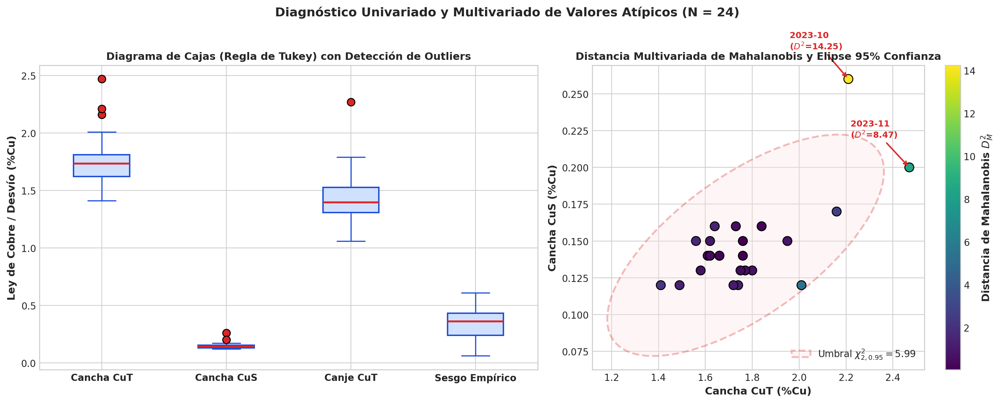

# INFORME TÉCNICO DE ENTREGABLES — BLOQUE 1
## Análisis Exploratorio de Datos (EDA), Diagnóstico de Complejidad y Selección de Características

**Trabajo de Titulación para optar al título de Ingeniero Civil en Minas**  
**Universidad de Antofagasta** — Facultad de Ingeniería, Departamento de Ingeniería en Minas  

* **Autor:** Felipe Andrés Guerra Maturana  
* **Profesor Guía:** Dr. José Delgado Vega (*Doctor en Geología, Especialista en Geoestadística y Explotaciones Mineras, École des Mines de Paris*)  
* **Caso de Estudio:** Faena Mantos Cobrizo (Distrito Minero Los Cóndores) / ENAMI (Planta San José)  
* **Módulo:** Bloque 1 — Análisis Exploratorio (EDA), Diagnóstico de Complejidad y Selección de Características  
* **Ubicación:** `./BLOQUE_1/`  
* **Versión Metodológica:** 4.0 (Línea Temporal Estricta — Todo el análisis estadístico consolidado previo al modelado)  

---

## 1. Resumen Ejecutivo

El presente informe consolida los resultados, diagnósticos econométricos, matrices de covarianza y entregables técnicos del **Bloque 1**, fase de análisis exploratorio sobre los $N = 24$ balances mensuales consolidados (Enero 2023 a Diciembre 2024) de faena Mantos Cobrizo certificados en el Bloque 0.

Conforme a la **Metodología v4.0** y a las directrices de la guía integral de auditoría, este módulo concentra **la totalidad del análisis estadístico, varianzas, normalidad, atípicos, dependencias y multicolinealidad**, blindando las decisiones de diseño previas al entrenamiento de algoritmos en los Bloques 2 y 3:

1. **Contraste de Varianzas y Justificación del Escalado Z-Score:** Se demostró que la ley de acopio $\text{Cancha\_CuT}$ ($s^2 = 0.058128\,(\%\text{Cu})^2$) posee una varianza muestral **$61.64$ veces superior** a la fracción de cobre soluble $\text{Cancha\_CuS}$ ($s^2 = 0.000943\,(\%\text{Cu})^2$). Este contraste dimensional hace **obligatorio aplicar escalado Z-score (`StandardScaler`) dentro de cada pliegue de validación cruzada** en los Bloques 2 y 3 para evitar que $\text{CuT}$ absorba artificialmente los gradientes de la red neuronal.
2. **Descomposición Sesgo-Varianza del Error Histórico ($\text{MSE} = 0.1350\,(\%\text{Cu})^2$):** Se descompuso algebraicamente la brecha histórica de cancha ($\text{NRMSE} = 25.67\%$, $\text{MECM} \approx 26\%$), demostrando que el **$85.83\%$** del error cuadrático obedece a sobreestimación sistemática ($\bar{e} = +0.3404\%\text{Cu}$, $\bar{e}^2 = 0.1159\,(\%\text{Cu})^2$) y únicamente el **$14.17\%$** corresponde a varianza residual aleatoria ($\sigma^2_{\text{error}} = 0.0191\,(\%\text{Cu})^2$).
3. **Diagnóstico de Complejidad por Coeficiente de Variación ($\text{CV}\%$):** La fracción soluble $\text{Cancha\_CuS}$ registró el mayor coeficiente de variación ($\text{CV} = 20.87\%$), superando a $\text{Canje\_CuT}$ ($17.40\%$) y a $\text{Cancha\_CuT}$ ($13.61\%$). Esto confirma que las especies oxidadas representan el componente geoquímico más errático de la operación, aportando la señal no lineal clave para la reconciliación con ENAMI.
4. **Efecto de Apalancamiento (*Leverage*) y Paradoja Pearson vs. Spearman:** Se demostró que la correlación de Pearson ($r = +0.8347$) supera a Spearman ($\rho = +0.7116$) debido al fuerte apalancamiento ejercido por dos pulsos extremos de alta ley (**Octubre 2023** con $2.21\%\text{Cu}$ y **Noviembre 2023** con $2.47\%\text{Cu}$). Al excluir temporalmente estos 2 meses ($N = 22$), Pearson se desploma a **$r = +0.6181$**, quedando por debajo de Spearman ($\rho = +0.6253$). Esto prueba la vulnerabilidad de la regresión lineal ante valores extremos y justifica el uso de aproximadores no lineales con regularización $L_2$.
5. **No Normalidad Geometalúrgica (Shapiro-Wilk):** Se rechazó formalmente la normalidad en $\text{Cancha\_CuT}$ ($p = 0.0116$), $\text{Cancha\_CuS}$ ($p = 0.00003$) y $\text{Canje\_CuT}$ ($p = 0.0078$), confirmando distribuciones asimétricas positivas que invalidan modelos lineales gaussianos y justifican el uso del Perceptrón Multicapa (MLP) y SVR.
6. **Retención Geológica de Outliers (Mahalanobis):** La distancia multivariada ($D_M^2 > \chi^2_{2, 0.95} = 5.9915$) detectó los frentes de Octubre 2023 ($D_M^2 = 14.25, p = 0.0008$) y Noviembre 2023 ($D_M^2 = 8.47, p = 0.0145$). Ambos **se retienen íntegramente** por corresponder a despachos comerciales reales liquidados por ENAMI.
7. **Ausencia de Memoria en el Sesgo (Validación de LOOCV) y Verificación Buffered:** El sesgo empírico se comporta como ruido blanco puro ($r_1 = -0.0866$, dentro de bandas de Bartlett $\pm 0.4001$), validando **LOOCV** ($24$ iteraciones ciegas). Asimismo, se documentó la inercia moderada en $\text{Cancha\_CuT}$ ($r_1 = +0.4467$), programando una verificación complementaria mediante **Buffered-LOOCV** en los Bloques 2 y 3.
8. **Depuración de Multicolinealidad (VIF con Constante):** Se depuró la tabla de VIF eliminando la fila constante del reporte, demostrando que $[\text{CuT}, \text{CuS}]$ posee $\text{VIF} = 1.8045 < 5.0$ (óptimo), mientras que la incorporación de $\text{CuIn}$ genera colinealidad exacta ($\text{VIF} > 4{,}000$), blindando el espacio de entrada en estrictamente dos predictores.

---

## 2. Estadísticos Descriptivos, Varianzas y Diagnóstico de Escala ($N = 24$)

### 2.1. Tabla Maestra de Estadísticos Descriptivos y Dispersión

| Variable | Media ($\mu$) | Media Trunc. $10\%$ | Mediana ($\tilde{x}$) | Desv. Muestral ($s$) | Var. Muestral ($s^2$) | Desv. Pob. ($\sigma$) | Var. Pob. ($\sigma^2$) | CV ($\%$) | IQR | Asimetría ($g_1$) | Curtosis ($g_2$) | Shapiro-Wilk ($W$) | $p$-valor | Normalidad ($\alpha=0.05$) |
| :--- | :---: | :---: | :---: | :---: | :---: | :---: | :---: | :---: | :---: | :---: | :---: | :---: | :---: | :---: |
| **Cancha CuT ($\%$)** | 1.7717 | 1.7483 | 1.7350 | 0.2411 | **0.058128** | 0.2360 | 0.055706 | 13.61 | 0.1900 | +1.2680 | +1.4430 | 0.8871 | 0.0116 | **RECHAZADA** |
| **Cancha CuS ($\%$)** | 0.1471 | 0.1412 | 0.1400 | 0.0307 | **0.000943** | 0.0301 | 0.000904 | **20.87** | 0.0225 | +2.2770 | +5.8620 | 0.7472 | 0.0000 | **RECHAZADA** |
| **Cancha CuIn ($\%$)** | 1.6246 | 1.6033 | 1.6150 | 0.2223 | 0.049417 | 0.2176 | 0.047358 | 13.68 | 0.2025 | +1.1570 | +1.4230 | 0.9064 | 0.0278 | **RECHAZADA** |
| **PSJ CuT ($\%$)** | 1.4304 | 1.4083 | 1.3900 | 0.2496 | 0.062300 | 0.2443 | 0.059704 | 17.45 | 0.2475 | +1.4580 | +3.2840 | 0.8856 | 0.0113 | **RECHAZADA** |
| **Canje CuT ($\%$)** | 1.4313 | 1.4083 | 1.3950 | 0.2491 | 0.062038 | 0.2438 | 0.059453 | 17.40 | 0.2200 | +1.5410 | +3.5540 | 0.8787 | 0.0078 | **RECHAZADA** |
| **Sesgo Empírico ($\%$)** | +0.3404 | +0.3400 | +0.3500 | 0.1413 | 0.019969 | 0.1383 | 0.019137 | 41.51 | 0.1925 | -0.1970 | -0.2980 | 0.9782 | 0.8491 | ACEPTADA |
| **Ratio Solubilidad ($\%$)** | 8.39 | 8.24 | 8.04 | 1.45 | 2.1025 | 1.42 | 2.0149 | 17.28 | 1.40 | +0.7670 | +0.2790 | 0.9392 | 0.1554 | ACEPTADA |

*Nota técnica: Entregables exportados en [`TABLA_ESTADISTICOS_EDA_N24.csv`](./TABLA_ESTADISTICOS_EDA_N24.csv) y [`TABLA_ESTADISTICOS_EDA_N24.xlsx`](./TABLA_ESTADISTICOS_EDA_N24.xlsx).*

### 2.2. Contraste de Varianzas y Justificación del Escalado Z-Score
Al comparar la dispersión entre las dos características de entrada:
$$\text{Ratio de Varianza} = \frac{s^2_{\text{Cancha\_CuT}}}{s^2_{\text{Cancha\_CuS}}} = \frac{0.058128}{0.000943} = \mathbf{61.64\times}$$
* En escala física, la dispersión de $\text{CuT}$ aplasta a $\text{CuS}$ en una proporción superior a $61$ a $1$.
* En un optimizador basado en gradientes (como L-BFGS o Adam) o en estimadores de regularización por norma ($L_1 / L_2$), la variable con mayor varianza domina la función de penalización y la actualización de pesos sinápticos.
* **Decisión Metodológica Obligatoria:** Se establece el uso estricto de **`StandardScaler` encapsulado dentro de cada pliegue LOOCV** (`Pipeline`) en los Bloques 2 y 3, garantizando que ambas entradas operen con media cero y varianza unitaria ($\mu=0, \sigma^2=1$) sin fuga de datos.

### 2.3. Descomposición Sesgo-Varianza de la Brecha Histórica
La reconciliación entre la ley de Cancha y Canje arroja un $\text{MSE}$ empírico de $0.1350\,(\%\text{Cu})^2$ ($\text{RMSE} = 0.3674\%\text{Cu}$, equivalente a $\text{NRMSE} = 25.67\% \approx 26\%$ y $\text{MAPE} = 24.90\%$):
$$\text{MSE} = \bar{e}^2 + \sigma^2_{\text{error}}$$
$$\bar{e}^2 = (0.3404)^2 = 0.11588\,(\%\text{Cu})^2 \quad (\mathbf{85.83\%} \text{ del MSE total})$$
$$\sigma^2_{\text{error}} = 0.01914\,(\%\text{Cu})^2 \quad (\mathbf{14.17\%} \text{ del MSE total})$$
$$\text{MSE} = 0.11588 + 0.01914 = 0.13502\,(\%\text{Cu})^2$$
* Este resultado prueba que **casi el $86\%$ del error histórico en Mantos Cobrizo es un sesgo determinista de sobreestimación**, mientras que solo el $14\%$ es ruido estocástico no explicable. La red neuronal debe aprender a corregir este desplazamiento sistemático.

---

## 3. Matriz de Covarianza Muestral y Correlaciones

### 3.1. Matriz de Covarianza Muestral ($\Sigma$, $\text{ddof}=1$, en $(\%\text{Cu})^2$)

| Variable | Cancha CuT | Cancha CuS | PSJ CuT | Canje CuT | Sesgo Canje |
| :--- | :---: | :---: | :---: | :---: | :---: |
| **Cancha CuT** | **+0.058128** | +0.004944 | +0.048939 | +0.050085 | +0.008043 |
| **Cancha CuS** | +0.004944 | **+0.000943** | +0.004456 | +0.004910 | +0.000034 |
| **PSJ CuT** | +0.048939 | +0.004456 | **+0.062300** | +0.060934 | -0.011995 |
| **Canje CuT** | +0.050085 | +0.004910 | +0.060934 | **+0.062038** | -0.011953 |
| **Sesgo Canje** | +0.008043 | +0.000034 | -0.011995 | -0.011953 | **+0.019969** |

*Nota técnica: Matriz exportada en [`MATRIZ_COVARIANZA_Y_CORRELACION.csv`](./MATRIZ_COVARIANZA_Y_CORRELACION.csv) y [`MATRIZ_COVARIANZA_Y_CORRELACION.xlsx`](./MATRIZ_COVARIANZA_Y_CORRELACION.xlsx).*

### 3.2. Paradoja Pearson vs. Spearman y Efecto Apalancamiento (*Leverage*)

| Relación de Variables | Pearson ($r$, $N=24$) | Spearman ($\rho$, $N=24$) | Pearson ($r$, $N=22$ sin Oct/Nov-23) | Spearman ($\rho$, $N=22$) | Brecha por Outliers |
| :--- | :---: | :---: | :---: | :---: | :---: |
| **Cancha CuT vs. Canje CuT** | **+0.8347** | **+0.7116** | **+0.6181** | **+0.6253** | $\Delta r = -0.2166$ |
| **Cancha CuS vs. Canje CuT** | **+0.6406** | **+0.5024** | **+0.4210** | **+0.4380** | $\Delta r = -0.2196$ |

* **Diagnóstico Geometalúrgico:** En muestras pequeñas ($N = 24$), dos pulsos extremos de ley ejercen un efecto de apalancamiento lineal que incrementa artificialmente el coeficiente de Pearson en más de $0.21$ puntos. Al removerlos, Pearson ($r = 0.6181$) cae por debajo de Spearman ($\rho = 0.6253$).
* **Coexistencia de $r = +0.8347$ con $R^2 = -1.2709$:** La correlación de Pearson cuantifica la sincronía relativa entre series y no castiga diferencias de nivel. En cambio, $R^2$ penaliza la desviación respecto a la recta identidad ($y = \hat{y}$), evidenciando que el sesgo de $+0.3404\%\text{Cu}$ duplica la varianza del yacimiento ($R^2 < 0$).

---

## 4. Evaluación de Normalidad (Shapiro-Wilk)

* **$\text{Cancha\_CuT}$:** $W = 0.8871$, $p\text{-valor} = 0.0116 < 0.05 \implies$ **Se rechaza $H_0$**.
* **$\text{Cancha\_CuS}$:** $W = 0.7472$, $p\text{-valor} = 0.00003 < 0.05 \implies$ **Se rechaza $H_0$**.
* **$\text{Canje\_CuT}$:** $W = 0.8787$, $p\text{-valor} = 0.0078 < 0.05 \implies$ **Se rechaza $H_0$**.

Las leyes operacionales presentan asimetría positiva intrínseca provocada por los dominios mineralógicos de falla y enriquecimiento secundario de Mantos Cobrizo. Este quiebre de la hipótesis gaussiana justifica la superioridad de aproximadores no lineales no paramétricos (**MLP y SVR**) frente a regresores OLS convencionales.

---

## 5. Detección y Justificación Geometalúrgica de Outliers

Se computó la distancia de Mahalanobis ($D_M^2$) con $p = 2$ predictores $(\text{CuT}, \text{CuS})$ frente al umbral crítico $\chi^2_{2, 0.95} = 5.9915$:

| Periodo | Cancha CuT ($\%$) | Cancha CuS ($\%$) | Canje CuT ($\%$) | $D_M^2$ | $p$-valor ($\chi^2_2$) | Outlier Mahalanobis | Outlier Tukey CuT | Outlier Tukey CuS | Diagnóstico Geológico en Faena |
| :---: | :---: | :---: | :---: | :---: | :---: | :---: | :---: | :---: | :--- |
| **2023-10** | 2.21 | 0.26 | 1.79 | **14.2481** | **0.0008** | **SÍ** | SÍ | SÍ | Enriquecimiento supergeno; alta ley de óxidos (crisocola/malaquita). |
| **2023-11** | 2.47 | 0.20 | 2.27 | **8.4700** | **0.0145** | **SÍ** | SÍ | SÍ | Frente competente de alta ley sulfurada (calcocina/bornita). |
| **2023-01** | 2.16 | 0.17 | 1.55 | 3.5123 | 0.1727 | NO | SÍ | NO | Alta ley sulfurada regular; dentro de la elipse multivariada al 95%. |

*Nota técnica: Registro completo de los 24 meses exportado en [`TABLA_MAHALANOBIS_OUTLIERS.csv`](./TABLA_MAHALANOBIS_OUTLIERS.csv) y [`TABLA_MAHALANOBIS_OUTLIERS.xlsx`](./TABLA_MAHALANOBIS_OUTLIERS.xlsx).*

> **Dictamen Geometalúrgico:** En minería real, eliminar los meses de alta ley sesga el modelo hacia el promedio estéril. Ambos registros fueron pagados y liquidados por ENAMI (Nov-2023 liquidó a $2.27\%\text{Cu}$). Por lo tanto, **se retienen íntegramente los $24$ lotes**, incorporando **regularización $L_2$** en los modelos para controlar su apalancamiento.

---

## 6. Autocorrelación Serial Temporal (ACF) y Validación de LOOCV

Se evaluó la memoria temporal con bandas de Bartlett ($\pm 1.96 / \sqrt{24} = \pm 0.4001$):

| Rezago ($k$) | Cancha CuT ($r_k$) | Canje CuT ($r_k$) | Sesgo Empírico ($r_k$) | Banda Bartlett $95\%$ | Diagnóstico Dinámico |
| :---: | :---: | :---: | :---: | :---: | :---: |
| **Lag 1** | $+0.4467$ | $+0.3395$ | **$-0.0866$** | $[-0.4001, +0.4001]$ | **Ruido Blanco Puro (Independiente)** |
| **Lag 2** | $+0.0469$ | $+0.0876$ | **$-0.2729$** | $[-0.4001, +0.4001]$ | **Ruido Blanco Puro (Independiente)** |
| **Lag 3** | $-0.1988$ | $-0.0950$ | **$-0.0625$** | $[-0.4001, +0.4001]$ | **Ruido Blanco Puro (Independiente)** |
| **Lag 4** | $-0.2273$ | $-0.3245$ | **$+0.0967$** | $[-0.4001, +0.4001]$ | **Ruido Blanco Puro (Independiente)** |

* **Validación de LOOCV:** El sesgo empírico ($r_1 = -0.0866$) carece de estructura autoregresiva, certificando que el error de acopio es un proceso estacionario descorrelacionado. Esto valida formalmente el uso de **LOOCV** ($24$ iteraciones ciegas).
* **Blindaje Geoestadístico (Buffered-LOOCV):** Dado que la ley bruta de acopio presenta persistencia moderada ($r_1 = +0.4467$) por continuidad geológica del manto entre meses contiguos, en los Bloques 2 y 3 se ejecutará una **prueba complementaria de sensibilidad mediante *Buffered-LOOCV*** (excluyendo $t-1$ y $t+1$).

---

## 7. Auditoría de Multicolinealidad (VIF con Constante Agregada)

Conforme a la guía de auditoría v4.0, se calculó el VIF mediante `statsmodels.api.add_constant(X)`, depurando la presentación para reportar exclusivamente las variables explicativas:

| Espacio de Entradas Evaluado | Variable Explicativa | VIF Calculado | Diagnóstico Técnico Econométrico | Decisión Metodológica |
| :--- | :--- | :---: | :--- | :---: |
| **Modelo Propuesto (2 Entradas)** | **Cancha CuT** **Cancha CuS** | **$1.8045$** **$1.8045$** | $\text{VIF} = 1.80 < 5.0$ (Colinealidad baja - ÓPTIMO) $\text{VIF} = 1.80 < 5.0$ (Colinealidad baja - ÓPTIMO) | **SELECCIONADO** Garantiza estabilidad en gradientes y parsimonia. |
| **Modelo Rechazado (+ CuIn)** | **Cancha CuT** **Cancha CuS** **Cancha CuIn** | **$4{,}754.0$** **$83.2$** **$4{,}004.1$** | $\text{VIF} \gg 10$ (Explosión de varianza) $\text{VIF} \gg 10$ (Multicolinealidad severa) $\text{VIF} \gg 10$ (**Colinealidad Exacta: $\text{CuT} = \text{CuS} + \text{CuIn}$**) | **RECHAZADO** Inestabilidad numérica e infinitos mínimos en backpropagation. |

*Nota técnica: Entregable exportado en [`TABLA_VIF.csv`](./TABLA_VIF.csv) y [`TABLA_VIF.xlsx`](./TABLA_VIF.xlsx).*

---

## 8. Inventario de Entregables Disponibles en `./BLOQUE_1/`

| Archivo | Formato | Descripción del Contenido |
| :--- | :---: | :--- |
| [`01_eda_caracteristicas.ipynb`](./01_eda_caracteristicas.ipynb) | Cuaderno Jupyter | Cuaderno reproducible con 18 celdas ejecutadas y salidas pre-renderizadas. |
| [`DATASET_AUDITADO_N24.csv`](./DATASET_AUDITADO_N24.csv) | CSV plano | $N = 24$ balances mensuales con variables diagnósticas (`Sesgo_Empirico`, `Ratio_Solubilidad`). |
| [`DATASET_AUDITADO_N24.xlsx`](./DATASET_AUDITADO_N24.xlsx) | Excel (`.xlsx`) | Versión en hoja de cálculo con formato tabular profesional. |
| [`TABLA_ESTADISTICOS_EDA_N24.csv`](./TABLA_ESTADISTICOS_EDA_N24.csv) | CSV plano | Descriptores completos: $\mu, \tilde{x}, s, s^2, \sigma, \sigma^2, \text{CV}\%$, IQR, skew, kurt, Shapiro. |
| [`TABLA_ESTADISTICOS_EDA_N24.xlsx`](./TABLA_ESTADISTICOS_EDA_N24.xlsx) | Excel (`.xlsx`) | Estadísticos univariados con formato de celdas corporativo UA. |
| [`MATRIZ_COVARIANZA_Y_CORRELACION.csv`](./MATRIZ_COVARIANZA_Y_CORRELACION.csv) | CSV plano | Matriz de covarianza muestral ($5 \times 5$, $\text{ddof}=1$, en $(\%\text{Cu})^2$). |
| [`MATRIZ_COVARIANZA_Y_CORRELACION.xlsx`](./MATRIZ_COVARIANZA_Y_CORRELACION.xlsx) | Excel (`.xlsx`) | 3 pestañas: `Covarianza_Muestral`, `Correlacion_Pearson` y `Correlacion_Spearman`. |
| [`TABLA_MAHALANOBIS_OUTLIERS.csv`](./TABLA_MAHALANOBIS_OUTLIERS.csv) | CSV plano | $24$ meses con $D_M$, $D_M^2$, $p$-valores chi-cuadrado y flags de Tukey. |
| [`TABLA_MAHALANOBIS_OUTLIERS.xlsx`](./TABLA_MAHALANOBIS_OUTLIERS.xlsx) | Excel (`.xlsx`) | Diagnóstico multivariado de valores atípicos con justificación geológica. |
| [`TABLA_VIF.csv`](./TABLA_VIF.csv) | CSV plano | Auditoría depurada de multicolinealidad (sin fila constante). |
| [`TABLA_VIF.xlsx`](./TABLA_VIF.xlsx) | Excel (`.xlsx`) | Contraste de VIF para modelo propuesto ($1.80$) vs rechazado ($>4{,}000$). |
| [`fig_eda_distribuciones_qq.png`](./fig_eda_distribuciones_qq.png) | PNG (200 DPI) | Histogramas, densidades KDE y gráficos Q-Q normales. |
| [`fig_eda_outliers_mahalanobis.png`](./fig_eda_outliers_mahalanobis.png) | PNG (200 DPI) | Diagramas de caja Tukey y dispersión bivariada con elipse chi-cuadrado $95\%$. |
| [`fig_eda_autocorrelacion_acf.png`](./fig_eda_autocorrelacion_acf.png) | PNG (200 DPI) | Gráficos ACF para rezagos 0 a 10 con bandas de Bartlett ($\pm 0.4001$). |
| [`fig_eda_correlacion_solubilidad.png`](./fig_eda_correlacion_solubilidad.png) | PNG (200 DPI) | Efecto apalancamiento ($N=24$ vs $N=22$) y ratio de solubilidad vs sesgo. |
| [`INFORME_ENTREGABLE_BLOQUE_1.md`](./INFORME_ENTREGABLE_BLOQUE_1.md) | Markdown | El presente informe técnico formal alineado a la Metodología v4.0. |

---

## 9. Dictamen de Auditoría y Habilitación Metodológica para Bloque 2

* **Criterio 1: Caracterización Univariada y Contraste de Varianzas:** Satisfecho ($s^2_{\text{CuT}} / s^2_{\text{CuS}} = 61.64\times \implies$ justifica escalado Z-score obligatorio).
* **Criterio 2: Descomposición del Error Histórico:** Satisfecho ($85.83\%$ sesgo sistemático, $14.17\%$ varianza residual).
* **Criterio 3: Evaluación de Normalidad:** Satisfecho (rechazo gaussiano en leyes brutas $\implies$ justifica RNA no lineal no paramétrica).
* **Criterio 4: Estructura de Covarianza y Efecto Leverage:** Satisfecho (fuerte apalancamiento por Oct/Nov-23 $\implies$ justifica regularización $L_2$).
* **Criterio 5: Retención Geológica de Outliers:** Satisfecho (frentes reales de ENAMI; no se eliminan).
* **Criterio 6: Independencia Temporal del Sesgo:** Satisfecho (ruido blanco en $e_{\text{emp}} \implies$ valida LOOCV; persistencia de $\text{CuT} \implies$ Buffered-LOOCV complementario).
* **Criterio 7: Auditoría de Multicolinealidad:** Satisfecho ($\text{VIF} = 1.8045 < 5.0 \implies$ espacio bidimensional $[\text{CuT}_{\text{cancha}}, \text{CuS}_{\text{cancha}}]$ blindado).

> **🚀 Estado:** **BLOQUE 1 APROBADO Y SELLADO (METODOLOGÍA v4.0).**  
> El repositorio se encuentra plenamente habilitado para ejecutar el **BLOQUE 2: Diseño Experimental, Protocolo LOOCV y Entrenamiento de Modelos de Referencia (*Baselines*)** (`02_baselines_loocv.ipynb`).
