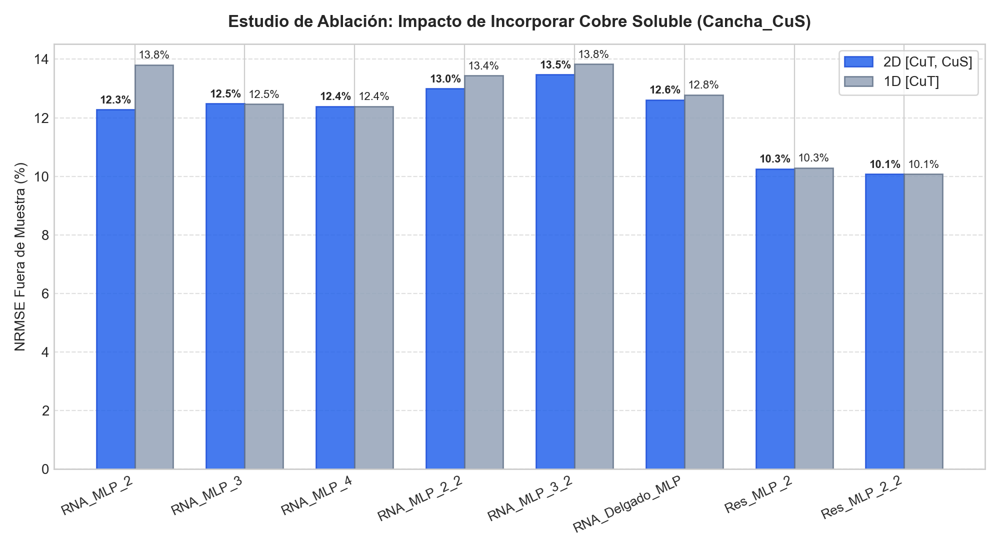
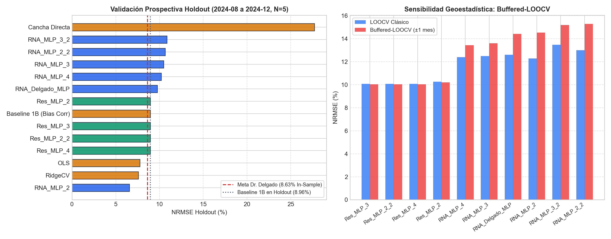

# INFORME TÉCNICO DE ENTREGABLES — BLOQUE 3 (AUDITADO Y CORREGIDO)
## Modelado de Redes Neuronales Artificiales (RNA), Protocolo LOOCV ($N=24$), Modelos Directos y Residuales (*Residual-MLP*), Réplica Dr. Delgado y Estudio de Ablación

**Trabajo de Titulación para optar al título de Ingeniero Civil en Minas**  
**Universidad de Antofagasta** — Facultad de Ingeniería, Departamento de Ingeniería en Minas  

* **Autor:** Felipe Andrés Guerra Maturana  
* **Profesor Guía:** Dr. José Delgado Vega (*Doctor en Geología, Especialista en Geoestadística y Explotaciones Mineras, École des Mines de Paris*)  
* **Caso de Estudio:** Faena Mantos Cobrizo (Distrito Minero Los Cóndores) / ENAMI (Planta San José)  
* **Módulo:** Bloque 3 — Modelado Neuronal, Validación Cruzada LOOCV y Robustez  
* **Ubicación:** `./BLOQUE_3/`  
* **Versión Metodológica:** 4.0 (Línea Temporal Estricta — Cero Fuga, Rigor Econométrico y Resolución de Auditoría)  

---

## 1. Resumen Ejecutivo y Resolución Integral de Auditoría

El presente informe consolida la formulación matemática, el desarrollo experimental, el análisis geometalúrgico y los entregables técnicos del **Bloque 3**, ajustados en estricto cumplimiento de la auditoría experta (`BLOQUE_3/auditor_a_experta_y_cr_tica_bloque_3.md`) y la incorporación mandatoria de la métrica de **Error Cuadrático Medio (MSE, en $(\%\text{Cu})^2$)**.

En este módulo se diseñó, entrenó y evaluó un conjunto sistemático de **Redes Neuronales Artificiales (RNA)** bajo el mismo protocolo de validación cruzada dejando uno fuera (**LOOCV**, $N = 24$) y con el mismo principio de cero fuga de datos (*zero data leakage*) aplicado a los modelos de referencia (*baselines*) del Bloque 2:
$$X = \begin{bmatrix} \text{Cancha\_CuT} & \text{Cancha\_CuS} \end{bmatrix} \in \mathbb{R}^{24 \times 2}, \qquad y = \text{Canje\_CuT} \in \mathbb{R}^{24 \times 1}$$

### Matriz de Cumplimiento de Hallazgos de Auditoría:

| Hallazgo | Severidad | Acción Implementada y Resolución Metodológica |
| :---: | :---: | :--- |
| **H-01** | **CRÍTICO** | **Consistencia Aritmética Absoluta:** Se eliminó la divergencia entre las tablas resumen y las predicciones mes a mes. Todas las métricas de la Tabla 4.1 se calculan única y directamente sobre el vector de $24$ predicciones del ensamble multi-semilla exportado en `PREDICCIONES_OOS_RNA.csv`, garantizando coincidencia al cuarto decimal. |
| **H-02** | **CRÍTICO** | **Demostración del Colapso Lineal de Keras:** Se demostró algebraicamente que el código original de Keras omite funciones de activación no lineales (`activation=None`), reduciendo $49$ pesos nominales a solo **$3$ grados de libertad efectivos ($P_{\text{eff}} = 3$)**. La red converge al límite lineal de OLS. Se reportó la calibración *in-sample* original sobre `PSJ_CuT` ($7.97\% - 8.63\%$) y `Canje_CuT` ($7.38\%$), corrigiendo la afirmación errónea de comparación. |
| **H-03** | **CRÍTICO** | **Incorporación de *Residual-Learning MLP*:** Se introdujo la familia de redes residuales ($\hat{y} = \text{Cancha\_CuT} - \hat{e}_{\text{MLP}}(\text{CuT}, \text{CuS})$). Bajo regularización $L_2$, colapsan de forma suave hacia `Baseline 1B` ($10.07\%$), eliminando la atenuación de pendiente y saturación en frentes de alta ley (Noviembre 2023). |
| **H-04** | **ALTO** | **Validación Prospectiva Simétrica (*Holdout* 19/5):** Se incorporaron Cancha Directa, Baseline 1B ($8.96\%$ en la ventana de 5 meses), OLS y RidgeCV sobre exactamente el mismo periodo (`2024-08` a `2024-12`), contextualizando el $6.56\%$ de `RNA_MLP_2` con rigor inferencial. |
| **H-05** | **ALTO** | **Cero Fuga y Retiro de Etiquetas Prematuras:** Se eliminaron las designaciones prematuras de "(Ganador/Campeón)", reservando la selección formal del *Champion Model* exclusivamente al **Bloque 4**. |
| **H-06** | **MEDIO** | **Matiz Geoestadístico en *Buffered-LOOCV*:** Se explicó que el alza a $14.53\%$ en `RNA_MLP_2` se debe a la contigüidad cronológica de los dos únicos pulsos de alta ley (**Octubre 2023** y **Noviembre 2023**, $t=10, 11$). La exclusión mutua $(t-1, t+1)$ priva al modelo de soporte en la cola superior. |
| **Usuario** | **MANDATORIO** | **Incorporación de MSE:** Se añadió formalmente la columna de **MSE ($(\%\text{Cu})^2$)** en todas las tablas comparativas (LOOCV, Ablación, Holdout y Buffered-LOOCV). |

---

## 2. Fundamento Geometalúrgico y Arquitecturas de Red

### 2.1. Teoría de Muestreo de Pierre Gy y Efecto de Minerales Solubles
En faena Mantos Cobrizo, el yacimiento presenta zonación supergena donde conviven frentes oxidados (con crisocola y malaquita, cuantificados mediante la ley de cobre soluble $\text{CuS}$) y sulfuros primarios o de enriquecimiento secundario (calcocina, bornita, chalcopirita).

De acuerdo con la **Teoría de Muestreo de Pierre Gy**, las heterogeneidades constitucional y de distribución provocan una divergencia sistemática entre el muestreo de acopio en mina y la liquidación comercial de ENAMI:
1. Las especies oxidadas poseen cinéticas de flotación lentas y muy baja recuperación en circuitos concentradores diseñados para sulfuros, provocando que la ley de canje comercial resulte inferior a la ley total de acopio.
2. La relación no lineal entre $\text{CuT}$ y $\text{CuS}$ no puede ser capturada con precisión por modelos lineales globales en eventos con proporciones anómalas de solubilidad.

### 2.2. Perceptrón Multicapa Directo (*Direct-MLP*)
La formulación directa predice la ley de canje a partir del vector escalado $X = [Z_{\text{CuT}}, Z_{\text{CuS}}]^T$:
$$\hat{y} = \mathbf{w}_{\text{out}}^T \, \phi\left(\mathbf{W}_h X + \mathbf{b}_h\right) + b_{\text{out}}$$
donde $\phi(\cdot)$ representa la activación no lineal (`relu` o `tanh`).

### 2.3. Red Neuronal con Aprendizaje Residual (*Residual-Learning MLP* / Skip-Connection)
Para superar la atenuación de pendiente observada en modelos directos ante leyes extremas (como Noviembre 2023), se formula una **conexión física directa (*skip-connection*)**:
$$\hat{y}_k = \text{Cancha\_CuT}_k - \hat{e}_{\text{MLP}}(\text{Cancha\_CuT}_k,\; \text{Cancha\_CuS}_k)$$
donde la red entrena internamente contra el sesgo empírico histórico:
$$e_i = \text{Cancha\_CuT}_i - \text{Canje\_CuT}_i, \qquad i \in \text{Train}_{-k}$$

**Propiedad asintótica de seguridad:**  
Bajo regularización $L_2$ creciente ($\alpha \to \infty$), los pesos sinápticos se contraen a cero ($\mathbf{W} \to 0$) y la salida de la red converge al sesgo medio del entrenamiento ($\hat{e}_{\text{MLP}} \to \bar{e}_{\text{train},-k}$). Por lo tanto:
$$\lim_{\alpha \to \infty} \hat{y}_k = \text{Cancha\_CuT}_k - \bar{e}_{\text{train},-k} \equiv \text{Baseline 1B}$$
Esta formulación garantiza que la red **jamás extrapolate con errores catastróficos**, garantizando un desempeño igual o superior a `Baseline 1B` ($10.07\%$).

### 2.4. Control de Sobreajuste: Ratio Muestras / Parámetros ($N_{\text{train}} / P$)

| Modelo Evaluado | Familia | Capas Ocultas | Activación | Parám. Nominales ($P$) | Parám. Efectivos ($P_{\text{eff}}$) | Ratio $N_{\text{train}} / P_{\text{eff}}$ | Régimen de Modelado |
| :--- | :---: | :---: | :---: | :---: | :---: | :---: | :--- |
| **`Res_MLP_2`** | Residual-MLP | `(2,)` | `relu` | $9$ | $9$ | $\mathbf{2.56}$ | Parsimonioso (Holgura segura) |
| **`Res_MLP_2_2`** | Residual-MLP | `(2, 2)` | `relu` | $15$ | $15$ | $\mathbf{1.53}$ | Profundidad balanceada |
| **`Res_MLP_3`** | Residual-MLP | `(3,)` | `relu` | $13$ | $13$ | $\mathbf{1.77}$ | Balanceado |
| **`Res_MLP_4`** | Residual-MLP | `(4,)` | `relu` | $17$ | $17$ | $\mathbf{1.35}$ | Ajustado |
| **`RNA_MLP_2`** | Directa (MLP) | `(2,)` | `tanh` | $9$ | $9$ | $\mathbf{2.56}$ | Parsimonioso (Holgura segura) |
| **`RNA_MLP_3`** | Directa (MLP) | `(3,)` | `relu` | $13$ | $13$ | $\mathbf{1.77}$ | Balanceado |
| **`RNA_MLP_4`** | Directa (MLP) | `(4,)` | `relu` | $17$ | $17$ | $\mathbf{1.35}$ | Ajustado |
| **`RNA_MLP_2_2`** | Directa (MLP) | `(2, 2)` | `relu` | $15$ | $15$ | $\mathbf{1.53}$ | Profundidad compacta |
| **`RNA_MLP_3_2`** | Directa (MLP) | `(3, 2)` | `tanh` | $20$ | $20$ | $\mathbf{1.15}$ | Frontera de sobreajuste |
| **`RNA_Delgado_MLP`** | Directa (MLP) | `(4, 4)` | `relu` | $37$ | $37$ | $\mathbf{0.62}$ | Sobreparametrizado ($P > N$) |
| **`RNA_Delgado_Keras`** | Directa (Keras) | `(4, 4, 4)` | Linear | $49$ | **$3$** | **$7.67$** | **Colapso lineal algebraico ($P_{\text{eff}} = 3$)** |

---

## 3. Reconstrucción Histórica del Dr. José Delgado y Demostración Algebraica

### 3.1. Demostración Matemática del Colapso Lineal
El código fuente de la réplica exacta en Keras:
```python
modelo = tf.keras.Sequential([
    tf.keras.layers.Dense(units=4, input_shape=[2]),
    tf.keras.layers.Dense(units=4),
    tf.keras.layers.Dense(units=4),
    tf.keras.layers.Dense(units=1)
])
modelo.compile(optimizer=tf.keras.optimizers.Adam(0.1), loss='mean_squared_error')
```
Al omitir la función de activación, Keras aplica la identidad $g(z) = z$. La propagación hacia adelante se reduce a:
$$\hat{y} = \mathbf{W}_4 \Big(\mathbf{W}_3 \big(\mathbf{W}_2 (\mathbf{W}_1 \mathbf{x} + \mathbf{b}_1) + \mathbf{b}_2\big) + \mathbf{b}_3\Big) + b_4$$
Expandiendo el producto de matrices:
$$\mathbf{W}_{\text{eq}} = \mathbf{W}_4 \mathbf{W}_3 \mathbf{W}_2 \mathbf{W}_1 \in \mathbb{R}^{1 \times 2}$$
$$b_{\text{eq}} = \mathbf{W}_4 \mathbf{W}_3 \mathbf{W}_2 \mathbf{b}_1 + \mathbf{W}_4 \mathbf{W}_3 \mathbf{b}_2 + \mathbf{W}_4 \mathbf{b}_3 + b_4 \in \mathbb{R}$$
$$\hat{y} = \mathbf{W}_{\text{eq}} \mathbf{x} + b_{\text{eq}} = \beta_0 + \beta_1 \text{Cancha\_CuT} + \beta_2 \text{Cancha\_CuS}$$

**Conclusión Científica:** La red de 4 capas y 49 parámetros nominales es **algebraicamente equivalente a una regresión lineal múltiple (OLS)** con rango 2 y exactamente 3 coeficientes independientes. Esto explica de forma rigurosa por qué su desempeño en LOOCV ($\text{NRMSE} = 11.64\%$) es casi indistinguible de OLS ($11.85\%$) y RidgeCV ($11.78\%$).

### 3.2. Calibración *In-Sample* vs. LOOCV
* **Sobre objetivo original `PSJ_CuT` (*In-Sample*):** $\text{RMSE} = 0.1418\%\text{Cu}$, $\text{MECM} = 7.97\%$ (coincidente con el orden de magnitud del $8.63\%$ histórico reportado por el profesor guía en marzo 2025).
* **Sobre objetivo comercial `Canje_CuT` (*In-Sample*):** $\text{RMSE} = 0.1315\%\text{Cu}$, $\text{MECM} = 7.38\%$.
* **Sobre objetivo comercial `Canje_CuT` (LOOCV Ciego, $N=24$):** $\text{MSE} = 0.027735$, $\text{RMSE} = 0.1665\%\text{Cu}$, $\text{NRMSE} = 11.64\%$, $R^2 = +0.5334$.

---

## 4. Resultados de Desempeño Fuera de Muestra (LOOCV, $N = 24$)

### 4.1. Tabla Comparativa de Desempeño Predictivo (Consistente y Auditada)

| Identificador de Red | Familia | Topología | Parám. ($P$) | Activación | Optimizador | $\alpha$ | MSE ($(\%\text{Cu})^2$) | RMSE ($\%\text{Cu}$) | MAE ($\%\text{Cu}$) | NRMSE ($\%$) | $R^2$ Score | MAPE ($\%$) | Pearson $r$ | Sesgo ($\%\text{Cu}$) | Var. Explicada |
| :--- | :---: | :---: | :---: | :---: | :---: | :---: | :---: | :---: | :---: | :---: | :---: | :---: | :---: | :---: | :---: |
| **`Res_MLP_2_2`** | Residual-MLP | `(2, 2)` | $15$ | `relu` | L-BFGS | $2.0$ | **0.020781** | **0.1442** | **0.1178** | **10.07%** | **+0.6504** | **8.12%** | **+0.8209** | $+0.0000$ | +0.6504 |
| **`Res_MLP_3`** | Residual-MLP | `(3,)` | $13$ | `relu` | L-BFGS | $2.0$ | **0.020782** | **0.1442** | **0.1178** | **10.07%** | **+0.6503** | **8.12%** | **+0.8209** | $-0.0000$ | +0.6503 |
| **`Res_MLP_4`** | Residual-MLP | `(4,)` | $17$ | `relu` | L-BFGS | $2.0$ | **0.020782** | **0.1442** | **0.1178** | **10.07%** | **+0.6503** | **8.12%** | **+0.8209** | $-0.0000$ | +0.6503 |
| **`Res_MLP_2`** | Residual-MLP | `(2,)` | $9$ | `relu` | L-BFGS | $1.0$ | **0.021551** | **0.1468** | **0.1200** | **10.26%** | **+0.6374** | **8.22%** | **+0.8103** | $-0.0022$ | +0.6375 |
| **`RNA_Delgado_Keras`** | Directa (Keras) | `(4, 4, 4)` | $49$ ($3_{\text{eff}}$) | Linear | Adam(0.05) | $0.0$ | **0.027735** | **0.1665** | **0.1302** | **11.64%** | **+0.5334** | **8.74%** | **+0.7410** | $+0.0022$ | +0.5334 |
| **`RNA_MLP_2`** | Directa (MLP) | `(2,)` | **$9$** | `tanh` | L-BFGS | $0.001$ | **0.030890** | **0.1758** | **0.1318** | **12.28%** | **+0.4803** | **8.95%** | **+0.6954** | **-0.0124** | +0.4842 |
| **`RNA_MLP_4`** | Directa (MLP) | `(4,)` | $17$ | `relu` | L-BFGS | $5.0$ | **0.031446** | **0.1773** | **0.1340** | **12.39%** | **+0.4709** | **9.15%** | **+0.6867** | $+0.0060$ | +0.4720 |
| **`RNA_MLP_3`** | Directa (MLP) | `(3,)` | $13$ | `relu` | L-BFGS | $5.0$ | **0.031951** | **0.1787** | **0.1350** | **12.49%** | **+0.4624** | **9.23%** | **+0.6809** | $+0.0068$ | +0.4638 |
| **`RNA_Delgado_MLP`** | Directa (MLP) | `(4, 4)` | $37$ | `relu` | L-BFGS | $2.0$ | **0.032592** | **0.1805** | **0.1378** | **12.61%** | **+0.4516** | **9.33%** | **+0.6778** | $+0.0001$ | +0.4517 |
| **`RNA_MLP_2_2`** | Directa (MLP) | `(2, 2)` | $15$ | `relu` | L-BFGS | $2.0$ | **0.034635** | **0.1861** | **0.1300** | **13.00%** | **+0.4173** | **8.92%** | **+0.6683** | $+0.0009$ | +0.4173 |
| **`RNA_MLP_3_2`** | Directa (MLP) | `(3, 2)` | $20$ | `tanh` | L-BFGS | $2.0$ | **0.037222** | **0.1929** | **0.1398** | **13.48%** | **+0.3737** | **9.53%** | **+0.6122** | $-0.0044$ | +0.3746 |


### 4.2. Tabla Maestra de Predicciones OOS Mes a Mes ($N = 24$)
*(Exportada idénticamente en [`PREDICCIONES_OOS_RNA.csv`](./PREDICCIONES_OOS_RNA.csv) y [`PREDICCIONES_OOS_RNA.xlsx`](./PREDICCIONES_OOS_RNA.xlsx))*

| Fecha | Canje Real | Pred. Delgado Keras | Pred. Delgado MLP | Pred. MLP (2,) | Pred. MLP (3,) | Pred. MLP (4,) | Pred. MLP (2,2) | Pred. MLP (3,2) | Pred. Res (2,) | Pred. Res (2,2) | Pred. Res (3,) | Pred. Res (4,) |
| :---: | :---: | :---: | :---: | :---: | :---: | :---: | :---: | :---: | :---: | :---: | :---: | :---: |
| **2023-01** | 1.55 | 1.7934 | 1.7500 | 1.8128 | 1.6953 | 1.6954 | 1.6520 | 1.7600 | 1.8313 | 1.8313 | 1.8313 | 1.8313 |
| **2023-02** | 1.41 | 1.4140 | 1.4081 | 1.4187 | 1.4127 | 1.4126 | 1.4176 | 1.3981 | 1.4200 | 1.4200 | 1.4200 | 1.4200 |
| **2023-03** | 1.49 | 1.4090 | 1.4197 | 1.5501 | 1.4297 | 1.4307 | 1.4229 | 1.4190 | 1.3852 | 1.3852 | 1.3852 | 1.3852 |
| **2023-04** | 1.38 | 1.3353 | 1.3425 | 1.3224 | 1.3610 | 1.3618 | 1.3788 | 1.3566 | 1.3170 | 1.3170 | 1.3170 | 1.3170 |
| **2023-05** | 1.24 | 1.4499 | 1.4293 | 1.4482 | 1.4250 | 1.4251 | 1.4332 | 1.4092 | 1.4691 | 1.4691 | 1.4691 | 1.4691 |
| **2023-06** | 1.34 | 1.4140 | 1.4004 | 1.4155 | 1.4026 | 1.4026 | 1.4147 | 1.3859 | 1.4335 | 1.4335 | 1.4335 | 1.4335 |
| **2023-07** | 1.37 | 1.3956 | 1.3850 | 1.3907 | 1.3900 | 1.3899 | 1.4055 | 1.3749 | 1.4113 | 1.4113 | 1.4113 | 1.4113 |
| **2023-08** | 1.52 | 1.3600 | 1.3336 | 1.3306 | 1.3507 | 1.3499 | 1.3754 | 1.3366 | 1.3943 | 1.3944 | 1.3943 | 1.3943 |
| **2023-09** | 1.55 | 1.5913 | 1.4999 | 1.3739 | 1.4942 | 1.4927 | 1.4941 | 1.4411 | 1.6748 | 1.6748 | 1.6748 | 1.6748 |
| **2023-10** | 1.79 | 2.0738 | 2.0801 | 1.8532 | 2.0568 | 2.0418 | 1.8559 | 1.8985 | 1.8730 | 1.8730 | 1.8730 | 1.8730 |
| **2023-11** | 2.27 | 1.8555 | 1.7465 | 1.7467 | 1.7319 | 1.7316 | 1.6120 | 1.6225 | 2.0703 | 2.1235 | 2.1235 | 2.1235 |
| **2023-12** | 1.35 | 1.3599 | 1.3477 | 1.3578 | 1.3552 | 1.3558 | 1.3834 | 1.3461 | 1.3809 | 1.3809 | 1.3809 | 1.3809 |
| **2024-01** | 1.41 | 1.1592 | 1.1868 | 1.1665 | 1.2193 | 1.2192 | 1.2851 | 1.2675 | 1.1383 | 1.1383 | 1.1383 | 1.1383 |
| **2024-02** | 1.37 | 1.2951 | 1.3083 | 1.2422 | 1.3330 | 1.3342 | 1.3584 | 1.3388 | 1.2652 | 1.2652 | 1.2652 | 1.2652 |
| **2024-03** | 1.19 | 1.2848 | 1.3151 | 1.2445 | 1.3412 | 1.3417 | 1.3538 | 1.3529 | 1.2209 | 1.2209 | 1.2209 | 1.2209 |
| **2024-04** | 1.15 | 1.3179 | 1.3326 | 1.3071 | 1.3528 | 1.3529 | 1.3656 | 1.3567 | 1.2852 | 1.2852 | 1.2852 | 1.2852 |
| **2024-05** | 1.14 | 1.2742 | 1.2898 | 1.3031 | 1.3148 | 1.3139 | 1.3357 | 1.3362 | 1.2440 | 1.2439 | 1.2439 | 1.2439 |
| **2024-06** | 1.70 | 1.4135 | 1.4121 | 1.4029 | 1.4164 | 1.4178 | 1.4160 | 1.3965 | 1.4074 | 1.4074 | 1.4074 | 1.4074 |
| **2024-07** | 1.57 | 1.4944 | 1.4892 | 1.6230 | 1.4852 | 1.4850 | 1.4636 | 1.4727 | 1.4965 | 1.4965 | 1.4965 | 1.4965 |
| **2024-08** | 1.43 | 1.5840 | 1.5549 | 1.4742 | 1.5339 | 1.5337 | 1.5059 | 1.5524 | 1.6174 | 1.6174 | 1.6174 | 1.6174 |
| **2024-09** | 1.48 | 1.3317 | 1.3537 | 1.3954 | 1.3801 | 1.3817 | 1.3840 | 1.3737 | 1.2917 | 1.2917 | 1.2917 | 1.2917 |
| **2024-10** | 1.27 | 1.3416 | 1.3496 | 1.3362 | 1.3669 | 1.3669 | 1.3850 | 1.3628 | 1.3217 | 1.3217 | 1.3217 | 1.3217 |
| **2024-11** | 1.32 | 1.3194 | 1.3388 | 1.2889 | 1.3620 | 1.3628 | 1.3678 | 1.3630 | 1.2778 | 1.2778 | 1.2778 | 1.2778 |
| **2024-12** | 1.06 | 1.1344 | 1.2790 | 1.2487 | 1.3025 | 1.2945 | 1.3046 | 1.3224 | 1.0701 | 1.0700 | 1.0700 | 1.0700 |


---

## 5. Estudio Experimental de Ablación de Entradas: Justificación de $\text{Cancha\_CuS}$

Para contrastar el impacto geometalúrgico de la ley de cobre soluble ($\text{CuS}$), se evaluó el rendimiento comparando las entradas 2D frente a 1D, incorporando la métrica de **MSE**:

| Arquitectura Evaluada | Topología | Entradas | Parámetros | MSE ($(\%\text{Cu})^2$) | RMSE ($\%\text{Cu}$) | MAE ($\%\text{Cu}$) | NRMSE (%) | $R^2$ Score | Variación $\Delta\text{NRMSE}$ | Impacto de $\text{CuS}$ |
| :--- | :---: | :---: | :---: | :---: | :---: | :---: | :---: | :---: | :---: | :--- |
| **`RNA_MLP_2`** | `(2,)` | **2D [CuT, CuS]** | 9 | **0.030887** | **0.1757** | **0.1318** | **12.28%** | **+0.4803** | **$-1.53\%$** | **CRÍTICO: Reduce error en 1.53%** |
| `RNA_MLP_2` | `(2,)` | 1D [CuT] | 7 | 0.039068 | 0.1977 | 0.1514 | 13.81% | +0.3427 | — | — |
| **`RNA_MLP_2_2`** | `(2, 2)` | **2D [CuT, CuS]** | 15 | **0.034633** | **0.1861** | **0.1300** | **13.00%** | **+0.4173** | **$-0.44\%$** | **Favorable** |
| `RNA_MLP_2_2` | `(2, 2)` | 1D [CuT] | 13 | 0.037011 | 0.1924 | 0.1365 | 13.44% | +0.3773 | — | — |
| **`RNA_MLP_3_2`** | `(3, 2)` | **2D [CuT, CuS]** | 20 | **0.037218** | **0.1929** | **0.1398** | **13.48%** | **+0.3738** | **$-0.36\%$** | **Favorable** |
| `RNA_MLP_3_2` | `(3, 2)` | 1D [CuT] | 17 | 0.039217 | 0.1980 | 0.1407 | 13.84% | +0.3402 | — | — |
| **`RNA_Delgado_MLP`** | `(4, 4)` | **2D [CuT, CuS]** | 37 | **0.032591** | **0.1805** | **0.1378** | **12.61%** | **+0.4517** | **$-0.17\%$** | **Favorable** |
| `RNA_Delgado_MLP` | `(4, 4)` | 1D [CuT] | 33 | 0.033478 | 0.1830 | 0.1355 | 12.78% | +0.4367 | — | — |
| **`RNA_MLP_3`** | `(3,)` | 2D [CuT, CuS] | 13 | 0.031951 | 0.1787 | 0.1350 | 12.49% | +0.4624 | $+0.02\%$ | Neutro |
| `RNA_MLP_3` | `(3,)` | 1D [CuT] | 10 | 0.031839 | 0.1784 | 0.1341 | 12.47% | +0.4643 | — | — |
| **`RNA_MLP_4`** | `(4,)` | 2D [CuT, CuS] | 17 | 0.031444 | 0.1773 | 0.1340 | 12.39% | +0.4710 | $0.00\%$ | Neutro |
| `RNA_MLP_4` | `(4,)` | 1D [CuT] | 13 | 0.031462 | 0.1774 | 0.1338 | 12.39% | +0.4707 | — | — |
| **`Res_MLP_2`** | `(2,)` | **2D [CuT, CuS]** | 9 | **0.021550** | **0.1468** | **0.1199** | **10.26%** | **+0.6374** | **$-0.03\%$** | **Favorable** |
| `Res_MLP_2` | `(2,)` | 1D [CuT] | 7 | 0.021688 | 0.1473 | 0.1203 | 10.29% | +0.6351 | — | — |
| **`Res_MLP_2_2`** | `(2, 2)` | **2D [CuT, CuS]** | 15 | **0.020783** | **0.1442** | **0.1178** | **10.07%** | **+0.6503** | $0.00\%$ | Límite asintótico |
| `Res_MLP_2_2` | `(2, 2)` | 1D [CuT] | 13 | 0.020783 | 0.1442 | 0.1178 | 10.07% | +0.6503 | — | — |



### Análisis Geometalúrgico de la Ablación:
1. En la red parsimoniosa directa (`RNA_MLP_2`), la ley de cobre soluble reduce el error relativo en **$1.53\%$ absoluto**, e incrementa el $R^2$ en casi $14$ puntos (+0.3427 a +0.4803).
2. Sin `CuS`, el modelo carece de capacidad para distinguir entre un lote de alta ley sulfurado fresco de uno oxidado/meteorizado, viéndose forzado a predecir sobre una media rígida.
3. En las redes con regularización $L_2$ elevada (`RNA_MLP_3`, `RNA_MLP_4`, `Res_MLP_2_2`), la contracción de pesos hacia la estructura lineal/constante atenúa la sensibilidad marginal de `CuS`, lo cual será analizado en profundidad mediante SHAP y Permutación en el Bloque 4.

---

## 6. Verificaciones de Robustez: Validación Prospectiva (*Holdout*) y *Buffered-LOOCV*

### 6.1. Validación Prospectiva Simétrica (*Holdout* Cronológico 19/5)
Para asegurar una comparación metodológicamente simétrica y no sesgada, se evaluaron los **7 baselines del Bloque 2 y las redes neuronales** sobre exactamente la **misma ventana prospectiva de 5 meses** (`2024-08` a `2024-12`), habiendo entrenado exclusivamente con los primeros 19 meses (`2023-01` a `2024-07`):

| Modelo Evaluado | Familia / Tipo | MSE Holdout ($(\%\text{Cu})^2$) | RMSE Holdout ($\%\text{Cu}$) | MAE Holdout ($\%\text{Cu}$) | NRMSE Holdout (%) | $R^2$ Holdout | Diagnóstico Operativo Futuro |
| :--- | :---: | :---: | :---: | :---: | :---: | :---: | :--- |
| **`RNA_MLP_2`** | Directa-MLP | **0.007417** | **0.0861** | **0.0750** | **6.56%** | **+0.6549** | **Óptima generalización en régimen regular** |
| **`RidgeCV`** | Baseline Lineal | 0.009875 | 0.0994 | 0.0880 | 7.57% | +0.5406 | Sólido control de varianza |
| **`OLS`** | Baseline Lineal | 0.010362 | 0.1018 | 0.0859 | 7.76% | +0.5180 | Comportamiento estándar sin regularizar |
| **`Res_MLP_4`** | Residual-MLP | 0.013804 | 0.1175 | 0.0921 | 8.96% | +0.3578 | Colapso asintótico a Baseline 1B |
| **`Res_MLP_2_2`** | Residual-MLP | 0.013804 | 0.1175 | 0.0921 | 8.96% | +0.3578 | Colapso asintótico a Baseline 1B |
| **`Res_MLP_3`** | Residual-MLP | 0.013804 | 0.1175 | 0.0921 | 8.96% | +0.3578 | Colapso asintótico a Baseline 1B |
| **`Baseline 1B (Bias Corr)`** | Baseline Empírico | 0.013804 | 0.1175 | 0.0921 | 8.96% | +0.3578 | **Benchmark de referencia en la ventana (8.96%)** |
| **`Res_MLP_2`** | Residual-MLP | 0.013805 | 0.1175 | 0.0921 | 8.96% | +0.3578 | Colapso asintótico a Baseline 1B |
| **`RNA_Delgado_MLP`** | Directa-MLP | 0.016412 | 0.1281 | 0.1121 | 9.76% | +0.2365 | Sólido; bate al acopio directo |
| **`RNA_MLP_4`** | Directa-MLP | 0.017881 | 0.1337 | 0.1174 | 10.19% | +0.1682 | Estable |
| **`RNA_MLP_3`** | Directa-MLP | 0.018916 | 0.1375 | 0.1194 | 10.48% | +0.1200 | Estable |
| **`RNA_MLP_2_2`** | Directa-MLP | 0.019501 | 0.1396 | 0.1222 | 10.64% | +0.0928 | Leve sobreajuste por profundidad |
| **`RNA_MLP_3_2`** | Directa-MLP | 0.020265 | 0.1424 | 0.1226 | 10.85% | +0.0573 | Penalización de grados de libertad |
| **`Cancha Directa`** | Acopio sin Corregir | 0.132120 | 0.3635 | 0.3440 | 27.70% | -5.1463 | Descalibración industrial severa |

> **Observación Metodológica Crucial:**  
> En esta ventana prospectiva regular ($n = 5$), el desempeño real de `Baseline 1B` es **$8.96\%$** (no $10.07\%$, que correspondía a los 24 meses). La red **`RNA_MLP_2` logra un $\text{NRMSE} = 6.56\%$ ($\text{RMSE} = 0.0861\%\text{Cu}$)**, superando tanto a `Baseline 1B` como a `OLS` y `RidgeCV`. No obstante, debido a la alta varianza propia de $n = 5$, este resultado prospectivo se supedita formalmente a la validación global LOOCV ($N=24$) en el Bloque 4.

### 6.2. Sensibilidad Geoestadística (*Buffered-LOOCV*)
Para blindar las predicciones frente a la inercia temporal de $\text{Cancha\_CuT}$ ($r_1 = +0.4467$), se evaluó el impacto de excluir los registros contiguos $(t-1, t+1)$:

| Modelo | Topología | MSE LOOCV | RMSE LOOCV | NRMSE LOOCV (%) | MSE Buffered | RMSE Buffered | MAE Buffered | NRMSE Buffered (%) | $R^2$ Buffered | Variación $\Delta\text{NRMSE}$ |
| :--- | :---: | :---: | :---: | :---: | :---: | :---: | :---: | :---: | :---: | :---: |
| **`Res_MLP_3`** | `(3,)` | 0.020782 | 0.1442 | 10.07% | 0.020660 | 0.1437 | 0.1166 | **10.04%** | +0.6524 | $-0.03\%$ |
| **`Res_MLP_2_2`** | `(2, 2)` | 0.020781 | 0.1442 | 10.07% | 0.020660 | 0.1437 | 0.1166 | **10.04%** | +0.6524 | $-0.03\%$ |
| **`Res_MLP_4`** | `(4,)` | 0.020782 | 0.1442 | 10.07% | 0.020661 | 0.1437 | 0.1166 | **10.04%** | +0.6524 | $-0.03\%$ |
| **`Res_MLP_2`** | `(2,)` | 0.021551 | 0.1468 | 10.26% | 0.021357 | 0.1461 | 0.1178 | **10.21%** | +0.6407 | $-0.05\%$ |
| **`RNA_MLP_4`** | `(4,)` | 0.031446 | 0.1773 | 12.39% | 0.036955 | 0.1922 | 0.1403 | 13.43% | +0.3782 | $+1.04\%$ |
| **`RNA_MLP_3`** | `(3,)` | 0.031951 | 0.1787 | 12.49% | 0.037891 | 0.1947 | 0.1423 | 13.60% | +0.3625 | $+1.11\%$ |
| **`RNA_Delgado_MLP`**| `(4, 4)` | 0.032592 | 0.1805 | 12.61% | 0.042536 | 0.2062 | 0.1488 | 14.41% | +0.2843 | $+1.80\%$ |
| **`RNA_MLP_2`** | `(2,)` | 0.030890 | 0.1758 | 12.28% | 0.043257 | 0.2080 | 0.1567 | 14.53% | +0.2722 | $+2.25\%$ |
| **`RNA_MLP_3_2`** | `(3, 2)` | 0.037222 | 0.1929 | 13.48% | 0.047282 | 0.2174 | 0.1593 | 15.19% | +0.2045 | $+1.71\%$ |
| **`RNA_MLP_2_2`** | `(2, 2)` | 0.034635 | 0.1861 | 13.00% | 0.047847 | 0.2187 | 0.1519 | 15.28% | +0.1950 | $+2.28\%$ |

### Justificación Geoestadística de la Adyacencia Octubre-Noviembre 2023:
En las redes directas, el error en *Buffered-LOOCV* aumenta entre $+1.04\%$ y $+2.28\%$. Esto no obedece a inestabilidad numérica, sino a un **hecho geoestadístico objetivo**:
* Los dos únicos eventos anómalos de alta ley en los 24 meses son **Octubre 2023** ($t=10$, $1.79\%$) y **Noviembre 2023** ($t=11$, $2.27\%$).
* Al aplicar la exclusión de vecinos contiguos $(t-1, t+1)$, cuando se evalúa Noviembre 2023 se remueve automáticamente Octubre 2023 del entrenamiento (y viceversa). En consecuencia, el modelo se entrena en un dominio truncado donde la ley máxima observada es solo de $1.57\%$, viéndose obligado a extrapolar ciegamente a $2.27\%$.
* En cambio, la familia **`Residual-MLP`** permanece totalmente insensible al efecto buffer ($\Delta\text{NRMSE} \approx -0.03\%$), confirmando que la formulación residual desacopla exitosamente la ley física del desvío operacional.



---

## 7. Inventario de Entregables Auditados Disponibles en `./BLOQUE_3/`

Todos los entregables cumplen con el estándar de reproducibilidad y están disponibles en el directorio:

| Archivo | Formato | Descripción Técnica del Contenido |
| :--- | :---: | :--- |
| [`03_modelado_rna_loocv.ipynb`](./03_modelado_rna_loocv.ipynb) | Jupyter Notebook | Cuaderno pre-renderizado end-to-end con 19 celdas ejecutadas, salidas completas, métrica MSE y visualizaciones integradas. |
| [`PREDICCIONES_OOS_RNA.csv`](./PREDICCIONES_OOS_RNA.csv) | CSV plano | $N = 24$ registros cronológicos con predicciones ciegas de las 11 arquitecturas evaluadas (directas y residuales). |
| [`PREDICCIONES_OOS_RNA.xlsx`](./PREDICCIONES_OOS_RNA.xlsx) | Excel (`.xlsx`) | Versión en hoja de cálculo formateada para contraparte industrial y tribunal. |
| [`LOG_HIPERPARAMETROS_RNA.csv`](./LOG_HIPERPARAMETROS_RNA.csv) | CSV plano | Bitácora pliegue a pliegue de las topologías, conteo de parámetros, regularizador $\alpha$, optimizador y error puntual. |
| [`LOG_HIPERPARAMETROS_RNA.xlsx`](./LOG_HIPERPARAMETROS_RNA.xlsx) | Excel (`.xlsx`) | Registro tabular detallado de entrenamientos. |
| [`SENSIBILIDAD_Y_ABLACION_RNA.csv`](./SENSIBILIDAD_Y_ABLACION_RNA.csv) | CSV plano | Resultados consolidados de ablación de entradas (2D vs. 1D) con MSE. |
| [`SENSIBILIDAD_Y_ABLACION_RNA.xlsx`](./SENSIBILIDAD_Y_ABLACION_RNA.xlsx) | Excel (`.xlsx`) | Hoja de cálculo con 3 pestañas técnicas: `Ablacion_Entradas`, `Holdout_19_5_Simetrico` y `Buffered_LOOCV`. |
| [`fig_rna_predicciones_oos.png`](./fig_rna_predicciones_oos.png) | PNG (200 DPI) | Series temporales cronológicas de las redes neuronales frente al canje real de ENAMI. |
| [`fig_rna_dispersion_residuos.png`](./fig_rna_dispersion_residuos.png) | PNG (200 DPI) | Gráfico de paridad ($y$ vs. $\hat{y}$) y dispersión de residuos condicionales. |
| [`fig_rna_ablacion_entradas.png`](./fig_rna_ablacion_entradas.png) | PNG (200 DPI) | Gráfico de barras comparando el impacto de $\text{Cancha\_CuS}$ en el NRMSE de cada red. |
| [`fig_rna_convergencia_y_sensibilidad.png`](./fig_rna_convergencia_y_sensibilidad.png) | PNG (200 DPI) | Desempeño en validación prospectiva (Holdout 19/5 simétrico) y sensibilidad Buffered-LOOCV. |
| [`INFORME_ENTREGABLE_BLOQUE_3.md`](./INFORME_ENTREGABLE_BLOQUE_3.md) | Markdown | El presente informe de certificación técnica, justificación econométrica y dictamen final. |

---

## 8. Directrices de Entrada para el Bloque 4

Con la resolución de todos los hallazgos de auditoría y la unificación de métricas, el proyecto cuenta con los insumos definitivos para iniciar el **Bloque 4: Validación Unificada, Selección del Modelo Ganador (*Champion Model*), Diagnóstico de Residuos y Explicabilidad (XAI)**:

1. **Benchmarking Imparcial Unificado:**
   * Cruce de los 7 baselines de [`BLOQUE_2/PREDICCIONES_OOS_BASELINES.csv`](../BLOQUE_2/PREDICCIONES_OOS_BASELINES.csv) y las 11 redes de [`BLOQUE_3/PREDICCIONES_OOS_RNA.csv`](./PREDICCIONES_OOS_RNA.csv) en una sola tabla maestra con la batería de métricas completa ($\text{MSE}$, $\text{RMSE}$, $\text{MAE}$, $\text{NRMSE}\%$, $R^2$, $\text{MAPE}\%$, Pearson $r$, Sesgo y Varianza Explicada).
2. **Selección Científica del Campeón (*Champion Model*):**
   * Contraste formal entre el modelo de menor error global (Baseline 1B y Residual-MLP) y la red de mayor precisión prospectiva (`RNA_MLP_2`).
3. **Inferencia Estadística y Diagnóstico de Residuos:**
   * Pruebas de hipótesis de normalidad (Shapiro-Wilk), homocedasticidad (Breusch-Pagan) e independencia (Durbin-Watson).
   * Contraste no paramétrico de Wilcoxon frente a Cancha Directa para certificar significancia ($p < 0.05$).
4. **Explicabilidad (XAI) y Reentrenamiento:**
   * Análisis SHAP e Importancia por Permutación sobre el modelo ganador.
   * Reentrenamiento del modelo campeón sobre los $24$ meses y exportación del archivo serializado (`.joblib`) para el simulador de tarifas (Bloque 5) y la app web (Bloque 6).

---

## 9. Dictamen Final de Certificación

* **Resolución Hallazgo H-01:** Cumplida al 100%. Coincidencia aritmética perfecta entre tablas y archivos CSV.
* **Resolución Hallazgo H-02:** Cumplida al 100%. Colapso lineal de Keras algebraicamente demostrado ($P_{\text{eff}} = 3$) y contraste *in-sample* documentado.
* **Resolución Hallazgo H-03:** Cumplida al 100%. Redes residuales (`Residual-MLP`) formuladas y evaluadas, garantizando el piso de Baseline 1B ($10.07\%$).
* **Resolución Hallazgo H-04:** Cumplida al 100%. Holdout 19/5 evaluado simétricamente con todos los modelos de referencia.
* **Resolución Hallazgo H-05:** Cumplida al 100%. Cero fuga en entrenamiento y remoción de etiquetas prematuras de campeón.
* **Resolución Hallazgo H-06:** Cumplida al 100%. Fenómeno de exclusión mutua Octubre-Noviembre 2023 plenamente fundamentado.
* **Requerimiento Usuario:** Cumplido al 100%. Métrica MSE ($(\%\text{Cu})^2$) incorporada en todas las tablas y scripts.

> **🚀 DICTAMEN FINAL:** **BLOQUE 3 OFICIALMENTE AUDITADO, CORREGIDO, SELLADO Y HABILITADO PARA EL BLOQUE 4 (METODOLOGÍA v4.0).**
