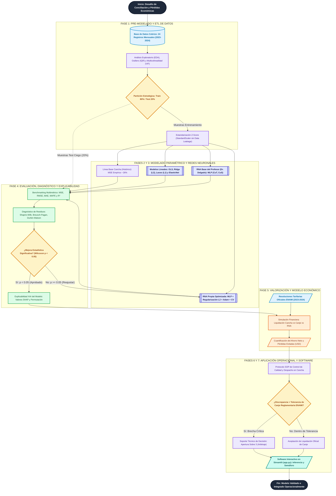
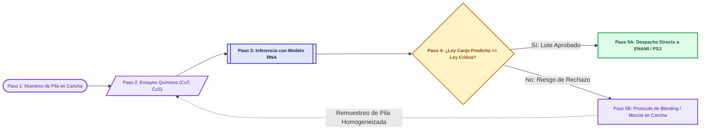

# METODOLOGÍA DE TRABAJO Y MARCO DE INVESTIGACIÓN APLICADA
## Predicción de la Ley Mineral de Venta Mediante Redes Neuronales Artificiales para Minimizar Pérdidas Económicas

**Trabajo de Titulación para optar al título de Ingeniero Civil en Minas**  
**Universidad de Antofagasta** — Facultad de Ingeniería, Departamento de Ingeniería en Minas  
* **Autor:** Felipe Andrés Guerra Maturana  
* **Profesor Guía:** Dr. José Delgado Vega (*Doctor en Geología, Especialista en Geoestadística y Explotaciones Minas, École des Mines de Paris*)  
* **Caso de Estudio:** Faena Mantos Cobrizo / ENAMI (Planta San José)  

---

## 🧭 Introducción y Enfoque Metodológico Global

La presente metodología articula de manera rigurosa la ingeniería de minas clásica, la metalurgia extractiva del cobre, la teoría de muestreo de Pierre Gy, la ciencia de datos y la inteligencia artificial supervisada. Su propósito central es cerrar la brecha de conciliación minera que afecta a la pequeña y mediana minería de Chile, reemplazando la incertidumbre del error empírico histórico entre la cancha de acopio y el poder de compra (**ENAMI** / **Planta San José**) por un sistema predictivo robusto, interpretable y con impacto económico cuantificable.

### Diagrama de Flujo Metodológico Integral



### Guía de Simbología y Código de Colores (Estándar Informático ANSI / ISO 5807)

| Símbolo Gráfico | Forma Mermaid | Significado Metodológico | Color Representativo |
| :---: | :---: | :--- | :--- |
| **Terminal** | `([ Texto ])` | Inicio y conclusión formal del flujo del sistema. | Grafito Oscuro (`#1E293B`) |
| **Almacén / Archivo** | `[( Texto )]` / `[/ Texto /]` | Base de datos maestra, datasets y documentos tarifarios ENAMI. | Azul Cielo (`#E0F2FE` / `#0284C7`) |
| **Proceso** | `[ Texto ]` | Operaciones deterministas, transformaciones ETL y cálculos matemáticos. | Lavanda (`#EDE9FE` / `#7C3AED`) |
| **Subrutina / Modelo** | `[[ Texto ]]` | Modelos de Machine Learning y Redes Neuronales Artificiales. | Índigo Técnico (`#E0E7FF` / `#4338CA`) |
| **Decisión / Validación** | `{ Texto }` | Ramificaciones condicionales, partición y contraste de hipótesis. | Ámbar Cálido (`#FEF3C7` / `#D97706`) |
| **Evaluación y XAI** | `[ Texto ]` | Diagnóstico de residuos, métricas de error y explicabilidad SHAP. | Verde Esmeralda (`#DCFCE7` / `#16A34A`) |
| **Económico / Financiero**| `[ Texto ]` | Liquidaciones monetarias, tarifas y cuantificación de ahorros. | Naranja Coral (`#FFEDD5` / `#EA580C`) |
| **Interfaz de Usuario** | `[/ Texto /]` | Frontend interactivo y herramientas visuales en Streamlit. | Verde Azulado / Teal (`#CCFBF1` / `#0D9488`) |

---

## 🔬 FASE 1: Pre-Modelado: Comprensión, Análisis Exploratorio (EDA) y Preprocesamiento

> [!IMPORTANT]
> Siguiendo el alcance delimitado en el informe de tesis, el espacio de características de entrada se restringe estrictamente a dos variables: **Cobre Total ($CuT$)** y **Cobre Soluble ($CuS$)** de cancha, siendo la variable objetivo la **Ley de Canje ($Canje\_CuT$)**.

### 1.1. Análisis Exploratorio y Estadístico Riguroso (EDA)
1. **Estadísticos Descriptivos Univariados:**
   * Cálculo de medidas de tendencia central: media aritmética ($\mu$), mediana ($\tilde{x}$) y media truncada.
   * Medidas de dispersión: varianza ($\sigma^2$), desviación estándar ($\sigma$), rango intercuartílico ($IQR$) y coeficiente de variación ($CV = \frac{\sigma}{\mu} \times 100$).
   * Medidas de forma: coeficiente de asimetría de Fisher (*skewness*) y coeficiente de curtosis.
2. **Evaluación de la Distribución de Probabilidad:**
   * Contraste de normalidad mediante el test de **Shapiro-Wilk** sobre $CuT$, $CuS$ y $Canje\_CuT$, evaluando el valor $p$ frente a un nivel de significancia $\alpha = 0.05$.
   * Inspección gráfica complementaria mediante histogramas de frecuencias, estimación de densidad por kernel (KDE) y gráficos de cuantiles teóricos (Q-Q Plots).
3. **Detección y Tratamiento de Valores Atípicos (*Outliers*):**
   * Detección univariada mediante la regla de Tukey: $[Q_1 - 1.5 \times IQR, \; Q_3 + 1.5 \times IQR]$.
   * Detección multivariada mediante la distancia de **Mahalanobis**:
     $$D_M(x) = \sqrt{(x - \mu)^T \Sigma^{-1} (x - \mu)}$$
     contrastada contra la distribución chi-cuadrado ($\chi^2_2$) para identificar observaciones anómalas sin sesgar la variabilidad geológica natural.

### 1.2. Análisis de Características (Feature Analysis) y Multicolinealidad
1. **Análisis de Asociación y Correlación:**
   * Correlación lineal de **Pearson** ($r$) para evaluar la fuerza de asociación lineal con la ley de canje.
   * Correlación de rangos de **Spearman** ($\rho$) para capturar relaciones monótonas no lineales.
   * Análisis del **Ratio de Solubilidad** metalúrgico:
     $$\text{Ratio Solubilidad} = \frac{CuS}{CuT}$$
     evaluando la proporción de especies oxidadas (lixiviables) frente a sulfuradas y su impacto en la dispersión hacia el canje.
2. **Diagnóstico de Multicolinealidad:**
   * Cálculo del Factor de Inflación de la Varianza (**VIF**) para descartar inestabilidad numérica en los coeficientes:
     $$\text{VIF}_j = \frac{1}{1 - R_j^2}$$
     verificando que $\text{VIF} < 5$ entre las variables de entrada seleccionadas.

### 1.3. Preprocesamiento y Normalización sin Fuga de Datos (*No Data Leakage*)
1. **Partición de Datos:**
   * División en conjunto de entrenamiento ($80\%$) y conjunto de prueba ciego ($20\%$) mediante partición controlada (`random_state=42`) o validación cruzada.
2. **Estandarización Z-Score:**
   * Las magnitudes de $CuT$ y $CuS$ presentan escalas de varianza distintas. Se aplica `StandardScaler`:
     $$z = \frac{x - \mu_{\text{train}}}{\sigma_{\text{train}}}$$
   * **Regla estricta:** La media $\mu_{\text{train}}$ y desviación $\sigma_{\text{train}}$ se calculan **únicamente** sobre el conjunto de entrenamiento (`fit_transform`) y se proyectan sobre el conjunto de prueba (`transform`), garantizando la pureza del test ciego.

---

## 📐 FASE 2: Modelado Paramétrico de Referencia (Línea Base Lineal y Regularizada)

> [!NOTE]
> Esta fase responde a la exigencia metodológica de la comisión evaluadora: demostrar cuantitativamente por qué una solución basada en redes neuronales es superior a las formulaciones lineales clásicas.

### 2.1. Línea Base Operacional Tradicional
* Representa el método empírico actual de la faena minera, donde se asume que la ley pagada en planta será igual a la estimada en cancha:
  $$\hat{y}_{\text{Base}, i} = CuT_{\text{Cancha}, i}$$
* Sobre esta base se calcula el Error Cuadrático Medio histórico de la faena:
  $$\text{MSE}_{\text{Histórico}} = \frac{1}{n} \sum_{i=1}^{n} \left( CuT_{\text{Cancha}, i} - Canje\_CuT_i \right)^2 \approx 26\% \text{ (MECM)}$$

### 2.2. Regresión Lineal Clásica por Mínimos Cuadrados Ordinarios (MCO / OLS)
* Ajuste del hiperplano de regresión:
  $$\hat{y} = \beta_0 + \beta_1 CuT + \beta_2 CuS$$
* Determinación del límite de capacidad explicativa de un modelo puramente lineal.

### 2.3. Regresiones Regularizadas: Ridge, Lasso y ElasticNet
Para mitigar la varianza en muestras acotadas ($N = 24$) y controlar el sobreajuste lineal, se implementan:

1. **Regresión Ridge (L2):**
   * Minimiza la suma de errores cuadráticos más una penalización proporcional al cuadrado de los coeficientes:
     $$\mathcal{L}_{\text{Ridge}} = \sum_{i=1}^n (y_i - \hat{y}_i)^2 + \lambda \sum_{j=1}^p \beta_j^2$$
   * Contrae suavemente los pesos hacia cero, reduciendo la sensibilidad ante fluctuaciones de muestreo.
2. **Regresión Lasso (L1):**
   * Aplica una penalización sobre el valor absoluto de los pesos:
     $$\mathcal{L}_{\text{Lasso}} = \sum_{i=1}^n (y_i - \hat{y}_i)^2 + \lambda \sum_{j=1}^p |\beta_j|$$
   * Actúa como selector automático de variables, evaluando si el modelo descarta o prioriza $CuS$ frente a $CuT$.
3. **Regresión ElasticNet:**
   * Combina penalizaciones L1 y L2 mediante un balance paramétrico $\alpha$ y $l_1\text{-ratio}$:
     $$\mathcal{L}_{\text{ElasticNet}} = \sum_{i=1}^n (y_i - \hat{y}_i)^2 + \alpha \cdot \rho \sum_{j=1}^p |\beta_j| + \frac{\alpha (1 - \rho)}{2} \sum_{j=1}^p \beta_j^2$$
* **Optimización:** Búsqueda del parámetro de regularización óptimo ($\lambda^*$) mediante `RidgeCV`, `LassoCV` y `ElasticNetCV`.

---

## 🧠 FASE 3: Modelado No Lineal con Redes Neuronales Artificiales (RNA)

### 3.1. Fundamentación Metalúrgica de la No Linealidad
De acuerdo con la **Teoría de Muestreo de Pierre Gy**, el error de estimación no se distribuye de manera lineal debido a:
* La **Heterogeneidad Constitucional ($CH$):** Diferencias de composición mineralógica entre partículas de óxidos y sulfuros.
* La **Heterogeneidad de Distribución ($DH$):** Fenómenos de segregación física y gravitacional durante el acopio en cancha, transporte en camiones y vaciado en tolva de recepción.
* Una Red Neuronal tipo Perceptrón Multicapa (**MLP**) actúa como aproximador universal de funciones, modelando estas no linealidades sin imponer supuestos rígidos de distribución.

### 3.2. Modelo de Referencia del Profesor (Dr. José Delgado Vega)
* **Arquitectura Base según Presentación Técnica:**
  * Entradas: 2 neuronas ($CuT$ y $CuS$).
  * Topología: Perceptrón Multicapa con una capa oculta de neuronas no lineales y una neurona de salida lineal.
  * Comportamiento documentado: Reducción del Módulo del Error Cuadrático Medio (MECM) de un 26% (cancha vs San José) a un **8.63%** (red vs San José).
  * Este modelo se reproduce como estándar de comparación metodológica directa.

### 3.3. Modelo Propio Optimizado
Desarrollo de una arquitectura avanzada en TensorFlow/Keras orientada a maximizar la generalización en conjuntos muestrales pequeños ($N = 24$):

```
       CAPA DE ENTRADA            CAPA OCULTA REGULARIZADA           CAPA DE SALIDA
     ┌─────────────────┐        ┌───────────────────────────┐      ┌─────────────────┐
     │  x₁: Cancha_CuT │ ────>  │  Neurona 1 (ReLU + L2)    │ ───> │                 │
     │                 │   ╳    │  Neurona 2 (ReLU + L2)    │ ───> │  ŷ: Canje_CuT   │
     │  x₂: Cancha_CuS │ ────>  │  Neurona 3 (ReLU + L2)    │ ───> │                 │
     └─────────────────┘        │  Neurona 4 (ReLU + L2)    │ ───> └─────────────────┘
                                └───────────────────────────┘
```

1. **Hiperparámetros de Diseño:**
   * **Capa de Entrada:** 2 dimensiones ($CuT$, $CuS$).
   * **Capa Oculta:** 4 unidades con función de activación ReLU ($\max(0, z)$) o LeakyReLU para evitar el problema de *Dying ReLU*.
   * **Inicialización de Pesos:** `he_uniform` o `glorot_uniform`, acordes a la función de activación para acelerar la convergencia.
   * **Regularización de Núcleo:** Regularización L2 de pesos ($\lambda = 0.01$) aplicada en las capas densas (`kernel_regularizer=regularizers.l2(0.01)`).
   * **Capa de Salida:** 1 neurona con activación `linear` para regresión continua.
2. **Compilación y Entrenamiento:**
   * **Función de Pérdida:** Error Cuadrático Medio (`loss='mean_squared_error'`).
   * **Optimizadores Evaluados:**
     * **Adam:** Adaptación de momentos de primer y segundo orden (`learning_rate=0.005`).
     * **RMSprop:** Tasa de aprendizaje adaptativa por gradiente cuadrático medio.
   * **Control de Batch:** Lotes pequeños (`batch_size=4` u `8`) para introducir gradientes estocásticos regulares que faciliten escapar de mínimos locales.
3. **Estrategia de Validación Cruzada Adaptada a Muestras Acotadas:**
   * **K-Fold Interno:** Validación cruzada de 3 a 5 pliegues sobre el conjunto de entrenamiento.
   * **Leave-One-Out Cross-Validation (LOOCV):** Evaluación muestra a muestra para medir la estabilidad estructural del modelo sin sesgo de partición.
   * **Reinicio de Semillas:** Control determinista con `tf.random.set_seed(42)` y `np.random.seed(42)` para garantizar trazabilidad científica total.

---

## 📊 FASE 4: Post-Modelado: Benchmarking, Diagnóstico de Residuos, Significancia y Explicabilidad (XAI)

### 4.1. Benchmarking de Modelos (Contraste Metodológico)
Comparativa cuantitativa cruzada entre los 5 modelos desarrollados mediante las siguientes métricas de desempeño:

$$\text{MSE} = \frac{1}{N} \sum_{i=1}^N (y_i - \hat{y}_i)^2, \quad \text{RMSE} = \sqrt{\text{MSE}}$$

$$\text{MAE} = \frac{1}{N} \sum_{i=1}^N |y_i - \hat{y}_i|, \quad \text{MAPE} = \frac{100\%}{N} \sum_{i=1}^N \left| \frac{y_i - \hat{y}_i}{y_i} \right|$$

$$R^2 = 1 - \frac{\sum_{i=1}^N (y_i - \hat{y}_i)^2}{\sum_{i=1}^N (y_i - \bar{y})^2}$$

* **Matriz de Benchmarking:**
  | Modelo | MSE | RMSE (% Cu) | MAE (% Cu) | MAPE (%) | $R^2$ |
  | :--- | :---: | :---: | :---: | :---: | :---: |
  | 1. Línea Base Cancha (Histórico) | — | — | — | ~26.0% | Base |
  | 2. Regresión Lineal OLS | — | — | — | — | — |
  | 3. Regresión Ridge / Lasso | — | — | — | — | — |
  | 4. RNA Profesor (Dr. Delgado) | — | — | — | ~8.6% | — |
  | 5. RNA Propia Optimizada (L2) | — | — | — | — | — |

### 4.2. Diagnóstico Riguroso de Residuos
Para validar que el modelo de RNA ha extraído toda la información determinista y que el residuo $e_i = (y_i - \hat{y}_i)$ corresponde a ruido blanco estocástico:
1. **Normalidad de Errores:** Test de Shapiro-Wilk sobre los residuos del modelo de RNA y gráfico Q-Q.
2. **Homocedasticidad:** Gráfico de Residuos vs Valores Ajustados ($\hat{y}$) y test de **Breusch-Pagan** para comprobar que la varianza del error es constante a lo largo de todo el rango de leyes.
3. **Autocorrelación Temporal (Durbin-Watson):**
   Dado que los datos son mensuales consecutivos (2023-2024), se calcula el estadístico $d$:
   $$d = \frac{\sum_{t=2}^N (e_t - e_{t-1})^2}{\sum_{t=1}^N e_t^2}$$
   verificando que $d \approx 2$ para garantizar que no existe dependencia residual serial entre meses consecutivos.

### 4.3. Prueba de Significancia Estadística de la Mejora
Para demostrar a la comisión que la reducción del error no es fruto de la casualidad estadística:
* Se formula una prueba de hipótesis pareada entre las desviaciones absolutas:
  $$D_i = |Canje\_CuT_i - CuT_{\text{Cancha}, i}| - |Canje\_CuT_i - \hat{y}_{\text{RNA}, i}|$$
* **Hipótesis Nula ($H_0$):** La mediana de las diferencias es menor o igual a cero (la red no mejora a la cancha).
* **Hipótesis Alternativa ($H_1$):** La mediana de las diferencias es significativamente mayor a cero (la red reduce el error real).
* **Método:** Test de rangos con signo de **Wilcoxon** (no paramétrico) o **t-Student pareado**, reportando el valor $p$ ($p < 0.05$).

### 4.4. Explicabilidad del Modelo (Explainable AI - XAI)
Para transformar la "caja negra" en un modelo auditable por la gerencia de mina y metalurgia:
1. **Valores SHAP (SHapley Additive exPlanations):**
   * Cálculo de las contribuciones marginales de Shapley mediante `shap.KernelExplainer` o `shap.DeepExplainer`.
   * **Beeswarm Plot & Summary Plot:** Visualización del impacto individual de $CuT$ y $CuS$ en la predicción final de cada lote.
2. **Importancia por Permutación (*Permutation Feature Importance*):**
   * Cuantificación del incremento en el MSE al permutar aleatoriamente cada variable de entrada, confirmando la sensibilidad relativa del modelo ante fluctuaciones de ley.

---

## 💰 FASE 5: Modelo Económico de Ahorro y Valorización Comercial

### 5.1. Marco Tarifario Oficial ENAMI (2023 - 2024)
Se implementa la estructura matemática exacta extraída de las resoluciones tarifarias oficiales de ENAMI archivadas en [MATERIAL_TESIS/Precio mx Enami 2023-2024](file:///c:/Users/fguer/Desktop/TESIS/MATERIAL_TESIS/Precio%20mx%20Enami%202023-2024):

$$\text{Valor Neto Liquidado (USD/Lote)} = \text{TMS} \times \left[ \text{VPP} - \text{Maquila} - \text{Cargos} \right] \pm \text{Castigos/Premios}$$

Donde:
* **$\text{TMS}$ (Toneladas Métricas Secas):**
  $$\text{TMS} = \text{TMH} \times \left(1 - \frac{\% \text{Humedad}}{100}\right)$$
* **$\text{VPP}$ (Valor Producto Pagable):**
  $$\text{VPP} = \text{Ley Pagable} \times \text{Precio Internacional Cobre (LME)} \times \text{Factor Conversión}$$
* **$\text{Ley Pagable (Deducción Metalúrgica)}:$**
  Calculada bajo la escala de deducción oficial de ENAMI (retención fija de unidades de ley o porcentaje de recuperación según rango):
  $$\text{Ley Pagable} = \max(0, \; \text{Ley Canje} - \text{Deducción Metalúrgica})$$
* **$\text{Maquila y Cargos de Tratamiento:}$** Tarifa fija por tonelada seca ($USD/\text{TMS}$) establecida en la resolución mensual de ENAMI.
* **$\text{Castigos por Impurezas / Acidez:}$** Penalizaciones aplicadas si se superan los umbrales de recepción.

### 5.2. Simulación Financiera Comparativa y Cuantificación de Pérdidas
Para cada uno de los 24 meses analizados, se simulan 3 estados financieros:
1. **Liquidación Proyectada por Cancha ($V_{\text{Cancha}}$):** El ingreso esperado por la mina al planificar con la ley de terreno.
2. **Liquidación Real Canje ($V_{\text{Real}}$):** El dinero efectivamente recibido tras la liquidación oficial de ENAMI / Planta San José.
3. **Liquidación Anticipada por RNA ($V_{\text{RNA}}$):** El ingreso estimado mediante el modelo predictivo antes del despacho.

* **Cuantificación de Beneficios Económicos:**
  * **Cálculo del Error Financiero Absoluto:**
    $$\Delta \text{Error Dinero}_{\text{Cancha}} = |V_{\text{Cancha}} - V_{\text{Real}}|$$
    $$\Delta \text{Error Dinero}_{\text{RNA}} = |V_{\text{RNA}} - V_{\text{Real}}|$$
  * **Ahorro Neto Cuantificable:**
    $$\text{Ahorro Total (USD)} = \sum_{k=1}^{24} \left( \Delta \text{Error Dinero}_{\text{Cancha}, k} - \Delta \text{Error Dinero}_{\text{RNA}, k} \right)$$
  * Determinación de las pérdidas evitadas por:
    * Prevención de despachos con leyes bajo la ley de corte operativa (*cut-off*).
    * Optimización de fletes y maquilas innecesarias sobre material estéril.
    * Estabilización del capital de trabajo y eliminación de desajustes en el flujo de caja proyectado.

---

## 🏭 FASE 6: Adopción Tecnológica, Gestión Operativa y Rol de ENAMI

### 6.1. Integración en la Operación Diaria de la Pequeña y Mediana Minería
* **Realidad de la Faena:** Los proyectos de pequeña minería carecen de departamentos de ciencia de datos y software especializado costoso.
* **Propuesta de Integración Ligera:**
  * El modelo opera en local o en la nube sobre plataformas gratuitas/abiertas (Python / Google Colab / Streamlit).
  * No requiere hardware de alto cómputo para la inferencia diaria (ejecución en segundos en cualquier computador de faena).

### 6.2. Procedimiento Operativo Estándar (SOP) de Despacho y Blending
Protocolo estandarizado de 5 pasos para el Jefe de Mina o Geólogo de Control de Calidad:



1. **Muestreo de Acopio:** Muestreo sistemático de la colpa chancada en cancha mediante incrementos representativos.
2. **Ensaye Rápido de Terreno:** Obtención de $CuT$ y $CuS$ por laboratorio químico de faena o fluorescencia portátil calibrada.
3. **Inferencia Algorítmica:** Ingreso de los valores al modelo predictivo.
4. **Toma de Decisión Operativa:**
   * Si la ley predicha $\hat{y}_{\text{RNA}} \ge \text{Ley Crítica ENAMI}$: Se autoriza el carguío de camiones para despacho directo.
   * Si la ley predicha $\hat{y}_{\text{RNA}} < \text{Ley Crítica ENAMI}$: Se activa protocolo de mezcla (*blending*) con pilas de mayor ley para evitar castigos o rechazos.
5. **Generación de Hoja de Ruta:** Despacho hacia el poder de compra con proyección financiera cerrada.

### 6.3. Relación Estratégica con ENAMI y Gestión del Protocolo de 3 Sobres
De acuerdo con el Reglamento de Compra de ENAMI, cada lote muestreado mecánicamente genera 3 sobres sellados:
1. *Sobre 1:* Laboratorio Oficial ENAMI.
2. *Sobre 2:* Productor Minero (Contraanálisis).
3. *Sobre 3:* Muestra Testigo / Dirimente (Bóveda de Arbitraje).

* **Rol de la Red Neuronal en el Protocolo:**
  * Al conocer con precisión matemática la ley real esperada en destino, el minero puede contrastar el resultado emitido por ENAMI (Sobre 1).
  * **Criterio de Arbitraje Racional:** Si la diferencia entre ENAMI y la predicción de la RNA supera la tolerancia de canje reglamentaria, el productor dispone de respaldo técnico-cuantitativo sólido para costear la apertura del Sobre 3 de dirimencia arbitral, protegiendo sus ingresos frente a errores de muestreo externos.

---

## 💻 FASE 7: Desarrollo de la Interfaz Gráfica de Usuario (Streamlit)

### 7.1. Arquitectura de la Aplicación (`app.py`)
La interfaz se diseña en **Streamlit**, framework ligero de Python que permite transformar el modelo de machine learning en una herramienta interactiva ejecutable tanto localmente como en la nube.

```
STREAMLIT WEB APP (app.py)
├── Barra Lateral (Sidebar):
│   ├── Selector de Faena (Mantos Cobrizo)
│   ├── Carga de Pesos del Modelo RNA (.h5 / .keras / .joblib)
│   └── Parámetros Económicos (Precio Cobre USD/lb, Mes Tarifario ENAMI)
├── Pestaña 1: Predicción Operativa de Canje
│   ├── Inputs interactivos: Cancha_CuT (%) y Cancha_CuS (%)
│   ├── Métricas en tiempo real: Ley Canje Predicha, Error Histórico vs RNA
│   └── Gráfico comparativo de dispersión
├── Pestaña 2: Simulador Financiero ENAMI
│   ├── Input: Toneladas Métricas Húmedas (TMH) y % Humedad
│   ├── Liquidación Proyectada: Valor Lote Cancha vs Valor Lote Predicho
│   └── Desglose de Maquila, Deducciones y Margen Neto Estimado
└── Pestaña 3: Semáforo y Asistente de Decisión
    ├── Alerta Verde: Lote apto para entrega comercial directa
    ├── Alerta Amarilla: Riesgo de castigo / Blending aconsejado
    └── Alerta Roja: Lote subeconómico / No despachar
```

### 7.2. Componentes Técnicos del Código de la Interfaz
* Carga del modelo previamente entrenado mediante `tf.keras.models.load_model` o serialización de pipeline `Joblib`.
* Reutilización del `StandardScaler` original para asegurar que la entrada del usuario reciba exactamente la misma transformación matemática que los datos de entrenamiento.
* Interfaz reactiva con visualizaciones en `Plotly` / `Matplotlib` para que el minero comprenda la predicción de manera intuitiva.

---

## 🎓 FASE 8: Síntesis Metodológica, Trazabilidad Académica y Trabajo Futuro

### 8.1. Matriz de Correspondencia con el Informe de Título
Esta metodología alimenta directamente cada capítulo del documento formal [INFORME_TESIS.docx](file:///c:/Users/fguer/Desktop/TESIS/INFORME_TESIS.docx):

| Capítulo del Informe | Fases Metodológicas Asociadas | Entregable Concreto |
| :--- | :--- | :--- |
| **Capítulo 1: Introducción y Planteamiento** | Introducción Global & Fase 6 | Formulación del problema operativo, objetivos y alcance de la faena Mantos Cobrizo. |
| **Capítulo 2: Revisión Bibliográfica & Marco Teórico** | Fase 2, Fase 3 & Fase 5 | Fundamento de Gy, tarifas ENAMI, formulación matemática de MLP, Ridge, Lasso y métricas. |
| **Capítulo 3: Materiales y Métodos** | Fase 1, Fase 2, Fase 3 & Fase 7 | Flujo EDA, normalización sin fuga de datos, topología de la RNA y diseño de la app en Streamlit. |
| **Capítulo 4: Resultados Obtenidos** | Fase 4 & Fase 5 | Tablas de Benchmarking, reducción de MSE (26% vs 8.6%), gráficos SHAP y simulaciones monetarias. |
| **Capítulo 5: Discusión** | Fase 4, Fase 5 & Fase 6 | Interpretación de residuos, significancia estadística (Wilcoxon) y viabilidad frente al protocolo ENAMI. |
| **Capítulo 6: Conclusiones y Recomendaciones** | Fase 8 | Deducciones finales, impacto económico demostrado y lineamientos de escalamiento operacional. |

### 8.2. Limitaciones del Estudio
1. **Especificidad Geológica Local:** El modelo se encuentra ajustado a la mineralogía y características físicas de la faena Mantos Cobrizo.
2. **Conjunto Muestral Discreto:** La base de datos comprende 24 registros mensuales históricos. Aunque se aplican regularizadores L2 y validación cruzada para mitigar el sobreajuste, la precisión se incrementará a medida que la faena alimente la red con nuevos despachos.

### 8.3. Líneas de Investigación Futura
1. **Ampliación Multielemental:** Incorporar a futuro el impacto de impurezas penalizables por ENAMI (Arsénico, Antimonio, Cloro) y consumo de ácido sulfúrico en pruebas de agitación.
2. **Transfer Learning hacia Otros Yacimientos:** Evaluar la transferencia del conocimiento del modelo hacia faenas análogas de la región, como los datos preliminares de la Mina Tigresa disponibles en el repositorio.
