# METODOLOGÍA DE TRABAJO Y LÍNEA TEMPORAL DE INVESTIGACIÓN APLICADA

## Predicción de la Ley Mineral de Venta Mediante Redes Neuronales Artificiales para Minimizar Pérdidas Económicas

**Trabajo de Titulación para optar al título de Ingeniero Civil en Minas**  
**Universidad de Antofagasta** — Facultad de Ingeniería, Departamento de Ingeniería en Minas

* **Autor:** Felipe Andrés Guerra Maturana
* **Profesor Guía:** Dr. José Delgado Vega (*Doctor en Geología, Especialista en Geoestadística y Explotaciones Mineras, École des Mines de Paris*)
* **Caso de Estudio:** Faena Mantos Cobrizo (Distrito Minero Los Cóndores) / ENAMI (Planta San José)
* **Versión Metodológica:** 4.0 (Línea Temporal Estricta sin Dependencias Circulares, Alineada al Estándar Académico UA y Optimizada para Ejecución Modular en Antigravity)

---

## 1. Diagnóstico del Orden Metodológico y Correcciones Estructurales (v3.0 a v4.0)

Para garantizar rigor científico ante la comisión evaluadora y evitar errores de secuencia en el flujo de Ciencia de Datos, esta versión corrige **cinco desórdenes lógicos** detectados en la versión anterior y adopta el estándar estructural aprobado en memorias recientes del Departamento de Ingeniería en Minas de la Universidad de Antofagasta (referencia institucional: Manríquez, 2025), superando sus limitaciones técnicas en régimen de muestra acotada ($N = 24$):

| Desorden Detectado en v3.0 | Por Qué Es Metodológicamente Incorrecto | Corrección Aplicada en v4.0 (Línea Temporal) |
| :--- | :--- | :--- |
| **1. Elegir y evaluar métricas de validación en el Bloque 0** | No se puede validar ni seleccionar el criterio de desempeño predictivo de un modelo antes de comprender estadísticamente los datos y antes de entrenar los algoritmos. | El **Bloque 0** se limita estrictamente a **Ingeniería de Datos (ETL), limpieza, homologación y entorno computacional**. La brecha histórica ($\text{MECM} \approx 26\%$) se documenta solo como diagnóstico del problema real; las métricas de validación predictiva se aplican de forma unificada en el **Bloque 4**, después de entrenar todos los modelos. |
| **2. Estadísticos descriptivos divididos entre Bloque 0 y Bloque 1** | La desviación estándar, varianza y covarianza quedaron en el Bloque 0, mientras que el CV, asimetría, normalidad, correlaciones y VIF quedaron en el Bloque 1. | Todo el análisis estadístico del dataset limpio se consolida en una sola fase cronológica: **Bloque 1 (EDA, Complejidad Estadística y Selección de Características)**. |
| **3. Evaluar modelos en Bloque 2, entrenar otros en Bloque 3 y volver a hacer Benchmarking en Bloque 4** | Duplicaba el análisis de errores en tres bloques distintos y mezclaba la fase de *entrenamiento* con la fase de *validación y selección del modelo ganador*. | Se separan estrictamente las etapas: **Bloque 2** entrena modelos de referencia (*Baselines*) y exporta predicciones ciegas; **Bloque 3** entrena arquitecturas RNA y exporta predicciones ciegas; **Bloque 4** reúne todas las predicciones ciegas, aplica las métricas de validación, diagnostica residuos, ejecuta pruebas de hipótesis y selecciona el modelo ganador. |
| **4. Falta de documentación de entorno y arquitectura de software** | El estándar UA exige documentar hardware, versiones de software/librerías, arquitectura por capas del dashboard y serialización (`.joblib` + `.csv`). | Se incorporan la **ficha de entorno computacional** en el Bloque 0 y la **arquitectura por capas** (Datos $\to$ Preprocesamiento $\to$ ML `.joblib` $\to$ UX/UI Streamlit/Plotly) en el Bloque 6. |
| **5. Cifra desactualizada de tonelaje de romana (`295,884.67 t`)** | La suma exacta de los 24 registros actualizados de `Romana_Ton` en la tabla auditada es $295{,}960.67\text{ t}$. | Se estandariza el uso de la suma exacta calculada dinámicamente desde `DATASET_AUDITADO_N24.csv` en los Bloques 0 y 5, sin cifras escritas a mano. |

> **Diferenciación técnica frente a la referencia institucional (Manríquez, 2025):** Mientras el estudio de flotas contaba con miles de ciclos y evaluaba métricas *in-sample* (produciendo $R^2 = 1.00$ en árboles de decisión), la presente tesis opera sobre $N = 24$ balances mensuales consolidados y blinda la validez científica mediante **evaluación estrictamente fuera de muestra (*out-of-sample*) vía LOOCV anidado sin fuga de datos**, arquitecturas parsimoniosas ($9$ a $20$ parámetros) y pruebas formales de significancia estadística.

---

## 2. Línea Temporal de Ejecución por Bloques (Flujo Causa $\to$ Efecto)

Cada bloque recibe insumos certificados del bloque anterior y entrega artefactos concretos para el siguiente. Ningún bloque adelanta decisiones que correspondan a una etapa posterior.

```mermaid
flowchart TD
    classDef terminal fill:#1E293B,stroke:#0F172A,stroke-width:2.5px,color:#FFFFFF,font-size:13px,font-weight:bold;
    classDef etl fill:#E0F2FE,stroke:#0284C7,stroke-width:2px,color:#0369A1,font-size:12px,font-weight:bold;
    classDef eda fill:#EDE9FE,stroke:#7C3AED,stroke-width:2px,color:#4C1D95,font-size:12px;
    classDef train fill:#E0E7FF,stroke:#4338CA,stroke-width:2px,color:#1E1B4B,font-size:12px,font-weight:bold;
    classDef eval fill:#DCFCE7,stroke:#16A34A,stroke-width:2px,color:#14532D,font-size:12px,font-weight:bold;
    classDef finance fill:#FFEDD5,stroke:#EA580C,stroke-width:2px,color:#7C2D12,font-size:12px,font-weight:bold;
    classDef deploy fill:#CCFBF1,stroke:#0D9488,stroke-width:2.5px,color:#115E59,font-size:12px,font-weight:bold;

    START(["INICIO: Problema de Conciliacion Cancha vs. ENAMI"]):::terminal

    B0["BLOQUE 0: Ingenieria de Datos (ETL), Limpieza y Entorno<br/>- Auditoria Excel (N=24), %Cu (2 dec), Romana_Ton<br/>- Extraccion 24 Circulares ENAMI Sulfuros (2023-2024)<br/>- Ficha de Hardware, Python y Librerias"]:::etl

    B1["BLOQUE 1: EDA, Diagnostico de Complejidad y Caracteristicas<br/>- Dispersion (Media, s, s2, CV%), Normalidad (Shapiro-Wilk)<br/>- Outliers (Tukey + Mahalanobis con Covarianza)<br/>- Correlaciones (Pearson/Spearman/MI), VIF y ACF<br/>=> Dictamen: 2 entradas (CuT, CuS), Z-score, LOOCV, modelos no lineales"]:::eda

    B2["BLOQUE 2: Diseno Experimental y Entrenamiento de Baselines<br/>- Definicion de Pipeline LOOCV (Zero Leakage) y Loss MSE<br/>- Cuantificacion Linea Base Operacional (Cancha directa, MECM~26%)<br/>- Entrenamiento: OLS, Ridge, Lasso, ElasticNet y SVR (RBF)<br/>=> Salida: Vector de 24 predicciones ciegas + Hiperparametros"]:::train

    B3["BLOQUE 3: Diseno y Entrenamiento de Redes Neuronales (RNA)<br/>- Replica MLP Dr. Delgado bajo mismo LOOCV<br/>- Grilla MLP parsimoniosa: (2,), (3,), (4,), (2,2), (3,2)<br/>- Optimizador L-BFGS + Regularizacion L2 interna + Multisimilla<br/>- Verificacion sensibilidad Buffered-LOOCV<br/>=> Salida: Vector de 24 predicciones ciegas + Log de entrenamientos"]:::train

    B4["BLOQUE 4: Validacion Unificada, Residuos, Significancia y XAI<br/>- Seleccion y calculo unificado de metricas sobre los 24 OOS:<br/>  R2, Varianza Explicada, MSE, RMSE, MAE, MAPE, NRMSE, Bias<br/>- Eleccion del Modelo Ganador (Champion Model)<br/>- Residuos (Shapiro, Breusch-Pagan, Durbin-Watson) + Wilcoxon<br/>- Reentrenamiento final N=24, Superficie 2D, SHAP y export .joblib"]:::eval

    B5["BLOQUE 5: Valorizacion Comercial ENAMI y Modelo Economico Dual<br/>- Cruce Predicciones OOS Ganadoras x 24 Tarifas ENAMI x Romana_Ton<br/>- Nivel 1: Reduccion desviacion presupuestaria (USD)<br/>- Nivel 2: Ahorro real de caja (Cut-off, Falsos Fletes, Blending, Sobre 2)"]:::finance

    B6["BLOQUE 6: Transferencia Operativa, Streamlit y Memoria Final<br/>- SOP de Cancha y Protocolo Reglamentario 3 Sobres ENAMI<br/>- Dashboard Interactivo Streamlit (3 capas, carga .joblib + Plotly)<br/>- Integracion final de tablas, graficos y codigo en INFORME_TESIS.docx"]:::deploy

    END_NODE(["FIN: Tesis Completa, Auditada y Transferible a Faena"]):::terminal

    START --> B0 --> B1 --> B2 --> B3 --> B4 --> B5 --> B6 --> END_NODE
```

---

## 3. Tablero de Control, Contratos de Entrada/Salida y Estado de Avance

| Bloque | Etapa en la Línea Temporal | Insumo de Entrada | Salida Principal (Contrato) | Estado Actual |
| :---: | :--- | :--- | :--- | :---: |
| **Bloque 0** | **ETL, Auditoría de Fuentes y Entorno** | `Data Cobrizo.xlsx` + 24 PDFs ENAMI | `DATASET_AUDITADO_N24.csv/.xlsx` `TARIFAS_ENAMI_CONSOLIDADAS_2023_2024.csv/.xlsx` | **COMPLETADO** *(Requiere ajuste menor de reordenamiento y suma `Romana_Ton`)* |
| **Bloque 1** | **EDA, Complejidad y Selección de Entradas** | `DATASET_AUDITADO_N24.csv` | `TABLA_ESTADISTICOS_EDA_N24.csv/.xlsx` `MATRIZ_COVARIANZA_Y_CORRELACION.csv/.xlsx` `TABLA_MAHALANOBIS_OUTLIERS.csv/.xlsx` `TABLA_VIF.csv/.xlsx` | **COMPLETADO** *(Consolidar aquí varianza/covarianza de B0)* |
| **Bloque 2** | **Protocolo LOOCV y Entrenamiento Baselines** | `DATASET_AUDITADO_N24.csv` + Dictamen B1 | `PREDICCIONES_OOS_BASELINES.csv` `LOG_HIPERPARAMETROS_BASELINES.csv` | **PRÓXIMO PASO OPERATIVO** |
| **Bloque 3** | **Entrenamiento de Arquitecturas RNA (MLP)** | `DATASET_AUDITADO_N24.csv` + Protocolo B2 | `PREDICCIONES_OOS_RNA.csv` `LOG_HIPERPARAMETROS_RNA.csv` `SENSIBILIDAD_BUFFERED_LOOCV.csv` | **PLANIFICADO** |
| **Bloque 4** | **Validación Unificada, Selección de Modelo y XAI** | `PREDICCIONES_OOS_BASELINES.csv` + `PREDICCIONES_OOS_RNA.csv` | `TABLA_BENCHMARKING_FINAL.csv/.xlsx` `DIAGNOSTICO_RESIDUOS_WILCOXON.csv` `modelo_ganador_mantos_cobrizo.joblib` + XAI | **PLANIFICADO** |
| **Bloque 5** | **Simulación Económica Dual ENAMI (USD)** | Predicciones OOS Ganadoras (B4) + Tarifas ENAMI (B0) | `SIMULACION_ECONOMICA_DUAL_USD.csv/.xlsx` Análisis de escenarios y sensibilidad | **PLANIFICADO** |
| **Bloque 6** | **SOP, Dashboard Streamlit y Memoria Final** | `modelo_ganador_mantos_cobrizo.joblib` (B4) + Tarifas (B0) + Resultados (B0–B5) | `app.py` (Streamlit + Plotly) SOP 3 Sobres ENAMI `INFORME_TESIS.docx` actualizado | **PLANIFICADO** |

---

## 4. Especificación Detallada Bloque por Bloque

### BLOQUE 0: Ingeniería de Datos (ETL), Auditoría de Fuentes y Entorno Computacional
> **Carpeta:** `./BLOQUE_0/` | **Cuaderno:** `00_auditoria_datos.ipynb`  
> **Propósito exclusivo:** Preparar, limpiar, validar y estructurar las fuentes de datos crudas sin adelantar inferencia ni validación de modelos.

1. **Especificación del Entorno de Desarrollo (Estándar UA):**
   * Documentar tabla de hardware (CPU, RAM, SO) y software utilizado (Python, `pandas`, `numpy`, `scipy`, `statsmodels`, `scikit-learn`, `shap`, `plotly`, `streamlit`, `joblib`, `pypdf`), garantizando reproducibilidad total.
2. **Ingesta, Limpieza y Homologación de `Data Cobrizo.xlsx`:**
   * Extracción de los $N = 24$ balances mensuales continuos (Enero 2023 a Diciembre 2024).
   * Verificación de nulos ($0$ faltantes), duplicados ($0$ registros repetidos) y tipos numéricos.
   * Homologación dimensional: conversión de leyes desde fracción decimal a **puntos porcentuales ($\%\text{Cu}$)** con formato uniforme de $2$ decimales.
   * Auditoría del balance de especies ($\text{CuT} = \text{CuS} + \text{CuIn}$): registrar discrepancia por redondeo ($0.01\%\text{Cu}$ en Cancha; $0.20\%\text{Cu}$ en Canje) y certificar que `Canje_CuT` corresponde al ensayo oficial directo.
   * Incorporación de tonelaje estimado en acopio (`Cancha_Ton` = $286{,}704\text{ t}$) y tonelaje oficial pesado en báscula puente (`Romana_Ton`, calculando su suma dinámicamente desde el dataframe: $295{,}960.67\text{ t}$).
3. **Extracción y Certificación de Tarifas ENAMI Sulfuros (2023–2024):**
   * Parseo de las $24$ circulares oficiales PDF (`Precio_Cu_cUSD_lb`, `Tipo_Cambio_CLP_USD`, `Flot_Base_USD_tms` al $2.5\%\text{Cu}$, `Flot_Escala_USD_tms_1pct`, `Flot_Fondo_Estab`, `Subprod_Cu_Insol`).
   * Documentación de la ecuación comercial neta de sulfuros ENAMI (sin duplicar descuento de maquila) y verificación visual obligatoria del escaneo `ABRIL 2023.pdf` antes de su uso en el Bloque 5.
4. **Diagnóstico Preliminar de la Brecha Operacional (Contexto del Problema):**
   * Gráfico cronológico de `Cancha_CuT` vs. `PSJ_CuT` vs. `Canje_CuT` y discrepancia mensual ($e_{\text{emp}} = \text{Cancha\_CuT} - \text{Canje\_CuT}$), confirmando sobreestimación positiva en los $24$ meses ($+0.3404\%\text{Cu}$ promedio). *(Nota: Las métricas formales de evaluación predictiva se consolidan en los Bloques 2 y 4).*

---

### BLOQUE 1: Análisis Exploratorio (EDA), Diagnóstico de Complejidad y Selección de Características
> **Carpeta:** `./BLOQUE_1/` | **Cuaderno:** `01_eda_caracteristicas.ipynb`  
> **Propósito exclusivo:** Comprender la distribución, dispersión, atípicos, dependencia temporal y colinealidad de los datos limpios para **tomar decisiones justificadas de diseño** antes de modelar.

1. **Estadísticos Descriptivos Univariados y Complejidad por Variación (CV):**
   * Cálculo integral (consolidando aquí media $\mu$, mediana $\tilde{x}$, media truncada, desviación estándar muestral $s$ y poblacional $\sigma$, varianza $s^2$ y $\sigma^2$, $\text{IQR}$, asimetría, curtosis y **Coeficiente de Variación** $\text{CV} = \frac{s}{\mu} \times 100\%$).
   * **Hallazgo clave de escala:** $\text{Cancha\_CuT}$ ($s^2 = 0.0581\,(\%\text{Cu})^2$, $\text{CV} = 13.6\%$) posee una varianza $61.6$ veces superior a $\text{Cancha\_CuS}$ ($s^2 = 0.00094\,(\%\text{Cu})^2$, $\text{CV} = 20.9\%$) $\implies$ **Justifica el escalado Z-score obligatorio** en los Bloques 2 y 3.
2. **Evaluación de Normalidad (Shapiro-Wilk, $\alpha = 0.05$):**
   * Rechazo de normalidad en `Cancha_CuT` ($p = 0.0116$), `Cancha_CuS` ($p = 0.00003$) y `Canje_CuT` ($p = 0.0078$) por asimetría positiva geológica $\implies$ **Justifica explorar aproximadores no paramétricos y no lineales (MLP/SVR)** frente a supuestos gaussianos clásicos.
3. **Estructura de Covarianza y Detección de Atípicos (*Outliers*):**
   * Cálculo de la **Matriz de Covarianza Muestral** ($\Sigma$, en $(\%\text{Cu})^2$) entre leyes y sesgo.
   * Detección univariada (Tukey) y multivariada mediante **Distancia de Mahalanobis** ($D_M(x)$ frente a $\chi^2_{2, 0.95} = 5.9915$): identifica **Octubre 2023** ($D_M = 3.7747, p = 0.0008$) y **Noviembre 2023** ($D_M = 2.9103, p = 0.0145$).
   * **Decisión geológica:** Se retienen íntegros los $N = 24$ lotes (son frentes reales liquidados por ENAMI), lo que exige **regularización $L_2$** en el modelado para controlar su efecto de apalancamiento (*leverage*).
4. **Análisis de Características y Dependencia No Lineal:**
   * Comparación entre correlación de **Pearson ($r$)**, **Spearman ($\rho$)** e **Información Mutua ($\text{MI}$)**, más evaluación diagnóstica del Ratio de Solubilidad ($\text{CuS}/\text{CuT}$).
   * Evidencia de apalancamiento en Pearson ($r = 0.8347$ con $N = 24$ vs. $r = 0.6181$ al excluir los 2 pulsos extremos, por debajo de Spearman $\rho = 0.6253$), demostrando vulnerabilidad de la regresión lineal clásica.
5. **Auditoría de Multicolinealidad (VIF con Intercepto):**
   * Contraste con `sm.add_constant(X)` reportando únicamente los predictores: $[\text{CuT}_{\text{cancha}}, \text{CuS}_{\text{cancha}}]$ obtiene $\text{VIF} = 1.8045 < 5.0$; al incorporar $\text{CuIn}$ el VIF explota por sobre $4{,}000$ $\implies$ **Blinda el espacio de entrada en exactamente 2 predictores**.
6. **Dependencia Serial (ACF) y Validación del Esquema de Partición:**
   * El sesgo empírico se comporta como ruido blanco ($r_1 = -0.0866$, dentro de bandas de Bartlett $\pm 0.4001$) $\implies$ **Valida el uso de LOOCV** como protocolo principal, mientras que la inercia moderada en `Cancha_CuT` ($r_1 = +0.4467$) motiva incorporar una verificación complementaria mediante *Buffered-LOOCV* en los Bloques 2 y 3.

---

### BLOQUE 2: Diseño Experimental, Protocolo LOOCV y Entrenamiento de Modelos de Referencia (*Baselines*)
> **Carpeta:** `./BLOQUE_2/` | **Cuaderno:** `02_baselines_loocv.ipynb`  
> **Propósito exclusivo:** Establecer el protocolo único de entrenamiento sin fuga de datos, fijar la línea base histórica operacional y entrenar todos los modelos de contraste (lineales y kernel), exportando sus predicciones ciegas y bitácoras de hiperparámetros.

1. **Definición Formal del Protocolo Experimental (Pre-Entrenamiento):**
   * **Esquema externo:** *Leave-One-Out Cross-Validation* (**LOOCV**, $24$ pliegues: $23$ meses entrenamiento / $1$ mes prueba ciego), generando $24$ predicciones *out-of-sample* en orden cronológico exacto.
   * **Cero fuga de datos (*Zero Data Leakage*):** Encapsulamiento obligatorio mediante `sklearn.pipeline.Pipeline([('scaler', StandardScaler()), ('model', ...)])` ajustado exclusivamente dentro de los $23$ datos de entrenamiento de cada pliegue (y en paralelo prueba de sensibilidad con `RobustScaler`).
   * **Función objetivo de entrenamiento (*Loss Function*):** Minimización del Error Cuadrático Medio ($\text{MSE}$) durante el ajuste interno de parámetros (diferenciable y sensible a desvíos extremos).
   * **Optimización interna de hiperparámetros:** Búsqueda mediante validación cruzada interna (*Nested CV*, K-Fold $K = 5$ dentro de los $23$ datos de entrenamiento), evitando cualquier ajuste sobre la muestra de prueba.
2. **Fijación de la Línea Base Operacional (Sin Modelo):**
   * Predictor empírico actual de faena: $\hat{y}_{\text{Cancha}, i} = \text{CuT}_{\text{cancha}, i}$.
   * Reconciliación algebraica con la cifra de referencia del profesor guía ($\text{MECM} = 26\% \equiv \text{NRMSE} = 25.67\%$ en Canje y $25.98\%$ en PSJ; descomposición $\text{MSE} = \bar{e}^2 + \sigma^2_{\text{error}} = 0.1159 + 0.0191 = 0.1350\,(\%\text{Cu})^2$, donde el $85.83\%$ es sesgo sistemático).
3. **Entrenamiento de Modelos de Referencia (*Baselines*):**
   * **Regresión Lineal Múltiple (MCO / OLS):** $\hat{y} = \beta_0 + \beta_1 \text{CuT} + \beta_2 \text{CuS}$.
   * **Regresión Ridge ($L_2$):** Optimización interna de $\alpha \in \{10^{-3}, \dots, 10^2\}$.
   * **Regresión Lasso ($L_1$):** Optimización interna de $\alpha$ (audita si mantiene o anula $\text{CuS}$).
   * **Regresión ElasticNet ($L_1 + L_2$):** Optimización conjunta de $\alpha$ y $\text{l1\_ratio}$.
   * **SVR (Kernel RBF):** Benchmark no lineal basado en vectores de soporte optimizando $C$, $\epsilon$ y $\gamma$ mediante `GridSearchCV` interno.
4. **Entregables de Salida del Bloque 2:**
   * `PREDICCIONES_OOS_BASELINES.csv/.xlsx` (matriz de $24$ filas cronológicas con las predicciones ciegas de cada baseline).
   * `LOG_HIPERPARAMETROS_BASELINES.csv/.xlsx` (coeficientes $\beta$, hiperparámetros óptimos seleccionados por pliegue y número de iteraciones/entrenamientos ejecutados).

---

### BLOQUE 3: Diseño, Optimización y Entrenamiento de Redes Neuronales Artificiales (RNA)
> **Carpeta:** `./BLOQUE_3/` | **Cuaderno:** `03_modelado_rna_loocv.ipynb`  
> **Propósito exclusivo:** Entrenar la réplica de referencia del profesor guía y explorar sistemáticamente una grilla parsimoniosa de arquitecturas MLP bajo el mismo protocolo LOOCV anidado del Bloque 2.

1. **Fundamento Geometalúrgico de la No Linealidad:**
   * Basado en la Teoría de Muestreo de Pierre Gy (interacción entre heterogeneidad constitucional de óxidos/sulfuros y heterogeneidad de distribución en acopios).
2. **Modelos Neuronales a Entrenar:**
   * **RNA Referencia (Dr. José Delgado Vega):** Réplica fiel de la topología base con entradas $(\text{CuT}_{\text{cancha}}, \text{CuS}_{\text{cancha}})$ y salida $\text{Canje\_CuT}$, evaluada bajo el mismo esquema LOOCV ciego.
   * **Grilla Parsimoniosa de Arquitecturas MLP (`hidden_layer_sizes`):**

| Topología | Capas Ocultas | Parámetros Libres ($w$ y $b$) | Relación vs. $N_{\text{train}} = 23$ | Objetivo Experimental |
| :---: | :---: | :---: | :---: | :--- |
| `(2,)` | 1 | $9$ | $9 < 23$ (Holgura alta) | Máxima parsimonia; mínima varianza. |
| `(3,)` | 1 | $13$ | $13 < 23$ (Balanceado) | Equilibrio entre curvatura no lineal y grados de libertad. |
| `(4,)` | 1 | $17$ | $17 < 23$ (Ajustado) | Límite superior para 1 capa oculta en $N = 24$. |
| `(2, 2)` | 2 | $15$ | $15 < 23$ (Balanceado) | Evaluación de profundidad controlada (2 capas compactas). |
| `(3, 2)` | 2 | $20$ | $20 < 23$ (Frontera) | Medición empírica del inicio del sobreajuste (*trade-off* sesgo-varianza). |

3. **Configuración de Optimización y Control de Varianza:**
   * **Optimizador principal:** `MLPRegressor(solver='lbfgs')` (cuasi-Newton determinista de segundo orden, óptimo para $N < 1000$).
   * **Activación:** Contraste controlado entre `relu` y `tanh`.
   * **Regularización $L_2$ (*Weight Decay*):** Grilla $\alpha \in \{0.001, 0.01, 0.05, 0.1, 0.5\}$ seleccionada exclusivamente por CV interna ($K = 5$).
   * **Estabilidad de inicialización:** Promediado/ensamble sobre múltiples semillas aleatorias fijas (por ejemplo, $10$ semillas por pliegue) para eliminar dependencia de una inicialización particular.
4. **Verificaciones Secundarias de Robustez (Sin Contaminar LOOCV):**
   * **Validación Temporal Prospectiva (*Holdout* cronológico):** Primeros $19$ meses entrenamiento $\to$ últimos $5$ meses prueba futura.
   * **Sensibilidad *Buffered-LOOCV*:** Exclusión de los meses contiguos $(t-1, t+1)$ para verificar que la autocorrelación de `Cancha_CuT` ($r_1 = +0.4467$) no infla el rendimiento predictivo.
5. **Entregables de Salida del Bloque 3:**
   * `PREDICCIONES_OOS_RNA.csv/.xlsx` (vector de $24$ predicciones ciegas por cada topología y réplica).
   * `LOG_HIPERPARAMETROS_RNA.csv/.xlsx` (hiperparámetros óptimos, activaciones, semillas, número de entrenamientos y convergencia).
   * `SENSIBILIDAD_TEMPORAL_Y_BUFFERED.csv/.xlsx`.

---

### BLOQUE 4: Validación Unificada, Selección del Modelo Ganador, Diagnóstico de Residuos y Explicabilidad (XAI)
> **Carpeta:** `./BLOQUE_4/` | **Cuaderno:** `04_validacion_residuos_xai.ipynb`  
> **Propósito exclusivo:** **Solo ahora, con todos los modelos entrenados**, cargar los vectores de predicciones ciegas (*out-of-sample*) de los Bloques 2 y 3, aplicar la batería completa de métricas de error, seleccionar científicamente el modelo ganador, auditar sus residuos, demostrar significancia estadística y abrir la "caja negra" mediante XAI.

1. **Batería Unificada de Métricas de Validación (Sobre $N = 24$ Predicciones Ciegas):**
   * **Escala física ($\%\text{Cu}$):** $\text{RMSE}$, $\text{MAE}$, Sesgo Medio ($\bar{e}$) y Desviación Estándar de Residuos ($\sigma_e$).
   * **Escala cuadrática ($(\%\text{Cu})^2$):** $\text{MSE}$ y Varianza de los Errores ($\sigma_e^2$), verificando la reducción tanto del sesgo al cuadrado ($\bar{e}^2$) como de la varianza residual.
   * **Escala relativa ($\%$):** $\text{NRMSE}$ (comparable directamente con el $\text{MECM} = 26\%$ y $8.63\%$) y $\text{MAPE}$.
   * **Capacidad explicativa (adimensional):** Coeficiente de Determinación ($R^2$) y **Varianza Explicada** (`explained_variance_score`, siguiendo el estándar de métricas de la Universidad de Antofagasta).
2. **Tabla Maestra de *Benchmarking* y Selección del Modelo Ganador (*Champion Model*):**
   * Contraste único e imparcial entre: Línea Base Cancha, OLS, Ridge, Lasso, ElasticNet, SVR (RBF), RNA Referencia Dr. Delgado y las $5$ topologías de la grilla MLP.
   * Selección formal del modelo ganador priorizando el menor $\text{RMSE}_{\text{LOOCV}}$ ($\text{MSE}_{\text{LOOCV}}$), mayor parsimonia y estabilidad frente a *outliers*.
3. **Diagnóstico Riguroso de Residuos del Modelo Ganador ($e_i = y_i - \hat{y}_i$, $N = 24$ cronológicos):**
   * **Insesgamiento:** Verificación de $\bar{e} \approx 0$.
   * **Normalidad:** Test de Shapiro-Wilk y gráfico Q-Q sobre los $24$ residuos ciegos.
   * **Homocedasticidad:** Gráfico *Residuos vs. Predichos* y test de Breusch-Pagan.
   * **Independencia temporal:** Estadístico de Durbin-Watson ($d \approx 2$).
4. **Prueba de Significancia Estadística Pareada:**
   * Test unilateral no paramétrico de **Wilcoxon** ($\alpha = 0.05$) sobre las diferencias de error cuadrático $D_i = (y_i - \hat{y}_{\text{Cancha}, i})^2 - (y_i - \hat{y}_{\text{Ganador}, i})^2$ (y contraste adicional contra el mejor modelo lineal OLS/Ridge), complementado con intervalo de confianza *bootstrap* ($B = 10{,}000$) de la reducción porcentual del $\text{MSE}$.
5. **Explicabilidad (XAI) y Serialización del Pipeline Final:**
   * Reentrenamiento definitivo de la arquitectura e hiperparámetros ganadores sobre el conjunto completo $N = 24$ encapsulado en un `Pipeline` (`StandardScaler` + `MLP`).
   * **Superficie de Respuesta 2D (Mapa de Contorno):** Carta operativa $(\text{CuT}_{\text{cancha}}, \text{CuS}_{\text{cancha}}) \to \widehat{\text{Canje\_CuT}}$ con los $24$ lotes superpuestos.
   * **Valores SHAP Exactos (`shap.KernelExplainer`):** Impacto marginal en $\%\text{Cu}$ por lote (*Summary* y *Waterfall Plots*).
   * **Importancia por Permutación:** Cuantificación del aporte real de la neurona $\text{CuS}_{\text{cancha}}$.
   * **Exportación de producción:** `modelo_ganador_mantos_cobrizo.joblib` + `metricas_validadas_champion.csv` listos para el Bloque 6.

---

### BLOQUE 5: Valorización Comercial ENAMI y Modelo Económico Dual
> **Carpeta:** `./BLOQUE_5/` | **Cuaderno:** `05_modelo_economico_enami.ipynb`  
> **Propósito exclusivo:** Traducir el desempeño validado del modelo ganador (predicciones ciegas del Bloque 4) a impacto financiero real en dólares ($\text{USD}$) utilizando las $24$ circulares oficiales de ENAMI Sulfuros (Bloque 0) y el tonelaje exacto de báscula puente (`Romana_Ton`).

1. **Verificación de Insumos Comerciales:**
   * Confirmación visual previa de los valores del escaneo `ABRIL 2023.pdf` y cálculo dinámico sobre los $24$ meses con `Romana_Ton` ($295{,}960.67\text{ t}$).
   * Ecuación de liquidación unitaria de sulfuros ENAMI:
     $$\text{Tarifa Unitaria (US\$/tms)} = \text{Tarifa Base}_{2.5\%} - \text{Escala}_{1\%} \times (2.5 - \text{Ley}) - \text{Cargos Reglamentarios}$$
     $$\text{Valor Lote (USD)} = \text{TMS} \times \text{Tarifa Unitaria (US\$/tms)}$$
2. **Evaluación Financiera Dual (Sin Confundir Error de Proyección con Caja):**
   * **Nivel 1 — Reducción de la Desviación Presupuestaria (USD):**
     $$\Delta \text{Desviación Presupuestaria (USD)} = \sum_{k=1}^{24} \left( |V_{\text{Cancha}, k} - V_{\text{Real}, k}| - |V_{\text{RNA}, k} - V_{\text{Real}, k}| \right)$$
     Cuantifica la estabilización del flujo de caja proyectado y la reducción del riesgo de capital de trabajo.
   * **Nivel 2 — Ahorro Operacional Real de Caja mediante Simulación Contrafactual (USD):**
     1. **Falsos Fletes y Maquilas Evitadas:** Lotes donde $\text{CuT}_{\text{cancha}} \ge \text{Ley de Corte Económica}$ (se despacharían con pérdida neta), pero donde la RNA advierte $\hat{y}_{\text{RNA}} < \text{Ley de Corte}$, reteniendo el material para mezcla.
     2. **Optimización de *Blending* Preventivo:** Simulación de mezclas en cancha para sostener los despachos sobre la ley mínima comercial.
     3. **Ahorro en Contraanálisis de Laboratorio (Sobre 2):** Cuantificación de ahorros directos en ensayes químicos externos cuando el Sobre 1 de ENAMI cae dentro de la banda predictiva de la RNA ($\hat{y}_{\text{RNA}} \pm \text{RMSE}_{\text{LOOCV}}$).
   * **Análisis de Sensibilidad:** Evaluación bajo distintos escenarios de precio del cobre LME, costos de flete y leyes de corte operativas.

---

### BLOQUE 6: Transferencia Operativa (SOP + Prototipo Streamlit) y Redacción Final de la Memoria
> **Carpeta:** `./BLOQUE_6/` | **Entregables:** `app.py`, SOP Operacional y `./INFORME_TESIS.docx`  
> **Propósito exclusivo:** Empaquetar el conocimiento en una herramienta usable en faena (siguiendo la arquitectura modular de software del estándar UA) e integrar todos los entregables auditados en el informe oficial de titulación.

1. **Procedimiento Operativo Estándar (SOP) y Protocolo de 3 Sobres ENAMI:**
   * Flujo operacional de $5$ pasos (Muestreo $\to$ Ensaye `CuT`/`CuS` $\to$ Inferencia RNA $\to$ Decisión Despacho/*Blending* $\to$ Control de Liquidación).
   * Posicionamiento reglamentario exacto: la RNA actúa como **gatillador económico del Sobre 2** (contraanálisis certificado del productor), el cual constituye el único respaldo legal para solicitar la apertura del **Sobre 3 (Arbitraje)**.
2. **Arquitectura Modular de la Herramienta Interactiva (`app.py` en Streamlit + Plotly):**
   * **Capa 1 — Datos y Validación:** Carga del histórico auditado (`.csv`) y parámetros tarifarios ENAMI.
   * **Capa 2 — Motor Predictivo (`.joblib`):** Consumo directo de `modelo_ganador_mantos_cobrizo.joblib` y `metricas_validadas_champion.csv` (cero reentrenamiento innecesario en inferencia diaria, escalado idéntico al de entrenamiento).
   * **Capa 3 — Presentación UX/UI en 3 Pestañas:**
     * *Pestaña 1 — Visualización Histórica y EDA:* Evolución Cancha vs. Canje, matriz de correlaciones interactiva y variabilidad ($\text{CV}\%$) en Plotly.
     * *Pestaña 2 — Predicción Operativa de Ley de Canje:* Ingreso de `Cancha_CuT` y `Cancha_CuS`, predicción $\widehat{\text{Canje\_CuT}} \pm \text{RMSE}_{\text{LOOCV}}$, ubicación del lote en la **Superficie de Respuesta 2D** y descomposición SHAP.
     * *Pestaña 3 — Simulador Financiero ENAMI y Semáforo Operativo:* Cálculo de liquidación proyectada (`TMH`, `%Humedad` $\to$ `TMS`), margen neto, semáforo de despacho (Verde / Amarillo / Rojo) y asistente de decisión para Sobre 2.
3. **Integración Documental con la Memoria Oficial (`./INFORME_TESIS.docx`):**

| Capítulo de la Memoria (Formato UA) | Bloques que lo Alimentan | Contenido Principal Sincronizado |
| :--- | :---: | :--- |
| **Capítulo 1: Introducción** | B0 y B6 | Problemática de conciliación, objetivos, alcances actualizados (incluyendo SOP y `app.py`) y limitaciones. |
| **Capítulo 2: Marco Teórico y Revisión Bibliográfica** | B0, B1, B3 y B5 | Comercialización y tarifas ENAMI Sulfuros, Teoría de Gy, MLP, regularización $L_1/L_2$, validación cruzada y XAI. |
| **Capítulo 3: Materiales y Métodos** | B0, B1, B2, B3 y B6 | Hardware/software, protocolo ETL, EDA, protocolo LOOCV sin fuga, grilla de arquitecturas y arquitectura de `app.py`. |
| **Capítulo 4: Resultados** | B1, B4 y B5 | Hallazgos de EDA, tabla comparativa unificada de modelos, residuos, Wilcoxon, Superficie 2D, SHAP y modelo económico dual. |
| **Capítulo 5: Discusión** | B1, B4, B5 y B6 | Análisis geometalúrgico de no linealidad y *outliers*, validez en $N = 24$, sensibilidad *Buffered-LOOCV* y protocolo ENAMI. |
| **Capítulo 6: Conclusiones y Trabajo Futuro** | B0 a B6 | Cumplimiento de objetivos, impacto económico demostrado y trabajo futuro (*Transfer Learning* a Mina Tigresa). |
| **Anexos** | B0 a B6 | Código limpio de `app.py`, capturas de pantallas del dashboard, tablas completas y circulares tarifarias. |

---

## 5. Instrucciones Directas de Ejecución y Reordenamiento para `Antigravity`

Para alinear el repositorio local (`./BLOQUE_0/` a `./BLOQUE_6/`) con esta **Versión 4.0** sin perder el trabajo ya validado, ejecutar en el siguiente orden exacto:

1. **Ajuste rápido de cierre en `BLOQUE_0` y `BLOQUE_1` (sin rehacer cálculos ya certificados):**
   * En `BLOQUE_0/INFORME_ENTREGABLE_BLOQUE_0.md`:
     * Corregir la suma de `Romana_Ton` usando el cálculo dinámico exacto ($295{,}960.67\text{ t}$) y eliminar referencias a archivos temporales de auditoría en el índice.
     * Dejar constancia de que el bloque documenta la **brecha histórica operacional** como línea base del problema, y que las tablas de dispersión/covarianza alimentan el diagnóstico del Bloque 1, mientras que las **métricas formales de validación predictiva** se ejecutarán de forma unificada en el Bloque 4.
   * En `BLOQUE_1/INFORME_ENTREGABLE_BLOQUE_1.md`:
     * Integrar la matriz de covarianza muestral y el contraste de varianzas ($s^2_{\text{CuT}} / s^2_{\text{CuS}} = 61.6\times$) dentro del resumen de EDA, y eliminar la fila `Constante (VIF = 1.0000)` de la tabla de VIF (manteniendo `sm.add_constant` en el código).
2. **Ejecución inmediata del `BLOQUE_2` (`./BLOQUE_2/02_baselines_loocv.ipynb`):**
   * Programar la función maestra `run_loocv_pipeline()` con `StandardScaler` interno (cero fuga de datos).
   * Entrenar Línea Base Cancha, OLS, Ridge, Lasso, ElasticNet y SVR (RBF).
   * **Contrato obligatorio de salida:** Exportar `PREDICCIONES_OOS_BASELINES.csv` (columnas: `Fecha`, `Canje_CuT`, `Pred_Cancha`, `Pred_OLS`, `Pred_Ridge`, `Pred_Lasso`, `Pred_ElasticNet`, `Pred_SVR`) y `LOG_HIPERPARAMETROS_BASELINES.csv`.
3. **Ejecución secuencial del `BLOQUE_3` (`./BLOQUE_3/03_modelado_rna_loocv.ipynb`):**
   * Entrenar la réplica del Dr. Delgado y la grilla MLP `(2,)`, `(3,)`, `(4,)`, `(2,2)`, `(3,2)` bajo exactamente la misma función maestra LOOCV + validación temporal ($19/5$) + verificación *Buffered-LOOCV*.
   * **Contrato obligatorio de salida:** Exportar `PREDICCIONES_OOS_RNA.csv` y `LOG_HIPERPARAMETROS_RNA.csv`.
4. **Ejecución unificada del `BLOQUE_4` (`./BLOQUE_4/04_validacion_residuos_xai.ipynb`):**
   * Leer ambos archivos de predicciones ciegas (`PREDICCIONES_OOS_BASELINES.csv` + `PREDICCIONES_OOS_RNA.csv`), calcular **en un único lugar** toda la batería de validación ($R^2$, Varianza Explicada, $\text{MSE}$, $\text{RMSE}$, $\text{MAE}$, $\text{MAPE}$, $\text{NRMSE}$, $\bar{e}$, $\sigma_e^2$), elegir el modelo ganador, ejecutar diagnóstico de residuos, test de Wilcoxon, Superficie 2D, SHAP, Permutación y exportar `modelo_ganador_mantos_cobrizo.joblib`.
5. **Ejecución de `BLOQUE_5` y `BLOQUE_6`:**
   * Bloque 5 consume `PREDICCIONES_OOS` del modelo ganador (Bloque 4) + `TARIFAS_ENAMI_CONSOLIDADAS_2023_2024.csv` (Bloque 0, tras confirmar visualmente `ABRIL 2023.pdf`).
   * Bloque 6 construye `app.py` cargando el `.joblib` del Bloque 4 y consolida todo en `INFORME_TESIS.docx`.