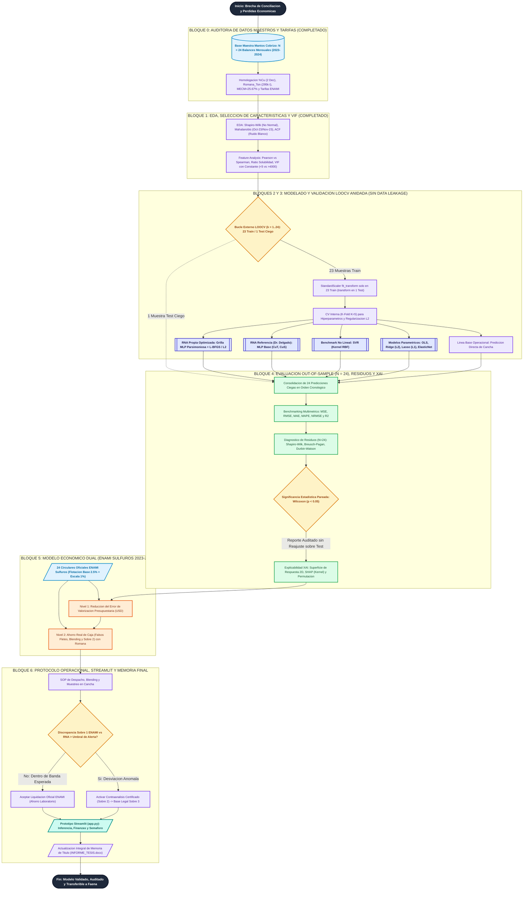

# METODOLOGÍA DE TRABAJO Y MARCO DE INVESTIGACIÓN APLICADA
## Predicción de la Ley Mineral de Venta Mediante Redes Neuronales Artificiales para Minimizar Pérdidas Económicas

**Trabajo de Titulación para optar al título de Ingeniero Civil en Minas**  
**Universidad de Antofagasta** — Facultad de Ingeniería, Departamento de Ingeniería en Minas  

* **Autor:** Felipe Andrés Guerra Maturana  
* **Profesor Guía:** Dr. José Delgado Vega (*Doctor en Geología, Especialista en Geoestadística y Explotaciones Mineras, École des Mines de Paris*)  
* **Caso de Estudio:** Faena Mantos Cobrizo (Distrito Minero Los Cóndores) / ENAMI (Planta San José)  
* **Versión Metodológica:** 3.0 (Estructura Modular por Bloques Autónomos, Auditada con Hallazgos Empíricos $N = 24$, Protocolo LOOCV sin Fuga de Datos y Valorización Comercial ENAMI)  

---

## 📊 Tablero de Control y Estado de Avance por Bloques

El desarrollo de la tesis se ejecuta mediante una arquitectura modular estricta de **bloques independientes** (`BLOQUE_0/` a `BLOQUE_6/`). Cada bloque contiene su propio cuaderno Jupyter pre-ejecutado con salidas renderizadas (`.ipynb`), datasets tabulares limpios (`.csv` y `.xlsx`), figuras de publicación a 200 DPI (`.png`) y su respectivo informe técnico de certificación (`INFORME_ENTREGABLE_BLOQUE_X.md`).

| Bloque | Denominación del Módulo | Carpeta | Entregables Clave | Estado Metodológico |
| :---: | :--- | :---: | :--- | :---: |
| **Bloque 0** | **Auditoría de Datos Maestros y Tarifas ENAMI** | [`./BLOQUE_0/`](../BLOQUE_0/) | `00_auditoria_datos.ipynb` `DATASET_AUDITADO_N24.csv/.xlsx` `TARIFAS_ENAMI_CONSOLIDADAS_2023_2024.csv/.xlsx` `INFORME_ENTREGABLE_BLOQUE_0.md` | **COMPLETADO Y SELLADO** *(Auditoría Técnica v2.1)* |
| **Bloque 1** | **Análisis Exploratorio (EDA) y Selección de Características** | [`./BLOQUE_1/`](../BLOQUE_1/) | `01_eda_caracteristicas.ipynb` `TABLA_ESTADISTICOS_EDA_N24.csv/.xlsx` `TABLA_MAHALANOBIS_OUTLIERS.csv/.xlsx` `TABLA_CORRELACIONES_Y_VIF.csv/.xlsx` `INFORME_ENTREGABLE_BLOQUE_1.md` | **COMPLETADO Y SELLADO** *(Normalidad rechazada, LOOCV validado por ACF, VIF blindado)* |
| **Bloque 2** | **Modelos de Referencia (*Baselines* bajo LOOCV)** | [`./BLOQUE_2/`](../BLOQUE_2/) | `02_baselines_loocv.ipynb` Línea Base Histórica, MCO/OLS, Ridge, Lasso, ElasticNet, SVR (RBF) `INFORME_ENTREGABLE_BLOQUE_2.md` | **EN DESARROLLO** *(Próximo paso operativo)* |
| **Bloque 3** | **Redes Neuronales Artificiales (RNA bajo LOOCV)** | [`./BLOQUE_3/`](../BLOQUE_3/) | `03_modelado_rna_loocv.ipynb` Réplica Dr. Delgado + Grilla MLP compacta `(2,)` a `(3,2)` con $L_2$ y L-BFGS `INFORME_ENTREGABLE_BLOQUE_3.md` | **PLANIFICADO** |
| **Bloque 4** | **Post-Modelado: Residuos, Wilcoxon y XAI** | [`./BLOQUE_4/`](../BLOQUE_4/) | `04_diagnostico_xai.ipynb` 24 predicciones ciegas, test de Wilcoxon ($p < 0.05$), Superficie 2D, SHAP `INFORME_ENTREGABLE_BLOQUE_4.md` | **PLANIFICADO** |
| **Bloque 5** | **Modelo Económico Dual y Simulación ENAMI** | [`./BLOQUE_5/`](../BLOQUE_5/) | `05_modelo_economico_enami.ipynb` Nivel 1 (Brecha Presupuestaria USD) y Nivel 2 (Ahorro Caja Real en $295{,}884\text{ t}$) `INFORME_ENTREGABLE_BLOQUE_5.md` | **PLANIFICADO** |
| **Bloque 6** | **Despliegue Operativo, SOP, Streamlit y Memoria Final** | [`./BLOQUE_6/`](../BLOQUE_6/) | `app.py` (Streamlit) SOP 3 Sobres ENAMI Actualización integral de `./INFORME_TESIS.docx` | **PLANIFICADO** |

---

## 1. Introducción y Enfoque Metodológico Global

La presente metodología articula de manera rigurosa la ingeniería de minas clásica, la metalurgia extractiva del cobre, la teoría de muestreo de Pierre Gy, la ciencia de datos y el aprendizaje automático supervisado. Su propósito central es cerrar la brecha de conciliación minera que afecta a la pequeña y mediana minería de Chile, reemplazando la incertidumbre del error empírico histórico entre la cancha de acopio y el poder de compra (**ENAMI** / **Planta San José**) por un sistema predictivo parsimonioso, estadísticamente validado, interpretable y con impacto económico cuantificable.

### 1.1. Diagrama de Flujo Metodológico Integral por Bloques

> **Principio Metodológico de Cero Fuga de Información (*Zero Data Leakage*):** Toda selección de arquitectura, escalado Z-score, optimización de hiperparámetros y regularización ocurre estrictamente dentro de los $23$ datos de entrenamiento de cada iteración LOOCV. La muestra de prueba de cada mes se mantiene completamente ciega hasta el momento de inferencia.

---

## 2. BLOQUE 0: Auditoría de Datos Maestros, Unidades y Parámetros Base
> **Estado:** ✅ **COMPLETADO, AUDITADO Y SELLADO**  
> **Carpeta:** [`./BLOQUE_0/`](../BLOQUE_0/) | **Entregable Principal:** [`00_auditoria_datos.ipynb`](../BLOQUE_0/00_auditoria_datos.ipynb)

Antes de cualquier modelado estadístico, se estableció una base de datos certificada, auditable y libre de ambigüedades dimensionales o de formato:

1. **Homologación Dimensional y Formato de Decimales:**
   * Todas las leyes de cobre extraídas de `Data Cobrizo.xlsx` ($N = 24$ balances mensuales, 2023–2024) fueron estandarizadas formalmente en **puntos porcentuales ($\%\text{Cu}$)** con un formato uniforme y estricto de **exactamente dos decimales (`0.00`)**, preservando los ceros a la derecha (`1.80`, `1.10`, `0.20`, `1.70`).
   * Se incorporó el tonelaje certificado de báscula puente (`Romana_Ton`, totalizando $295{,}884.67\text{ t}$) junto al tonelaje estimado en acopio (`Cancha_Ton`, totalizando $286{,}704\text{ t}$).
   * Esto garantiza consistencia dimensional en todo el proyecto: $\text{MSE}$ en $(\%\text{Cu})^2$, $\text{RMSE}$ y $\text{MAE}$ en $\%\text{Cu}$, y $\text{NRMSE/MAPE}$ en porcentaje relativo ($\%$).

2. **Reconciliación Matemática de la Métrica de Referencia ("MECM = 26%"):**
   * Se demostró algebraicamente que el error del $26\%$ reportado en la presentación del Dr. José Delgado corresponde unívocamente al **NRMSE** (*Normalized Root Mean Square Error*, $25.98\% \approx 26.0\%$ en PSJ y $25.67\% \approx 26.0\%$ en Canje) o al **MAPE** ($25.05\%$ y $24.90\%$).
   * Se fijaron los indicadores de la línea base histórica en Canje Oficial:
     $$\text{MSE}_{\text{Hist}} = 0.1350\,(\%\text{Cu})^2, \quad \text{RMSE}_{\text{Hist}} = 0.3674\%\text{Cu}, \quad \text{MAE}_{\text{Hist}} = 0.3404\%\text{Cu}$$
     $$\text{Sesgo Sistemático Cancha} = +0.3404\%\text{Cu} \quad (\text{Sobreestimación en los 24 meses}), \quad R^2_{\text{Hist}} = -1.2709$$

3. **Consolidación Tarifaria Oficial ENAMI (Sulfuros 2023–2024):**
   * Se procesaron y estructuraron las $24$ circulares mensuales oficiales de la Gerencia Comercial de ENAMI para **Minerales de Concentración (Sulfuros)**, consolidando el precio internacional del cobre LME ($\text{¢US\$/lb}$), tipo de cambio observado ($\text{\$/US\$}$), tarifa base de flotación a $2.5\%\text{Cu}$ ($\text{US\$/tms}$), escala por $1\%\text{Cu}$ y fondo de estabilización:
     $$\text{Tarifa Unitaria (US\$/tms)} = \text{Tarifa Base}_{2.5\%} - \text{Escala}_{1\%} \times (2.5 - \text{Ley}_{\text{Canje}}) - \text{Cargos Reglamentarios}$$
     $$\text{Valor Lote (USD)} = \text{TMS} \times \text{Tarifa Unitaria (US\$/tms)}$$

---

## 3. BLOQUE 1: Análisis Exploratorio (EDA), Selección de Características y Multicolinealidad
> **Estado:** ✅ **COMPLETADO, AUDITADO Y SELLADO**  
> **Carpeta:** [`./BLOQUE_1/`](../BLOQUE_1/) | **Entregable Principal:** [`01_eda_caracteristicas.ipynb`](../BLOQUE_1/01_eda_caracteristicas.ipynb)

> **Restricción de Alcance:** La matriz de entrada del modelo predictivo se limita estrictamente a **2 variables predictoras**: Cobre Total en cancha ($\text{CuT}_{\text{cancha}}$) y Cobre Soluble en cancha ($\text{CuS}_{\text{cancha}}$). La variable objetivo es la Ley de Canje oficial ($\text{Canje\_CuT}$).

### 3.1. Hallazgos del Análisis Exploratorio y Estadístico Riguroso
1. **Estadísticos Descriptivos Univariados ($N = 24$):**
   * $\text{Cancha\_CuT}$: Media $1.772\%\text{Cu}$, Mediana $1.735\%\text{Cu}$, Media Truncada al $10\%$ $1.748\%\text{Cu}$, Desv. Est. $0.241\%\text{Cu}$, $\text{CV} = 13.6\%$, Asimetría $+1.268$, Curtosis $+1.443$.
   * $\text{Cancha\_CuS}$: Media $0.147\%\text{Cu}$, Mediana $0.140\%\text{Cu}$, Desv. Est. $0.031\%\text{Cu}$, $\text{CV} = 20.9\%$, Asimetría $+2.277$, Curtosis $+5.862$.
   * $\text{Canje\_CuT}$: Media $1.431\%\text{Cu}$, Mediana $1.395\%\text{Cu}$, Desv. Est. $0.249\%\text{Cu}$, $\text{CV} = 17.4\%$, Asimetría $+1.541$, Curtosis $+3.554$.
2. **Evaluación de Normalidad (Shapiro-Wilk, $\alpha = 0.05$):**
   * $\text{Cancha\_CuT}$ ($W = 0.8871, p = 0.0116 < 0.05$), $\text{Cancha\_CuS}$ ($W = 0.7472, p = 0.00003 < 0.05$) y $\text{Canje\_CuT}$ ($W = 0.8787, p = 0.0078 < 0.05$) **rechazan formalmente la normalidad**.
   * *Fundamento geotécnico:* Las leyes naturales exhiben colas asimétricas positivas propias de enriquecimiento hidrotermal y supergeno, invalidando supuestos gaussianos lineales y justificando el uso de aproximadores no lineales no paramétricos (**Redes Neuronales**).
3. **Detección y Justificación de Atípicos (*Outliers*):**
   * Detección multivariada mediante Distancia de **Mahalanobis** ($D_M(x)$ frente a $\chi^2_{2, 0.95} = 5.9915$): Se detectaron dos meses anómalos:
     * **Octubre 2023:** $D_M = 3.7747, D_M^2 = 14.2481, p = 0.0008$ ($\text{CuT} = 2.21\%, \text{CuS} = 0.26\%$). Pulso de alta solubilidad (crisocola/malaquita).
     * **Noviembre 2023:** $D_M = 2.9103, D_M^2 = 8.4700, p = 0.0145$ ($\text{CuT} = 2.47\%, \text{CuS} = 0.20\%$). Explotación de frente competente rico en calcocina/bornita.
   * *Decisión de Ingeniería:* **NO se eliminan arbitrariamente**. Representan frentes geológicos reales validados por ENAMI (Nov-23 liquidó a $2.27\%\text{Cu}$). Se retienen para obligar a que la red neuronal aprenda a regularizar sobre frentes de alta ley mediante decaimiento de pesos ($L_2$).
4. **Autocorrelación Serial Temporal (ACF) y Validación de LOOCV:**
   * La función de autocorrelación sobre el sesgo empírico ($e_{\text{emp}} = \text{CuT}_{\text{cancha}} - \text{Canje\_CuT}$) arrojó un rezago de orden 1 de $r_1 = -0.0866$, contenido dentro de la banda de ruido blanco de Bartlett al $95\%$ ($\pm 0.4001$).
   * *Conclusión metodológica:* El sesgo de acopio carece de memoria serial. Queda **plenamente justificado el protocolo LOOCV** ($24$ pliegues ciegos independientes) sin riesgo de sesgo temporal.
5. **Dependencia No Lineal y Ratio de Solubilidad:**
   * Brecha entre correlación de Pearson y Spearman ($\Delta = 0.1231$ en CuT; $\Delta = 0.1382$ en CuS) e Información Mutua positiva ($\text{MI} = 0.2156$).
   * El Ratio de Solubilidad ($\text{Sol}\% = \frac{\text{CuS}}{\text{CuT}} \times 100$, promedio $8.39\%$) no aporta información adicional y se descarta como tercer predictor para mantener la parsimonia.
6. **Auditoría de Multicolinealidad (VIF con Intercepto):**
   * Espacio propuesto $[\text{CuT}_{\text{cancha}}, \text{CuS}_{\text{cancha}}]$ con constante (`sm.add_constant`): $\text{VIF} = 1.8045 < 5.0$ (**Colinealidad baja, óptima**).
   * Modelo con Cobre Insoluble ($\text{CuIn}$): $\text{VIF}_{\text{CuT}} = 4{,}754.0$ y $\text{VIF}_{\text{CuIn}} = 4{,}004.1$ (tiende a $\infty$).
   * *Blindaje metodológico:* La identidad de balance $\text{CuT} = \text{CuS} + \text{CuIn}$ genera colinealidad exacta. Se **excluye categóricamente $\text{CuIn}$**, ratificando la matriz en exactamente $2$ predictores.

---

## 4. BLOQUE 2: Modelado Paramétrico y No Lineal de Referencia (*Baselines* bajo LOOCV)
> **Estado:** 🔄 **EN DESARROLLO / PRÓXIMO PASO OPERATIVO**  
> **Carpeta:** [`./BLOQUE_2/`](../BLOQUE_2/) | **Entregable Principal:** `02_baselines_loocv.ipynb`

Todos los modelos de contraste se evaluarán bajo exactamente los mismos $24$ pliegues externos de validación cruzada dejando uno fuera (**LOOCV**), aplicando escalado Z-score (`StandardScaler`) ajustado **exclusivamente en los 23 meses de entrenamiento de cada pliegue** (*Zero Data Leakage*).

### 4.1. Modelos a Implementar y Evaluar
1. **Línea Base Operacional Tradicional (Cancha):**
   $$\hat{y}_{\text{Base}, i} = \text{CuT}_{\text{cancha}, i}$$
2. **Regresión Lineal Clásica (MCO / OLS):**
   $$\hat{y} = \beta_0 + \beta_1 \text{CuT}_{\text{cancha}} + \beta_2 \text{CuS}_{\text{cancha}}$$
   Cuantifica la ganancia obtenida exclusivamente por corregir el sesgo sistemático lineal.
3. **Regresiones Lineales Regularizadas (Ridge, Lasso, ElasticNet):**
   * **Ridge ($L_2$):** $\mathcal{L} = \sum (y - \hat{y})^2 + \lambda \sum \beta_j^2$.
   * **Lasso ($L_1$):** $\mathcal{L} = \sum (y - \hat{y})^2 + \lambda \sum |\beta_j|$.
   * **ElasticNet ($L_1 + L_2$):** Combinación convexa de penalizaciones.
   * *Regla de ejecución:* La optimización del hiperparámetro de penalización ($\lambda^*$) se efectúa estrictamente mediante validación cruzada interna (`RidgeCV`, `LassoCV`, `ElasticNetCV`) dentro de los $23$ datos de entrenamiento de cada pliegue.
4. **Benchmark No Lineal para Muestras Pequeñas: SVR (Kernel RBF):**
   * Máquina de Soporte Vectorial para regresión con kernel gaussiano radial, como rival no lineal directo de la red neuronal en régimen acotado ($N = 24$).

### 4.2. Criterios de Aprobación para Avanzar a Bloque 3
* Implementación de la función maestra `loocv_evaluate(model, X, y)` sin fuga de datos.
* Consolidación de tabla de métricas fuera de muestra ($\text{MSE}$, $\text{RMSE}$, $\text{MAE}$, $\text{MAPE}$, $\text{NRMSE}$, $R^2$).
* Exportación de tablas en CSV/XLSX, figuras a 200 DPI y el informe técnico `BLOQUE_2/INFORME_ENTREGABLE_BLOQUE_2.md`.

---

## 5. BLOQUE 3: Modelado No Lineal con Redes Neuronales Artificiales (RNA bajo LOOCV)
> **Estado:** 📋 **PLANIFICADO**  
> **Carpeta:** [`./BLOQUE_3/`](../BLOQUE_3/) | **Entregable Principal:** `03_modelado_rna_loocv.ipynb`

### 5.1. Fundamentación Metalúrgica de la No Linealidad (Pierre Gy)
De acuerdo con la **Teoría de Muestreo de Pierre Gy**, la discrepancia cancha-canje presenta no linealidad debido a la interacción entre la **Heterogeneidad Constitucional** (proporción variable de óxidos friables y sulfuros competentes) y la **Heterogeneidad de Distribución** (segregación gravitacional de finos durante carguío y acopio). El Perceptrón Multicapa (**MLP**) modela esta superficie compleja sin supuestos rígidos.

### 5.2. Modelos Neuronales a Comparar
1. **Modelo de Referencia del Dr. José Delgado Vega:**
   * Reproducción fiel de la topología base del profesor guía con entradas $(\text{CuT}, \text{CuS})$ y salida $\text{Canje\_CuT}$, evaluada bajo el mismo esquema LOOCV para contrastar el error porcentual reportado ($26\%$ vs. $8.63\%$).
2. **Grilla de Arquitecturas Parsimoniosas Propias:**
   * En respeto al principio de parsimonia frente a $N_{\text{train}} = 23$:

| Topología (`hidden_layer_sizes`) | Capas Ocultas | Parámetros Libres ($w$ y $b$) | Propósito Experimental |
| :---: | :---: | :---: | :--- |
| `(2,)` | 1 | $9$ | Máxima parsimonia ($9 < 23$); varianza mínima. |
| `(3,)` | 1 | $13$ | Equilibrio capacidad no lineal / grados de libertad. |
| `(4,)` | 1 | $17$ | Límite superior para 1 capa oculta en $N_{\text{train}} = 23$. |
| `(2, 2)` | 2 | $15$ | Profundidad compacta (2 capas de 2 neuronas). |
| `(3, 2)` | 2 | $20$ | Evaluación de frontera de sobreajuste. |

### 5.3. Especificaciones de Optimización para $N = 24$
* **Motor Principal:** `scikit-learn` — `MLPRegressor` con solver determinista cuasi-Newton `lbfgs`, superior a métodos estocásticos por mini-lotes en muestras pequeñas ($N < 1000$).
* **Regularización $L_2$ (*Weight Decay*):** Grilla $\alpha \in \{0.001, 0.01, 0.05, 0.1, 0.5\}$ seleccionada por CV interna (K-Fold $K = 5$).
* **Estabilidad:** Promediado sobre múltiples semillas aleatorias fijas para eliminar varianza de inicialización.

---

## 6. BLOQUE 4: Post-Modelado — Benchmarking, Residuos, Wilcoxon y XAI
> **Estado:** 📋 **PLANIFICADO**  
> **Carpeta:** [`./BLOQUE_4/`](../BLOQUE_4/) | **Entregable Principal:** `04_diagnostico_xai.ipynb`

Opera sobre el vector de **$N = 24$ predicciones ciegas (*out-of-sample*) en orden cronológico exacto**:

1. **Benchmarking Multimétrico Completo:**
   * Comparativa de Cancha, OLS, Ridge, Lasso, ElasticNet, SVR, RNA Dr. Delgado y RNA Propia Optimizada sobre $\text{MSE}$, $\text{RMSE}$, $\text{MAE}$, $\text{MAPE}$, $\text{NRMSE}$ y $R^2$.
2. **Diagnóstico Riguroso de Residuos ($e_i = y_i - \hat{y}_i$):**
   * Eliminación de sesgo sistemático ($\bar{e} \approx 0$).
   * Normalidad de errores (Shapiro-Wilk).
   * Homocedasticidad (Breusch-Pagan).
   * Independencia temporal (Durbin-Watson $d \approx 2$).
3. **Prueba de Significancia Estadística Pareada:**
   * Test no paramétrico de rangos con signo de **Wilcoxon** (unilateral, $\alpha = 0.05$) sobre las diferencias de error cuadrático $D_i = (y_i - \hat{y}_{\text{Cancha}, i})^2 - (y_i - \hat{y}_{\text{RNA}, i})^2$, certificando con $p < 0.05$ que la mejora de la red no es producto del azar.
4. **Explicabilidad del Modelo (*Explainable AI* — XAI):**
   * **Superficie de Respuesta 2D:** Mapa de contorno $(\text{CuT}, \text{CuS}) \to \widehat{\text{Canje}}$ con los $24$ puntos históricos.
   * **Valores SHAP (`KernelExplainer`):** Contribución marginal en $\%\text{Cu}$ de cada variable por mes.
   * **Importancia por Permutación (`permutation_importance`):** Aporte predictivo de la segunda neurona ($\text{CuS}$).

---

## 7. BLOQUE 5: Modelo Económico Dual y Valorización Comercial ENAMI
> **Estado:** 📋 **PLANIFICADO**  
> **Carpeta:** [`./BLOQUE_5/`](../BLOQUE_5/) | **Entregable Principal:** `05_modelo_economico_enami.ipynb`

Incorpora las $24$ circulares mensuales consolidadas de ENAMI para flotación de sulfuros y el tonelaje certificado de báscula puente (`Romana_Ton` = $295{,}884.67\text{ t}$):

### 7.1. Estructura Financiera en Dos Niveles
* **Nivel 1 — Reducción de Desviación Presupuestaria (USD):**
  $$\Delta \text{Presupuesto (USD)} = \sum_{k=1}^{24} \left( |V_{\text{Cancha}, k} - V_{\text{Real}, k}| - |V_{\text{RNA}, k} - V_{\text{Real}, k}| \right)$$
  Mide la reducción de volatilidad e incertidumbre en la planificación del capital de trabajo.
* **Nivel 2 — Ahorro Operacional Real de Caja (USD):**
  1. **Falsos Fletes y Maquilas Evitadas:** Detección de lotes con $\text{CuT}_{\text{cancha}} \ge \text{Ley de Corte}$, pero cuya ley real en planta genera margen negativo tras descontar flete y tratamiento. Si la RNA anticipa $\hat{y}_{\text{RNA}} < \text{Cut-off}$, el lote se retiene o mezcla, evitando pérdida efectiva.
  2. **Optimización de *Blending* Preventivo:** Mezcla programada en acopio para sostener lotes sobre la ley mínima pagable de ENAMI.
  3. **Ahorro en Ensayes de Laboratorio (Sobre 2):** Reducción de costos al evitar contraanálisis innecesarios cuando la liquidación de ENAMI se ubica dentro del intervalo de confianza de la RNA.

---

## 8. BLOQUE 6: Protocolo Operacional, Streamlit y Memoria Final
> **Estado:** 📋 **PLANIFICADO**  
> **Carpeta:** [`./BLOQUE_6/`](../BLOQUE_6/) | **Entregables:** `app.py`, SOP Operacional y Actualización `./INFORME_TESIS.docx`

1. **Procedimiento Operativo Estándar (SOP) y Protocolo de 3 Sobres ENAMI:**
   * Protocolo para actuar como gatillador racional del **Sobre 2** (Productor) y habilitar la apertura del **Sobre 3 (Arbitraje)** ante desviaciones anómalas superiores a la tolerancia reglamentaria de ENAMI.
2. **Prototipo Interactivo en Streamlit (`app.py`):**
   * Módulo de inferencia en tiempo real con barra de incertidumbre ($\pm \text{RMSE}$).
   * Semáforo operacional (Verde: Despacho directo; Amarillo: Blending; Rojo: Retener despacho).
   * Simulador financiero dinámico con tarifas ENAMI.
3. **Actualización Integral de la Memoria de Título (`./INFORME_TESIS.docx`):**
   * Traslado exhaustivo de todos los resultados, tablas, diagnósticos y conclusiones a los Capítulos 1 al 6 de la tesis formal en Word.

---

## 9. Matriz de Correspondencia con los Capítulos de la Tesis (`./INFORME_TESIS.docx`)

| Capítulo de la Memoria de Título | Bloques Metodológicos Asociados | Contenido Específico a Sincronizar |
| :--- | :---: | :--- |
| **Capítulo 1: Introducción** | Bloque 0 y Bloque 6 | Planteamiento de la brecha cancha-ENAMI, objetivos general y específicos, alcances con SOP/Streamlit y limitaciones muestrales ($N = 24$). |
| **Capítulo 2: Marco Teórico** | Bloques 0, 1, 3 y 5 | Tarifas oficiales ENAMI Sulfuros, Teoría de Muestreo de Gy, Perceptrón Multicapa, regularización $L_1/L_2$ y métricas estadísticas. |
| **Capítulo 3: Materiales y Métodos** | Bloques 0, 1, 2, 3 y 6 | Auditoría de datos ($N = 24$, leyes a 2 decimales, báscula puente), EDA, protocolo LOOCV sin fuga, grilla parsimoniosa RNA y arquitectura de `app.py`. |
| **Capítulo 4: Resultados Obtenidos** | Bloques 4 y 5 | Tabla comparativa de *benchmarking*, residuos de regresión, prueba de Wilcoxon ($p < 0.05$), explicabilidad XAI (SHAP) y modelo económico dual en USD. |
| **Capítulo 5: Discusión** | Bloques 1, 4, 5 y 6 | Interpretación geometalúrgica de atípicos y no linealidad, justificación de LOOCV por ruido blanco en ACF, protocolo de 3 sobres y sensibilidad tarifaria. |
| **Capítulo 6: Conclusiones y Trabajo Futuro** | Todos los Bloques | Síntesis de cumplimiento de objetivos, cuantificación de reducción de pérdidas económicas y líneas de investigación futuras (*Transfer Learning* a Mina Tigresa). |

---

## 10. Compromisos de Calidad y Estándar de Entrega por Bloque

Para resguardar la máxima transparencia y reproducibilidad ante el profesor guía Dr. José Delgado Vega y la comisión evaluadora:
1. **Autonomía Total por Carpeta:** Cada bloque (`BLOQUE_0/`, `BLOQUE_1/`, etc.) debe ser completamente autocontenido.
2. **Pre-Renderizado de Cuadernos:** Todo cuaderno Jupyter (`.ipynb`) se entrega ejecutado de principio a fin sin errores, con gráficos, tablas y mensajes impresos en el propio archivo.
3. **Formatos Duales de Datos:** Toda tabla cuantitativa se exporta simultáneamente en texto plano estructurado (`.csv`) y en formato corporativo formateado (`.xlsx`).
4. **Calidad de Ilustración Científica:** Todas las figuras se generan con resolución de publicación (**200 DPI**) con paleta institucional y tipografía legible.
5. **Control de Versiones Continuo:** Cada avance se documenta mediante commits atómicos y sincronización en GitHub.
