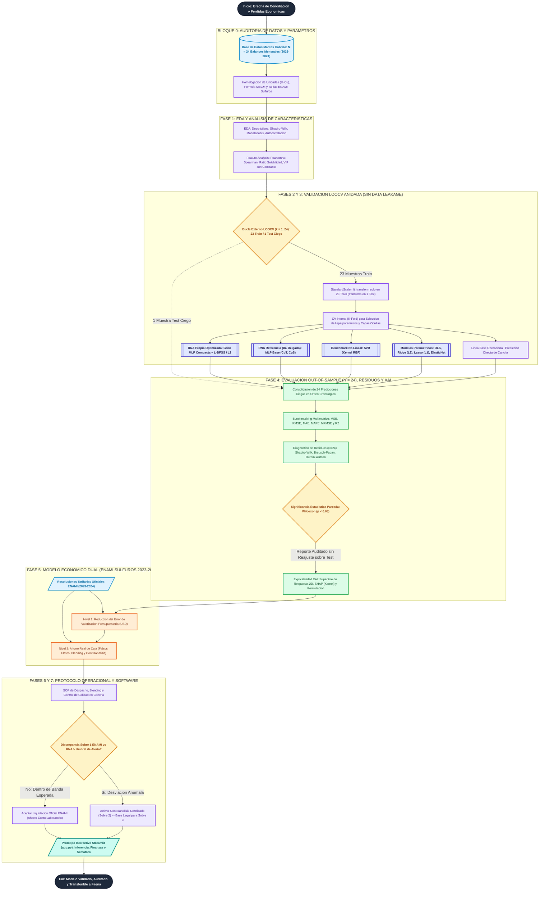
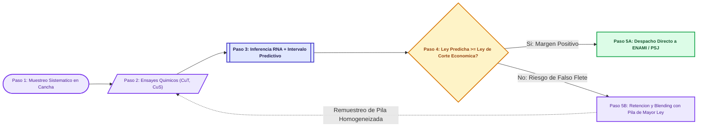

# METODOLOGÍA DE TRABAJO Y MARCO DE INVESTIGACIÓN APLICADA
## Predicción de la Ley Mineral de Venta Mediante Redes Neuronales Artificiales para Minimizar Pérdidas Económicas

**Trabajo de Titulación para optar al título de Ingeniero Civil en Minas**  
**Universidad de Antofagasta** — Facultad de Ingeniería, Departamento de Ingeniería en Minas  
* **Autor:** Felipe Andrés Guerra Maturana  
* **Profesor Guía:** Dr. José Delgado Vega (*Doctor en Geología, Especialista en Geoestadística y Explotaciones Mineras, École des Mines de Paris*)  
* **Caso de Estudio:** Faena Mantos Cobrizo (Distrito Minero Los Cóndores) / ENAMI (Planta San José)  
* **Versión Metodológica:** 2.0 (Auditada para muestra acotada $N = 24$, protocolo LOOCV sin fuga de datos y valorización comercial rigurosa)

---

## Introducción y Enfoque Metodológico Global

La presente metodología articula de manera rigurosa la ingeniería de minas clásica, la metalurgia extractiva del cobre, la teoría de muestreo de Pierre Gy, la ciencia de datos y el aprendizaje automático supervisado. Su propósito central es cerrar la brecha de conciliación minera que afecta a la pequeña y mediana minería de Chile, reemplazando la incertidumbre del error empírico histórico entre la cancha de acopio y el poder de compra (**ENAMI** / **Planta San José**) por un sistema predictivo parsimonioso, estadísticamente validado, interpretable y con impacto económico cuantificable.

### Diagrama de Flujo Metodológico Integral (Sin Fuga de Datos)

> **Principio metodológico clave del diagrama:** Toda selección de arquitectura, regularización e hiperparámetros ocurre estrictamente dentro de la validación cruzada interna (`INNER_CV`). No existe retroalimentación desde la evaluación final (`TEST_SIG`) hacia el reajuste del modelo, garantizando cero fuga de información (*zero test leakage*).

### Guía de Simbología y Código de Colores (Estándar ANSI / ISO 5807)

| Símbolo Gráfico | Forma Mermaid | Significado Metodológico | Color Representativo |
| :---: | :---: | :--- | :--- |
| **Terminal** | `([ Texto ])` | Inicio y cierre formal del flujo de investigación. | Grafito Oscuro (`#1E293B`) |
| **Almacén / Archivo** | `[( Texto )]` / `[/ Texto /]` | Base de datos maestra y documentos tarifarios ENAMI. | Azul Cielo (`#E0F2FE` / `#0284C7`) |
| **Proceso** | `[ Texto ]` | Transformaciones ETL, protocolos y cálculos deterministas. | Lavanda (`#EDE9FE` / `#7C3AED`) |
| **Subrutina / Modelo** | `[[ Texto ]]` | Algoritmos estadísticos y redes neuronales. | Índigo Técnico (`#E0E7FF` / `#4338CA`) |
| **Decisión / Validación** | `{ Texto }` | Particiones de validación, pruebas estadísticas y reglas de negocio. | Ámbar Cálido (`#FEF3C7` / `#D97706`) |
| **Evaluación y XAI** | `[ Texto ]` | Diagnóstico de residuos, métricas *out-of-sample* y explicabilidad. | Verde Esmeralda (`#DCFCE7` / `#16A34A`) |
| **Económico / Financiero** | `[ Texto ]` | Valorización presupuestaria y ahorro operacional real. | Naranja Coral (`#FFEDD5` / `#EA580C`) |
| **Interfaz de Usuario** | `[/ Texto /]` | Aplicación interactiva en Streamlit para transferencia operativa. | Verde Azulado (`#CCFBF1` / `#0D9488`) |

---

## BLOQUE 0: Auditoría de Datos Maestros, Unidades y Parámetros Base

Antes de ejecutar análisis estadísticos o entrenar modelos, se establece una línea base auditable y libre de ambigüedades dimensionales:

1. **Verificación de Escala de Leyes:** Todas las leyes de cobre extraídas de `Data Cobrizo.xlsx` se estandarizan explícitamente en **puntos porcentuales de cobre ($\%\text{Cu}$)** (por ejemplo, transformar `0.0155` a `1.55`), de modo que:
   * $\text{MSE}$ se exprese en $(\%\text{Cu})^2$.
   * $\text{RMSE}$ y $\text{MAE}$ se interpreten directamente en $\%\text{Cu}$.
   * $\text{MAPE}$ y $\text{NRMSE}$ se expresen en porcentaje relativo ($\%$).
2. **Homologación del Indicador "MECM" de Referencia:** Verificar la formulación algebraica exacta utilizada en la presentación del Dr. José Delgado para las cifras de referencia ($26\%$ histórico vs. $8.63\%$ RNA), distinguiendo rigurosamente si corresponde a **MAPE** o a **RMSE Relativo ($\text{NRMSE} = \frac{\text{RMSE}}{\bar{y}} \times 100$)**. Nunca se equiparará dimensionalmente un porcentaje relativo con el $\text{MSE}$ absoluto.
3. **Extracción Tarifaria ENAMI (2023–2024):** Construir una tabla mensual limpia con los parámetros oficiales vigentes para **Minerales de Concentración (Sulfuros)** desde `./MATERIAL_TESIS/Precio%20mx%20Enami%202023-2024` (precio LME mensual, tipo de cambio, escala de deducción metalúrgica, cargo de maquila, ley mínima pagable y tolerancias de canje).

---

## FASE 1: Pre-Modelado — Análisis Exploratorio (EDA), Características y Preprocesamiento

> **Restricción de Alcance:** En estricta coherencia con los objetivos del informe de tesis, la matriz de entrada se limita a **2 variables predictoras**: Cobre Total en cancha ($\text{CuT}_{\text{cancha}}$) y Cobre Soluble en cancha ($\text{CuS}_{\text{cancha}}$). La variable objetivo es la Ley de Canje oficial ($\text{Canje\_CuT}$), sobre $N = 24$ balances mensuales consolidados (2023–2024).

### 1.1. Análisis Exploratorio y Estadístico Riguroso (EDA)
1. **Estadísticos Descriptivos Univariados:**
   * Tendencia central: media aritmética ($\mu$), mediana ($\tilde{x}$) y media truncada.
   * Dispersión: varianza ($\sigma^2$), desviación estándar ($\sigma$), rango intercuartílico ($\text{IQR}$) y coeficiente de variación ($\text{CV} = \frac{\sigma}{\mu} \times 100$).
   * Forma: coeficiente de asimetría de Fisher y curtosis.
2. **Evaluación de Normalidad:**
   * Test de **Shapiro-Wilk** (óptimo para $N < 50$) sobre $\text{CuT}_{\text{cancha}}$, $\text{CuS}_{\text{cancha}}$ y $\text{Canje\_CuT}$ con significancia $\alpha = 0.05$, complementado con histogramas, KDE y gráficos Q-Q.
3. **Detección de Valores Atípicos (*Outliers*):**
   * Regla univariada de Tukey: $[Q_1 - 1.5 \cdot \text{IQR},\; Q_3 + 1.5 \cdot \text{IQR}]$.
   * Detección multivariada mediante la distancia de **Mahalanobis**:
     $$D_M(x) = \sqrt{(x - \mu)^T \Sigma^{-1} (x - \mu)}$$
     contrastada frente a $\chi^2_{2,\; 0.95}$. Los valores atípicos geológicos **no se eliminan arbitrariamente**; se investigan metalúrgicamente (cambios de frente o zonas de transición óxido-sulfuro) y se evalúa la sensibilidad del modelo con y sin ellos.
4. **Autocorrelación Serial de la Serie Mensual:**
   * Evaluación de la función de autocorrelación ($\text{ACF}$) sobre la secuencia mensual de leyes y del sesgo empírico para determinar si existe inercia geológica entre meses consecutivos.

### 1.2. Análisis de Características (*Feature Analysis*) y Multicolinealidad
1. **Correlación Lineal vs. Monotónica:**
   * Contraste entre correlación de **Pearson** ($r$) y de rangos de **Spearman** ($\rho$), junto con **Información Mutua** (`mutual_info_regression`), para evidenciar componentes no lineales entre las entradas y $\text{Canje\_CuT}$.
2. **Variables Diagnósticas (Solo para Interpretación en EDA, No como Entradas de la RNA):**
   * **Ratio de Solubilidad:** $\text{Sol}(\%) = \frac{\text{CuS}_{\text{cancha}}}{\text{CuT}_{\text{cancha}}} \times 100$, para segmentar los 24 lotes según grado de alteración oxidada y evaluar su correlación con el sesgo empírico ($e_{\text{emp}} = \text{CuT}_{\text{cancha}} - \text{Canje\_CuT}$).
3. **Auditoría de Multicolinealidad (VIF con Intercepto):**
   * Cálculo del Factor de Inflación de la Varianza agregando obligatoriamente una columna constante (`sm.add_constant(X)`):
     $$\text{VIF}_j = \frac{1}{1 - R_j^2}$$
   * Se verifica $\text{VIF} < 5$ entre $\text{CuT}_{\text{cancha}}$ y $\text{CuS}_{\text{cancha}}$.
   * **Justificación explícita de exclusión de $\text{CuIn}$:** Dado el balance de especies $\text{CuT} = \text{CuS} + \text{CuIn}$, incluir el Cobre Insoluble genera colinealidad exacta ($\text{VIF} = \infty$), aportando ganancia de información nula e introduciendo inestabilidad en los pesos de la red.

### 1.3. Estrategia de Validación y Escalado sin Fuga de Datos (*Zero Data Leakage*)
1. **Protocolo Principal — Validación Cruzada Dejando Uno Fuera (LOOCV):**
   * En $N = 24$, una partición aleatoria $80\% / 20\%$ deja solo $5$ observaciones de prueba, provocando alta varianza muestral e invalidando pruebas estadísticas sobre residuos.
   * Por ello, el protocolo principal es **LOOCV** ($24$ pliegues externos: en cada iteración se entrena con $23$ meses y se predice $1$ mes ciego). Esto genera **$24$ predicciones genuinamente fuera de muestra en orden cronológico exacto (2023–2024)**.
2. **Protocolo Secundario — Validación Temporal (*Holdout* Prospectivo):**
   * Complementariamente, se ejecuta una partición cronológica estricta (primeros $19$ meses entrenamiento $\rightarrow$ últimos $5$ meses prueba futura) para medir el comportamiento prospectivo del modelo hacia el futuro sin mezclar periodos.
3. **Estandarización Z-Score Interna:**
   * Se aplica `StandardScaler`:
     $$z = \frac{x - \mu_{\text{train}}}{\sigma_{\text{train}}}$$
   * **Regla estricta:** El ajuste (`fit_transform`) se ejecuta **exclusivamente** sobre los $23$ datos de entrenamiento dentro de cada pliegue LOOCV (y en cada subpliegue interno), aplicando luego `transform` al dato de prueba ciego. En caso de detectarse asimetría severa en el EDA, se evaluará en paralelo `RobustScaler`.

---

## FASE 2: Modelado Paramétrico y No Lineal de Referencia (*Baselines*)

Todos los modelos de contraste se evalúan bajo exactamente los mismos $24$ pliegues externos de LOOCV para garantizar comparabilidad justa.

### 2.1. Línea Base Operacional Tradicional
Representa la práctica actual en faena, asumiendo que la ley liquidada en planta equivale a la ley medida en cancha:
$$\hat{y}_{\text{Base}, i} = \text{CuT}_{\text{cancha}, i}$$
$$\text{MSE}_{\text{Histórico}} = \frac{1}{N} \sum_{i=1}^{N} \left( \text{CuT}_{\text{cancha}, i} - \text{Canje\_CuT}_i \right)^2$$

### 2.2. Regresión Lineal Clásica (MCO / OLS)
Ajuste del plano lineal:
$$\hat{y} = \beta_0 + \beta_1 \text{CuT}_{\text{cancha}} + \beta_2 \text{CuS}_{\text{cancha}}$$
Permite cuantificar cuánto error se reduce únicamente corrigiendo el sesgo sistemático lineal de cancha.

### 2.3. Regresiones Lineales Regularizadas (Ridge, Lasso y ElasticNet)
Evaluadas con optimización de hiperparámetros ($\lambda^*$) estrictamente dentro del conjunto de entrenamiento de cada pliegue (`RidgeCV`, `LassoCV`, `ElasticNetCV`):
1. **Ridge ($L_2$):**
   $$\mathcal{L}_{\text{Ridge}} = \sum_{i=1}^{n} (y_i - \hat{y}_i)^2 + \lambda \sum_{j=1}^{p} \beta_j^2$$
2. **Lasso ($L_1$):**
   $$\mathcal{L}_{\text{Lasso}} = \sum_{i=1}^{n} (y_i - \hat{y}_i)^2 + \lambda \sum_{j=1}^{p} |\beta_j|$$
3. **ElasticNet ($L_1 + L_2$):**
   $$\mathcal{L}_{\text{ElasticNet}} = \sum_{i=1}^{n} (y_i - \hat{y}_i)^2 + \alpha \rho \sum_{j=1}^{p} |\beta_j| + \frac{\alpha (1 - \rho)}{2} \sum_{j=1}^{p} \beta_j^2$$

### 2.4. Benchmark No Lineal para Muestras Pequeñas: SVR (Kernel RBF)
Se incluye una Máquina de Soporte Vectorial para regresión (`SVR` con kernel radial RBF) como rival no lineal directo de la red neuronal en régimen de datos acotados ($N = 24$), validando si el Perceptrón Multicapa ofrece ventajas reales frente a métodos de kernel.

---

## FASE 3: Modelado No Lineal con Redes Neuronales Artificiales (RNA)

### 3.1. Fundamentación Metalúrgica de la No Linealidad
De acuerdo con la **Teoría de Muestreo de Pierre Gy**, la discrepancia entre cancha y canje presenta comportamiento no lineal debido a la interacción entre la **Heterogeneidad Constitucional** (proporción variable de óxidos friables y sulfuros competentes) y la **Heterogeneidad de Distribución** (segregación gravitacional de finos en acopio, carguío y transporte). El Perceptrón Multicapa (**MLP**) actúa como aproximador universal capaz de modelar esta superficie de respuesta sin imponer supuestos paramétricos lineales.

### 3.2. Modelo de Referencia del Profesor (Dr. José Delgado Vega)
* Reproducción fiel de la topología base documentada por el profesor guía con entradas $(\text{CuT}_{\text{cancha}}, \text{CuS}_{\text{cancha}})$ y salida $\text{Canje\_CuT}$, auditando su desempeño bajo el mismo esquema LOOCV y contrastando las métricas absolutas ($\text{MSE}$, $\text{RMSE}$) junto con el indicador porcentual reportado ($26\%$ vs. $8.63\%$).

### 3.3. Diseño e Iteración de Arquitecturas MLP Parsimoniosas (Modelo Propio)
En cumplimiento del objetivo específico de iterar capas ocultas y resguardando el **principio de parsimonia** (mantener el número de parámetros libres acotado frente a $N_{\text{train}} = 23$), se evalúa una grilla controlada de topologías mediante validación cruzada anidada (*Nested CV*, K-Fold interno $K = 5$):

| Topología Evaluada (`hidden_layer_sizes`) | Capas Ocultas | Parámetros Libres ($w$ y $b$) | Propósito Experimental |
| :---: | :---: | :---: | :--- |
| `(2,)` | 1 | $9$ | Máxima parsimonia ($9 < 23$); menor varianza. |
| `(3,)` | 1 | $13$ | Equilibrio capacidad no lineal / grados de libertad. |
| `(4,)` | 1 | $17$ | Límite superior de 1 capa oculta para $N_{\text{train}} = 23$. |
| `(2, 2)` | 2 | $15$ | Prueba de profundidad controlada (2 capas compactas). |
| `(3, 2)` | 2 | $20$ | Análisis empírico del punto de inicio de sobreajuste (*trade-off* sesgo-varianza). |

#### Especificaciones Técnicas de Optimización para $N = 24$
1. **Motor Principal Recomendado (`scikit-learn` — `MLPRegressor` con `L-BFGS`):**
   * **Optimizador:** `solver='lbfgs'` (algoritmo cuasi-Newton de segundo orden determinista). Es superior a los métodos estocásticos por mini-lotes en muestras pequeñas ($N < 1000$), ya que procesa los $23$ registros de entrenamiento simultáneamente sin ruido de gradiente.
   * **Activación:** Evaluación controlada de `relu` ($\max(0, z)$) y `tanh` (suave y diferenciable, útil en superficies continuas pequeñas).
   * **Regularización $L_2$ (*Weight Decay*):** Grilla $\alpha \in \{0.001,\; 0.01,\; 0.05,\; 0.1,\; 0.5\}$ seleccionada estrictamente por CV interna.
   * **Estabilidad frente a inicialización:** Entrenamiento con múltiples semillas aleatorias fijas (por ejemplo, promedio o ensamble de $5$ a $10$ semillas) para eliminar la dependencia de una sola inicialización de pesos.
2. **Motor Alternativo / Contrastivo (`TensorFlow / Keras`):**
   * Si se implementa en Keras para fines comparativos o despliegue, se empleará entrenamiento **full-batch** (`batch_size = len(X_train)`) con `kernel_regularizer=regularizers.l2(lambda)`, `EarlyStopping` sobre pérdida de validación interna y tasa de aprendizaje reducida (`Adam`, $\text{lr} \le 0.005$), descartando mini-lotes pequeños (`batch_size=4`) que introducen varianza errática en $N = 24$.

---

## FASE 4: Post-Modelado — Benchmarking, Diagnóstico de Residuos, Significancia y XAI

Todos los análisis de esta fase operan sobre el vector consolidado de **$N = 24$ predicciones ciegas (*out-of-sample*) obtenidas vía LOOCV**, preservando su orden cronológico mensual (2023–2024).

### 4.1. Benchmarking Multimétrico

$$\text{MSE} = \frac{1}{N} \sum_{i=1}^{N} (y_i - \hat{y}_i)^2 \quad [(\%\text{Cu})^2], \qquad \text{RMSE} = \sqrt{\text{MSE}} \quad [\%\text{Cu}]$$

$$\text{MAE} = \frac{1}{N} \sum_{i=1}^{N} |y_i - \hat{y}_i| \quad [\%\text{Cu}], \qquad \text{MAPE} = \frac{100\%}{N} \sum_{i=1}^{N} \left| \frac{y_i - \hat{y}_i}{y_i} \right| \quad [\%]$$

$$\text{NRMSE} = \frac{\text{RMSE}}{\bar{y}} \times 100\% \quad [\%], \qquad R^2 = 1 - \frac{\sum_{i=1}^{N} (y_i - \hat{y}_i)^2}{\sum_{i=1}^{N} (y_i - \bar{y})^2}$$

| Modelo Evaluado (LOOCV, $N = 24$) | $\text{MSE}$ ($(\%\text{Cu})^2$) | $\text{RMSE}$ ($\%\text{Cu}$) | $\text{MAE}$ ($\%\text{Cu}$) | $\text{MAPE}$ ($\%$) | $\text{NRMSE}$ ($\%$) | $R^2$ |
| :--- | :---: | :---: | :---: | :---: | :---: | :---: |
| 1. Línea Base Cancha (Histórico) | — | — | — | — | — | — |
| 2. Regresión Lineal (OLS) | — | — | — | — | — | — |
| 3. Ridge / Lasso / ElasticNet | — | — | — | — | — | — |
| 4. SVR (Kernel RBF) | — | — | — | — | — | — |
| 5. RNA Referencia (Dr. Delgado) | — | — | — | — | — | — |
| 6. RNA Propia Optimizada (MLP + $L_2$) | — | — | — | — | — | — |

### 4.2. Diagnóstico Riguroso de Residuos ($e_i = y_i - \hat{y}_i$, $N = 24$)
1. **Eliminación de Sesgo Sistemático:** Verificar que la media de los residuos $\bar{e} \approx 0$ (frente al sesgo negativo/sobreestimación sistemática de la ley de cancha).
2. **Normalidad de Errores:** Test de **Shapiro-Wilk** y gráfico Q-Q sobre los $24$ residuos *out-of-sample*.
3. **Homocedasticidad:** Gráfico de residuos versus valores ajustados ($\hat{y}_i$) y test de **Breusch-Pagan** (regresando $e_i^2$ contra $\hat{y}_i$, interpretado en conjunto con la inspección visual dada la potencia moderada en $N = 24$).
4. **Independencia Temporal (Durbin-Watson):** Al conservar los $24$ residuos ordenados mes a mes, se evalúa válidamente el estadístico:
   $$d = \frac{\sum_{t=2}^{N} (e_t - e_{t-1})^2}{\sum_{t=1}^{N} e_t^2}$$
   verificando ausencia de autocorrelación serial ($d \approx 2$).

### 4.3. Prueba de Significancia Estadística Pareada ($N = 24$)
Para demostrar que la reducción de error de la RNA respecto a la cancha (y frente a OLS) no es producto del azar:
* Se definen las diferencias pareadas de error cuadrático (y absoluto):
  $$D_i = (y_i - \text{CuT}_{\text{cancha}, i})^2 - (y_i - \hat{y}_{\text{RNA}, i})^2, \quad i = 1, \dots, 24$$
* **Hipótesis Nula ($H_0$):** La mediana de $D_i$ es menor o igual a cero ($\text{RNA}$ no reduce el error).
* **Hipótesis Alternativa ($H_1$):** La mediana de $D_i$ es estrictamente mayor que cero ($\text{RNA}$ reduce significativamente el error).
* **Contraste:** Test no paramétrico de rangos con signo de **Wilcoxon** (unilateral, $\alpha = 0.05$), complementado con intervalo de confianza *bootstrap* ($B = 10{,}000$) para la reducción porcentual del $\text{MSE}$.

### 4.4. Explicabilidad del Modelo (*Explainable AI* — XAI)
Al contar con exactamente $2$ variables de entrada y $1$ salida, se despliegan tres niveles de interpretabilidad física sobre el modelo final reentrenado con los hiperparámetros óptimos:
1. **Superficie de Respuesta 2D (Mapa de Contorno):** Grilla densa $(\text{CuT}_{\text{cancha}}, \text{CuS}_{\text{cancha}})$ proyectando las curvas de nivel de $\widehat{\text{Canje\_CuT}}$ junto con los $24$ lotes históricos superpuestos. Visualiza de forma directa cómo la proporción de cobre soluble modula la corrección no lineal.
2. **Valores SHAP Exactos (`shap.KernelExplainer`):** Cuantificación de la contribución marginal exacta (en $\%\text{Cu}$) de $\text{CuT}_{\text{cancha}}$ y $\text{CuS}_{\text{cancha}}$ en cada mes (*Summary Plot* y *Waterfall Plots*).
3. **Importancia por Permutación (`permutation_importance`):** Incremento promedio en el $\text{MSE}$ al permutar repetidamente cada entrada, demostrando cuantitativamente el aporte predictivo de la segunda neurona ($\text{CuS}$).

---

## FASE 5: Modelo Económico Dual y Valorización Comercial ENAMI

### 5.1. Marco Tarifario Oficial ENAMI para Minerales de Concentración / Sulfuros (2023–2024)
Dado que Mantos Cobrizo presenta predominio de especies sulfuradas (bajo ratio $\text{CuS}/\text{CuT}$) y su liquidación objetivo depende de $\text{Canje\_CuT}$, se implementa la estructura oficial de las resoluciones mensuales de **Minerales de Concentración (Sulfuros)** ubicadas en `./MATERIAL_TESIS/Precio%20mx%20Enami%202023-2024`:

$$V_{\text{Lote}}\; (\text{USD}) = \text{TMS} \times \left[ \text{VPP} - \text{Maquila} - \text{Cargos} \right] - \text{Castigos}$$

Donde:
* **Toneladas Métricas Secas ($\text{TMS}$):**
  $$\text{TMS} = \text{TMH} \times \left(1 - \frac{\%\text{Humedad}}{100}\right)$$
* **Valor Producto Pagable ($\text{VPP}$):**
  $$\text{VPP} = \text{Ley Pagable} \times P_{\text{LME}} \times 22.0462$$
* **Ley Pagable:** Determinada por la escala de deducción metalúrgica y recuperación de flotación establecida en la circular mensual vigente de ENAMI para la ley de cobre total ($\text{CuT}$).
* **Maquila y Cargos:** Cargo de tratamiento fijo por $\text{TMS}$ ($\text{USD/TMS}$) y cargos de flete interno (faena $\rightarrow$ Planta San José).
* **Alcance de Penalizaciones:** Se consideran las cláusulas aplicables a sulfuros (humedad excedentaria y ley mínima pagable). *Nota metodológica:* Los castigos por consumo de ácido sulfúrico aplican exclusivamente a minerales oxidados de lixiviación ($\text{CuS}$) y no se mezclan con la tarifa de sulfuros, quedando documentados en el marco teórico y en las limitaciones de entrada del modelo.

### 5.2. Evaluación Financiera en Dos Niveles Rigurosos
Para evitar sobreestimar beneficios económicos, se distinguen rigurosamente el **error de proyección financiera** y el **ahorro real de caja**:

#### Nivel 1: Reducción del Error de Valorización y Estabilidad de Flujo de Caja (USD)
Para cada uno de los $24$ meses se valorizan $V_{\text{Cancha}}$ (proyección de terreno), $V_{\text{Real}}$ (liquidación efectiva ENAMI) y $V_{\text{RNA}}$ (liquidación anticipada por la red):
$$\Delta \text{Desviación Presupuestaria (USD)} = \sum_{k=1}^{24} \left( |V_{\text{Cancha}, k} - V_{\text{Real}, k}| - |V_{\text{RNA}, k} - V_{\text{Real}, k}| \right)$$
Este indicador cuantifica la **reducción de la brecha presupuestaria** y la disminución de la incertidumbre en la planificación del capital de trabajo (no corresponde a ingreso extra directo por sí mismo).

#### Nivel 2: Ahorro Operacional Real / Pérdidas Evitadas mediante Simulación de Escenarios (USD)
Se cuantifica el impacto efectivo en caja cuando la predicción de la RNA **modifica una decisión operativa antes del despacho** (supuestos operativos auditables):
1. **Falsos Fletes y Maquilas Evitadas:** Identificación de escenarios/lotes donde $\text{CuT}_{\text{cancha}} \ge \text{Ley de Corte Económica}$ (bajo el método tradicional el lote se despacha), pero la ley real genera margen neto negativo tras descontar flete y maquila. Si la RNA anticipa $\hat{y}_{\text{RNA}} < \text{Ley de Corte}$, el lote se retiene o redirige a *blending*, evitando pérdida directa de caja.
2. **Optimización de *Blending* (Mezcla Preventiva):** Simulación de mezclas en cancha para sostener la ley de despacho sobre la ley mínima comercial de ENAMI y evitar tramos de menor recuperación o penalización.
3. **Ahorro en Contraanálisis de Laboratorio (Sobre 2):** Reducción del gasto en ensayes químicos externos cuando la liquidación de ENAMI se ubica dentro del intervalo de predicción esperado por la RNA.

---

## FASE 6: Adopción Tecnológica, Gestión Operativa y Protocolo ENAMI

### 6.1. Integración Ligera en la Pequeña y Mediana Minería
El modelo entrenado se serializa (`joblib` / `.keras`) junto con su escalador (`StandardScaler`), permitiendo ejecución en menos de un segundo en cualquier computador estándar de faena mediante Python/Streamlit, sin requerir infraestructura de alto costo ni licencias comerciales.

### 6.2. Procedimiento Operativo Estándar (SOP) de Despacho y *Blending*

### 6.3. Soporte Racional al Protocolo Reglamentario de 3 Sobres de ENAMI
Conforme al Reglamento de Compra de Minerales de ENAMI, el muestreo oficial genera tres paquetes sellados: **Sobre 1** (ENAMI), **Sobre 2** (Productor) y **Sobre 3** (Testigo / Dirimente en bóveda). La normativa establece que el Sobre 3 solo puede abrirse si existe una discrepancia superior a la tolerancia oficial entre los certificados químicos del **Sobre 1 y el Sobre 2**.

El rol operativo de la RNA en esta etapa es actuar como **gatillador económico del Sobre 2**:
* **Escenario A (Consistencia):** Si la ley reportada por ENAMI (Sobre 1) cae dentro del intervalo de predicción de la RNA ($\hat{y}_{\text{RNA}} \pm \text{margen operativo}$), el productor acepta la liquidación con respaldo cuantitativo y **ahorra el costo de laboratorio del Sobre 2**.
* **Escenario B (Desviación Anómala):** Si el Sobre 1 resulta significativamente inferior a $\hat{y}_{\text{RNA}}$, se activa el envío del **Sobre 2** a un laboratorio externo certificado. Con ambos certificados químicos en mano, si $|\text{Sobre 1} - \text{Sobre 2}|$ excede la tolerancia reglamentaria de ENAMI, se procede formalmente a la apertura del **Sobre 3 (Arbitraje)**.

---

## FASE 7: Desarrollo de la Interfaz Gráfica de Usuario (Streamlit)

### 7.1. Arquitectura del Prototipo (`app.py`)
El modelo ganador —entrenado finalmente sobre los $N = 24$ registros completos utilizando la arquitectura e hiperparámetros validados en LOOCV— se encapsula en un `Pipeline` serializado (`StandardScaler` + `MLP`) consumido por `app.py`:

* **Barra Lateral (*Sidebar*):** Selección de faena (Mantos Cobrizo), carga del pipeline entrenado y parámetros tarifarios vigentes (precio cobre LME $\text{USD/lb}$, maquila, flete y ley de corte económica).
* **Pestaña 1 — Predicción Operativa de Canje:** Ingreso de $\text{CuT}_{\text{cancha}}$ ($\%$) y $\text{CuS}_{\text{cancha}}$ ($\%$), despliegue de $\widehat{\text{Canje\_CuT}}$ con banda de incertidumbre basada en el $\text{RMSE}_{\text{LOOCV}}$, posición del lote sobre la **Superficie de Respuesta 2D** y descomposición SHAP de la predicción.
* **Pestaña 2 — Simulador Financiero ENAMI:** Ingreso de $\text{TMH}$ y $\%\text{Humedad}$, cálculo de $\text{TMS}$, liquidación proyectada (Cancha vs. RNA), margen neto descontado flete/maquila y evaluación del umbral de alerta para contraanálisis (Sobre 2).
* **Pestaña 3 — Semáforo Operativo de Decisión:**
  * **Verde:** $\hat{y}_{\text{RNA}}$ supera cómodamente la ley de corte económica $\rightarrow$ Despacho directo.
  * **Amarillo:** $\hat{y}_{\text{RNA}}$ dentro de la banda marginal ($\text{Cut-off} \pm \text{RMSE}$) $\rightarrow$ Evaluar *blending* preventivo.
  * **Rojo:** $\hat{y}_{\text{RNA}} < \text{Cut-off}$ $\rightarrow$ Riesgo de falso flete; retener despacho.

---

## FASE 8: Plan de Ejecución por Bloques, Trazabilidad Académica y Alineación Documental

### 8.1. Hoja de Ruta Operativa Bloque por Bloque

| Bloque | Entregable Técnico / Script | Criterio de Aprobación para Avanzar |
| :---: | :--- | :--- |
| **Bloque 0** | `00_auditoria_datos.ipynb` | Dataset limpio $N=24$ en $\%\text{Cu}$, fórmula MECM verificada y tabla tarifaria mensual ENAMI 2023–2024 lista. |
| **Bloque 1** | `01_eda_caracteristicas.ipynb` | Tablas de descriptivos, Shapiro-Wilk, Mahalanobis, Pearson/Spearman, VIF con constante y gráfico Ratio Solubilidad vs. Sesgo. |
| **Bloque 2** | `02_baselines_loocv.ipynb` | Función maestra LOOCV sin fuga de datos; métricas *out-of-sample* para Cancha, OLS, Ridge, Lasso, ElasticNet y SVR. |
| **Bloque 3** | `03_modelado_rna_loocv.ipynb` | Comparativa de topologías `(2,)`, `(3,)`, `(4,)`, `(2,2)`, `(3,2)` + réplica modelo Dr. Delgado bajo LOOCV y validación temporal secundaria. |
| **Bloque 4** | `04_diagnostico_xai.ipynb` | Residuos $N=24$ auditados (Shapiro, Breusch-Pagan, Durbin-Watson), Wilcoxon ($p$-valor), Mapa de Contorno 2D, SHAP y Permutación. |
| **Bloque 5** | `05_modelo_economico_enami.ipynb` | Cuantificación dual: Nivel 1 (reducción error presupuestario) y Nivel 2 (ahorro real en caja por escenarios operativos). |
| **Bloque 6** | `app.py` + Actualización `./INFORME_TESIS.docx` | Pipeline serializado funcionando en Streamlit y resultados integrados en Capítulos 3, 4, 5 y 6. |

### 8.2. Matriz de Correspondencia con el Informe de Título (`./INFORME_TESIS.docx`)

| Capítulo del Informe | Fases Asociadas | Contenido Principal |
| :--- | :--- | :--- |
| **Capítulo 1: Introducción** | Introducción & Fase 6 | Planteamiento del problema, objetivos, alcances actualizados (incluyendo SOP y prototipo Streamlit) y limitaciones. |
| **Capítulo 2: Marco Teórico** | Fases 2, 3 y 5 | Comercialización y tarifas ENAMI (sulfuros vs. óxidos), Teoría de Muestreo de Gy, MLP, regularización $L_1/L_2$ y métricas. |
| **Capítulo 3: Materiales y Métodos** | Bloque 0, Fases 1, 2, 3 y 7 | Auditoría de datos, EDA, protocolo LOOCV sin fuga de datos, grilla de arquitecturas RNA y arquitectura de `app.py`. |
| **Capítulo 4: Resultados Obtenidos** | Fases 4 y 5 | Tabla de *benchmarking* multimétrico, diagnóstico de residuos, test de Wilcoxon, explicabilidad XAI y modelo económico dual. |
| **Capítulo 5: Discusión** | Fases 4, 5 y 6 | Interpretación geometalúrgica de los residuos, validez frente a $N=24$, rol racional en Sobre 2 y sensibilidad económica. |
| **Capítulo 6: Conclusiones** | Fase 8 | Síntesis de cumplimiento de objetivos, impacto técnico-económico demostrado y líneas de trabajo futuro. |

### 8.3. Ajustes Pendientes de Consistencia Documental en `./INFORME_TESIS.docx`
1. **Sincronizar Alcances:** Incorporar explícitamente en la sección *Alcances* del documento Word el desarrollo del Procedimiento Operativo Estándar (SOP) y el prototipo en Streamlit (`app.py`).
2. **Estilo de Citación:** Confirmar con el Dr. José Delgado el estándar definitivo de referencias exigido por el Departamento de Ingeniería en Minas de la Universidad de Antofagasta (numeración entre corchetes `[1]` según plantilla vs. APA 7 autor-año).
3. **Nomenclatura Uniforme:** Mantener de forma uniforme la denominación **Faena Mantos Cobrizo (Distrito Minero Los Cóndores)** en texto, tablas, gráficos y código.

### 8.4. Limitaciones y Trabajo Futuro
* **Limitaciones:** Especificidad geológica local (modelo calibrado a la mineralogía de Mantos Cobrizo), tamaño muestral discreto ($N = 24$ balances mensuales, mitigado mediante parsimonia, regularización $L_2$ y LOOCV) y exclusión directa de impurezas penalizables al restringirse estrictamente a dos entradas ($\text{CuT}$, $\text{CuS}$).
* **Trabajo Futuro:** Ampliación multielemental (arsénico, antimonio, humedad, consumo de ácido en lotes oxidados), reentrenamiento continuo conforme ingresen nuevos cierres mensuales y evaluación de *Transfer Learning* hacia yacimientos análogos de la región (como los registros preliminares de Mina Tigresa).